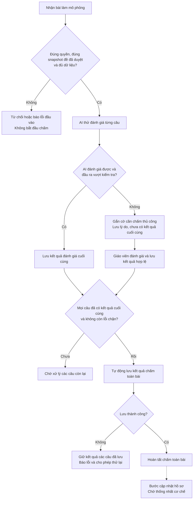

# W06 Luồng chấm bài và tiêu chí nghiệm thu

**Người phụ trách:** Ngô Nhất Nghi - Project & Product Lead  
**Trạng thái:** Bản nháp

Tài liệu xác định cách hệ thống đánh giá từng câu trả lời, chuyển câu AI không đánh giá được cho giáo viên và hoàn tất kết quả chấm toàn bài. Kết quả AI hợp lệ được ghi nhận tự động; giáo viên đánh giá những câu AI không xử lý được. Toàn bài hoàn tất chấm khi mọi câu có kết quả đánh giá cuối cùng hợp lệ và kết quả toàn bài được lưu thành công.

## 1. Mục tiêu và ranh giới W06

W06 bàn giao bản mô tả quy trình và quy tắc xử lý, tiêu chí nghiệm thu và các quyết định cần thống nhất để triển khai nhất quán trong W07–W08.

Phạm vi:

- Luồng AI đánh giá thành công và luồng chấm thủ công cho câu AI không đánh giá được.
- Điều kiện hoàn tất chấm và lưu kết quả toàn bài.
- Trường hợp lỗi, giới hạn quyền truy cập và tránh lưu kết quả trùng lặp.
- Danh sách nội dung cần thống nhất trước khi thiết kế, triển khai và nghiệm thu cập nhật hồ sơ.

Bài làm mô phỏng được cung cấp qua dữ liệu mẫu; nguồn dữ liệu đó phải xác định được học sinh, đề và phiên bản đề. Class diagram, API chi tiết, prompt đánh giá bài làm và rubric đánh giá chất lượng sinh đề thuộc các tài liệu riêng của thành viên phụ trách.

## 2. Cơ sở và các nguyên tắc bắt buộc

### 2.1. Cơ sở từ dự án

- Planner, API và dữ liệu mẫu cho sinh đề đã tích hợp; backend sinh đề đang gần hoàn tất.
- Code hiện có trạng thái đề `pending_teacher_review`/`approved`, cơ chế `revision`, duyệt đề và tạo lại câu. Đây là trạng thái của **đề**, không phải trạng thái chấm **bài làm**.
- Đánh giá bài làm sử dụng đề bài, câu trả lời, đáp án/lời giải tham chiếu và tiêu chí đánh giá được nhóm thống nhất. Cấu trúc kết quả đánh giá phải được Data, AI và Architecture đối chiếu trước khi triển khai.
- Hồ sơ mẫu hiện được thiết lập sẵn để thử tính năng sinh đề, nên mastery/evidence có thể không tương ứng với lịch sử bài làm. Khi thiết kế cập nhật hồ sơ, cần xác nhận dữ liệu ban đầu phù hợp với cơ chế đã chọn.
- Teacher token hiện dùng chung chưa xác định danh tính riêng từng giáo viên; grading và phân quyền theo bản ghi cần được bổ sung ở giai đoạn triển khai.
- Công thức, cách tính evidence, thời điểm và cơ chế lưu cập nhật hồ sơ đang chờ nhóm thống nhất.

### 2.2. Nguyên tắc nghiệp vụ theo phạm vi workflow hiện tại

| Mã | Nguyên tắc |
|---|---|
| BR-01 | Câu được AI đánh giá thành công và vượt kiểm tra đầu ra có kết quả cuối cùng được ghi nhận tự động, không chờ giáo viên duyệt lại. |
| BR-02 | Câu AI không đánh giá được phải gắn cờ và chuyển giáo viên; không tự tạo kết quả đánh giá để hoàn tất bài. |
| BR-03 | Chỉ hoàn tất chấm toàn bài khi tất cả câu cần đánh giá đều có kết quả cuối cùng hợp lệ, không còn lỗi chặn và kết quả toàn bài đã được lưu thành công. |
| BR-04 | Hoàn tất chấm độc lập với cập nhật hồ sơ. Không coi bài đã hoàn tất chấm là bằng chứng mastery/evidence đã được cập nhật; cơ chế cập nhật hồ sơ được bổ sung sau khi thống nhất. |
| BR-05 | Chỉ người có quyền mới được xem kết quả hoặc đánh giá câu cần xử lý thủ công. Backend phải kiểm tra quyền trên bản ghi, không chỉ ẩn nút trên giao diện. |
| BR-06 | Tiêu chí đánh giá bài làm học sinh và rubric đánh giá chất lượng sinh đề là hai tài liệu khác nhau. Mục tiêu 80/100 dành cho chất lượng sinh đề, không dùng để đánh giá bài làm học sinh. |

## 3. Vai trò và điều kiện đầu vào

| Vai trò | Trách nhiệm trong luồng |
|---|---|
| Giáo viên được cấp quyền | Xem tiến độ và kết quả; đánh giá các câu AI không xử lý được đã được chuyển sang chấm thủ công. |
| Backend | Kiểm tra đầu vào và quyền; gọi AI; kiểm tra đầu ra; lưu kết quả và thông tin lần đánh giá; xác định đủ điều kiện hoàn tất chấm toàn bài. |
| AI local | Trả kết quả đánh giá và nhận xét theo tiêu chí được thống nhất, hoặc báo không đánh giá được. Không tự thay đổi tiêu chí, quyền truy cập hoặc hồ sơ. |
| Học sinh | Là chủ thể của bài làm và hồ sơ. Không có quyền sửa kết quả đánh giá hoặc mastery/evidence. Không yêu cầu triển khai màn hình nộp bài trong W06. |

Trước khi bắt đầu chấm, backend phải xác định được:

1. Học sinh có thông tin trong hệ thống và giáo viên được phép xem, đánh giá bài của học sinh đó.
2. Bài làm có định danh riêng, gắn đúng học sinh và một snapshot phiên bản đề đã được giáo viên duyệt.
3. Snapshot chứa đủ nội dung câu, đáp án/lời giải tham chiếu, tiêu chí đánh giá và liên kết kỹ năng cần thiết. Tạo lại đề không làm thay đổi snapshot đang được chấm.
4. Mỗi câu có một bản ghi câu trả lời. Cần phân biệt rõ **học sinh để trống** với **dữ liệu câu trả lời bị thiếu do lỗi truyền/đọc**.
5. Các câu trả lời thuộc đúng đề, không trùng hoặc có câu lạ. Tiêu chí đánh giá tương ứng với câu hỏi; không lấy rubric chất lượng sinh đề để đánh giá bài làm.

Đầu vào không hợp lệ bị từ chối trước khi chấm hoặc bị chặn để xử lý dữ liệu; không tự sửa ID, bịa câu trả lời hoặc bỏ câu để đủ điều kiện hoàn tất chấm.

## 4. Tổng quan luồng xử lý

Nút cập nhật hồ sơ biểu thị phần thiết kế sẽ bổ sung, không phải thao tác tự động đã được xác định. Trạng thái hoàn tất chấm chỉ được ghi nhận sau khi lưu kết quả toàn bài thành công.

## 5. Các luồng nghiệp vụ chi tiết

### GF-01 AI đánh giá thành công

1. Backend lấy câu trả lời và dữ liệu đánh giá từ snapshot đã duyệt, rồi gửi dữ liệu cần thiết cho AI local.
2. AI trả kết quả đánh giá, nhận xét và thông tin theo cấu trúc do nhóm thống nhất. Bài làm là nội dung cần đánh giá, không được dùng làm chỉ dẫn thay đổi quy tắc xử lý.
3. Backend kiểm tra cấu trúc, định danh bài/câu, dữ liệu bắt buộc và tính hợp lệ của đầu ra theo contract đánh giá.
4. Nếu đầu ra đạt yêu cầu, backend lưu kết quả cuối cùng của câu với nguồn AI. Vượt kiểm tra kỹ thuật không chứng minh AI luôn đánh giá đúng về chuyên môn; QA cần đối chiếu với bộ ví dụ có kết quả tham chiếu.
5. Backend kiểm tra điều kiện hoàn tất chấm toàn bài. Nếu mọi câu đều đủ điều kiện thì tự chuyển sang GF-03.

**Kết quả:** Câu không xuất hiện trong danh sách bắt buộc chấm thủ công. Nếu AI đánh giá được toàn bộ bài thì không cần thêm thao tác giáo viên để hoàn tất chấm.

### GF-02 Chuyển câu AI không đánh giá được sang giáo viên

1. AI báo không thể đánh giá, đầu ra không hợp lệ hoặc việc gọi model thất bại sau giới hạn thử lại đã cấu hình.
2. Backend gắn cờ cần chấm thủ công cho câu, lưu lý do và giữ trạng thái chưa có kết quả cuối cùng. Đầu ra AI không hợp lệ không được dùng làm kết quả chính thức.
3. Giáo viên xem đề, bài làm, đáp án/lời giải tham chiếu, tiêu chí đánh giá và lý do chuyển thủ công; cung cấp kết quả đánh giá kèm nhận xét.
4. Backend kiểm tra quyền, xác nhận câu vẫn đang chờ chấm thủ công và kết quả giáo viên nhập hợp lệ theo contract. Nếu câu đã có kết quả cuối cùng, yêu cầu lỗi thời không được ghi đè kết quả đã lưu.
5. Backend lưu kết quả cuối cùng với nguồn giáo viên, bỏ cờ chờ chấm của câu và kiểm tra lại điều kiện hoàn tất chấm toàn bài.

**Kết quả:** Chỉ những câu chưa có kết quả cuối cùng hoặc còn lỗi chặn mới ngăn việc hoàn tất chấm. Kết quả các câu đã xử lý thành công được giữ nguyên.

Lỗi model không đồng nghĩa bài làm sai. Nếu chính đề/đáp án/tiêu chí đánh giá bị lỗi thì ghi nhận lỗi chặn và yêu cầu xử lý dữ liệu; không ép giáo viên tạo một kết quả tùy ý để đóng bài.

### GF-03 Hoàn tất chấm toàn bài

Backend chỉ thực hiện khi đồng thời thỏa mãn:

- Toàn bộ câu trong snapshot có đúng một câu trả lời tương ứng, kể cả bản ghi để trống hợp lệ.
- Mọi câu có kết quả đánh giá cuối cùng hợp lệ từ AI hoặc giáo viên.
- Không còn câu chờ chấm thủ công hoặc lỗi chặn liên quan đến dữ liệu và kết quả đánh giá.
- Học sinh, bài làm, phiên bản đề và các kết quả đánh giá được xác định nhất quán.

Các bước:

1. Kiểm tra tính đầy đủ và hợp lệ của kết quả đánh giá cho toàn bộ câu trong bài.
2. Lưu bản kết quả chấm toàn bài, gắn với bài làm và snapshot tương ứng, giữ nguồn đánh giá của từng câu.
3. Chỉ báo trạng thái `FINALIZED` sau khi lưu kết quả toàn bài thành công.
4. Nếu lưu thất bại, giữ các kết quả câu đã lưu trước đó; không công bố bài đã hoàn tất. Lần thử lại không tạo thêm bản kết quả hoặc lần đánh giá trùng.

**Kết quả:** Bài đã hoàn tất chấm và kết quả được lưu. Bước này không cập nhật mastery/evidence và không xác nhận hồ sơ đã đồng bộ. Thiết kế bước cập nhật hồ sơ được bổ sung theo mục 7 sau khi nhóm thống nhất.

## 6. Trạng thái nghiệp vụ đề xuất

### 6.1. Cấp câu trả lời

| Trạng thái | Ý nghĩa | Điều kiện ra khỏi trạng thái |
|---|---|---|
| `PENDING` | Chưa có kết quả đánh giá, chưa được AI xử lý. | Bắt đầu đánh giá. |
| `AI_GRADING` | AI đang xử lý; chưa có kết quả cuối cùng. | Đầu ra hợp lệ → `GRADED`; không đánh giá được → `MANUAL_REQUIRED`. |
| `MANUAL_REQUIRED` | Cần giáo viên đánh giá; chưa có kết quả cuối cùng. | Giáo viên lưu kết quả hợp lệ → `GRADED`. |
| `GRADED` | Có kết quả đánh giá cuối cùng từ AI hoặc giáo viên. | Được dùng để kiểm tra điều kiện hoàn tất chấm toàn bài; kết quả trùng lặp không được ghi đè. |

Nguồn đánh giá phải phân biệt AI và giáo viên chấm thủ công. `GRADED` chỉ thể hiện câu đã được đánh giá và lưu kết quả, không biểu thị học sinh trả lời đúng hay sai. Cách biểu diễn nội dung kết quả được chốt tại DEC-01.

### 6.2. Cấp bài làm

| Trạng thái | Ý nghĩa |
|---|---|
| `RECEIVED` | Bài làm đã được kiểm tra và ghi nhận, chưa bắt đầu chấm. |
| `GRADING` | Còn câu đang chờ hoặc đang được AI xử lý. |
| `AWAITING_MANUAL` | Không còn câu chờ/đang AI xử lý nhưng vẫn còn câu bắt buộc giáo viên đánh giá. |
| `READY_TO_FINALIZE` | Mọi câu có kết quả hợp lệ và không còn lỗi chặn; đang chờ lưu kết quả chấm toàn bài thành công. |
| `FINALIZED` | Đã hoàn tất chấm và lưu kết quả toàn bài. Không thể hiện trạng thái cập nhật hồ sơ. |
| `BLOCKED` | Có lỗi dữ liệu/chính sách đánh giá chặn xử lý tiếp; cần khắc phục trước khi trở lại trạng thái phù hợp. |

Nếu vừa có câu đang AI xử lý vừa có câu chờ giáo viên, bài hiển thị `GRADING` cùng số câu chờ chấm thủ công.

Sau khi AI xử lý xong tất cả câu, backend kiểm tra theo thứ tự: nếu có lỗi chặn thì chuyển sang `BLOCKED`; nếu còn câu cần giáo viên đánh giá thì chuyển sang `AWAITING_MANUAL`; nếu mọi câu đã có kết quả cuối cùng hợp lệ thì chuyển sang `READY_TO_FINALIZE`.

Khi lưu kết quả toàn bài thành công, chuyển sang `FINALIZED`. Nếu lưu lỗi, giữ `READY_TO_FINALIZE`, báo lỗi và cho phép thử lại. Bài đã hoàn tất giữ kết quả đã lưu; yêu cầu xử lý trùng lặp không được thay đổi kết quả.

## 7. Cập nhật hồ sơ (chờ thống nhất)

Cập nhật hồ sơ là bước riêng sau quá trình chấm; cơ chế chi tiết chưa được chốt. Workflow này chưa quy định công thức, đơn vị evidence, thời điểm kích hoạt, kho lưu hoặc yêu cầu lưu kết quả chấm và hồ sơ trong cùng một transaction.

Các nội dung cần thống nhất trước khi bổ sung thiết kế và tiêu chí nghiệm thu:

| Nội dung | Cần làm rõ | Phối hợp |
|---|---|---|
| Dữ liệu đầu vào | Kết quả đánh giá nào được dùng; liên kết với bài làm, câu hỏi, kỹ năng và dữ liệu nền ra sao. | Data, AI |
| Cách tính mastery | Cách chuyển kết quả đánh giá thành thông tin năng lực; công thức và ví dụ kiểm chứng. | Data, AI, Product |
| Đơn vị và cách tính evidence | Khi nào một kết quả được tính là bằng chứng; xử lý câu có nhiều kỹ năng và các lần làm lại. Chưa mặc định mỗi câu tạo một evidence. | Data, AI, Product |
| Thời điểm cập nhật | Khi nào kích hoạt sau khi hoàn tất chấm và cách thể hiện tiến độ cập nhật tách biệt với trạng thái chấm. | Product, Data, Architecture |
| Nơi lưu và đọc hồ sơ | Nguồn dữ liệu ban đầu, kho có thể ghi và nguồn mà màn hình Profile sử dụng. | Data, Architecture, UI |
| Lỗi và thử lại | Cách lưu, khôi phục và tránh cập nhật trùng khi gửi lại yêu cầu; không làm mất kết quả chấm đã hoàn tất. | Data, Architecture, QA |
| Tiêu chí nghiệm thu | Các kiểm tra công thức, mapping nhiều kỹ năng, evidence và hiển thị Profile sau cập nhật. | QA và các thành viên liên quan |

Phân biệt việc chưa có kết quả đánh giá với kết quả cho thấy học sinh làm sai. Việc đọc kết quả hoặc tải lại trang không được tự làm thay đổi hồ sơ.

Sau khi các quyết định liên quan được thống nhất, nhóm cập nhật mục này, API/data contract và bộ test cases. Hiện chưa dùng các quy tắc cập nhật hồ sơ chưa chốt để xác nhận nghiệm thu chức năng đó.

## 8. Tiêu chí nghiệm thu cho giai đoạn triển khai

Các tiêu chí sau là đầu vào để QA viết test cases cho luồng chấm và lưu kết quả. Chúng chưa được đánh dấu đạt chỉ vì tài liệu thiết kế đã hoàn thành. Ngưỡng đánh giá độ chính xác AI trên cả bộ dữ liệu do AI Lead và QA đề xuất riêng.

Các tiêu chí phụ thuộc cấu trúc kết quả và chính sách xử lý câu để trống sẽ được cụ thể hóa sau khi DEC-01/DEC-02 được chốt. Các kiểm tra cập nhật hồ sơ được bổ sung riêng sau khi thống nhất mục 7.

| Mã | Tình huống / Điều kiện | Kết quả phải quan sát được |
|---|---|---|
| AC-01 | Bài hợp lệ, mọi câu được AI đánh giá thành công. | Mỗi câu có kết quả cuối cùng nguồn AI; bài tự hoàn tất chấm sau khi lưu kết quả toàn bài thành công, không cần giáo viên duyệt lại. |
| AC-02 | AI đánh giá được một số câu, một câu không đánh giá được. | Giữ kết quả các câu thành công; câu còn lại có cờ và lý do chờ giáo viên; toàn bài chưa hoàn tất chấm. |
| AC-03 | Giáo viên đánh giá xong câu thủ công cuối cùng. | Cờ chờ chấm được giải quyết; backend tự kiểm tra và hoàn tất chấm nếu đủ điều kiện, không còn lỗi chặn và lưu thành công. |
| AC-04 | Giáo viên cung cấp kết quả thiếu trường bắt buộc hoặc sai cấu trúc đã thống nhất. | Từ chối lưu; giữ dữ liệu và trạng thái trước thao tác; thông báo lỗi rõ ràng. |
| AC-05 | AI trả JSON lỗi, sai ID hoặc thiếu/sai dữ liệu bắt buộc theo contract. | Không dùng đầu ra đó làm kết quả cuối cùng; sau giới hạn thử lại đã chốt, chuyển thủ công và lưu lý do. |
| AC-06 | Model không sẵn sàng, timeout hoặc hết số lần thử. | Các câu bị ảnh hưởng chuyển thủ công với lý do kỹ thuật; không tự tạo kết quả đánh giá; không mất bài làm hay kết quả câu khác. |
| AC-07 | Có một câu chưa có kết quả đánh giá cuối cùng. | Chưa được hoàn tất chấm toàn bài dù các câu khác đã có kết quả hợp lệ. |
| AC-08 | Giáo viên không mở bước xem lại kết quả AI. | Bài có đủ kết quả hợp lệ vẫn tự hoàn tất chấm sau khi lưu thành công; không xuất hiện yêu cầu duyệt lại kết quả AI bắt buộc. |
| AC-09 | Gửi lại yêu cầu lưu kết quả giáo viên hoặc hoàn tất chấm vì chưa nhận được phản hồi từ hệ thống. | Không tạo bản kết quả hoặc lần đánh giá trùng; trả kết quả đã lưu hoặc phản hồi trùng lặp rõ ràng. |
| AC-10 | Lưu kết quả chấm toàn bài lỗi giữa chừng. | Chưa báo bài hoàn tất; giữ kết quả từng câu đã lưu; thử lại không tạo bản kết quả hoặc lần đánh giá trùng. |
| AC-11 | Thiếu quyền, sai học sinh hoặc truy cập bài ngoài phạm vi. | Backend từ chối xem/đánh giá/hoàn tất chấm; không đổi dữ liệu hoặc tiết lộ nội dung bản ghi không được phép. |
| AC-12 | Đề chưa được duyệt hoặc bài làm tham chiếu phiên bản đề không tồn tại. | Không bắt đầu chấm. Với đề được tạo lại sau đó, bài cũ vẫn dùng snapshot gốc đã duyệt. |
| AC-13 | Bài làm thiếu câu trả lời do lỗi dữ liệu, có câu lạ hoặc trùng câu. | Báo lỗi cấu trúc; không tự biến dữ liệu thiếu thành câu học sinh bỏ trống. |
| AC-14 | Học sinh thực sự để trống một câu. | Giữ bản ghi thể hiện để trống và xử lý theo chính sách DEC-02 đã chốt; phân biệt với lỗi thiếu dữ liệu. |
| AC-15 | Lời giải hợp lệ khác phương pháp trong đáp án mẫu. | Không đánh giá sai chỉ vì khác cách trình bày; đánh giá theo tiêu chí đã thống nhất hoặc chuyển giáo viên nếu AI không xử lý được. QA đối chiếu bộ ví dụ đã được người review chuyên môn xác nhận. |
| AC-16 | Tải lại trang, đọc kết quả nhiều lần hoặc khởi động lại backend sau khi lưu. | Kết quả đã lưu vẫn được giữ; các thao tác đọc không thay đổi kết quả hoặc hồ sơ. |

## 9. Ví dụ dùng để trao đổi và nghiệm thu

Ví dụ giả lập có ba câu Q1, Q2, Q3. Ví dụ chỉ mô tả tiến độ xử lý, không gán một định dạng kết quả đánh giá chưa được nhóm thống nhất.

| Bước | Xử lý | Kết quả |
|---|---|---|
| 1 | AI đánh giá được Q1, Q3 nhưng không đánh giá được Q2. | Lưu kết quả cuối cùng nguồn AI cho Q1, Q3; Q2 chờ giáo viên kèm lý do; bài chưa hoàn tất chấm. |
| 2 | Giáo viên cung cấp kết quả hợp lệ cho Q2. | Mọi câu có kết quả; backend kiểm tra điều kiện và lưu kết quả chấm toàn bài. Lưu thành công thì chuyển sang `FINALIZED`. |
| 3 | Ứng dụng gửi lại yêu cầu lưu kết quả Q2 hoặc hoàn tất chấm vì chưa nhận được phản hồi. | Giữ nguyên kết quả đã lưu; không tạo thêm lần đánh giá hoặc bản kết quả toàn bài. |

Nếu lưu kết quả toàn bài ở bước 2 thất bại, bài chưa được công bố `FINALIZED`; các kết quả câu đã lưu vẫn được giữ để thử lại.

Sau khi hoàn tất chấm, kết quả bài làm có thể là đầu vào cho bước cập nhật hồ sơ sẽ được thiết kế sau. Ví dụ này chưa xác định thay đổi mastery/evidence và không khẳng định hồ sơ đã được cập nhật.

## 10. Quyết định cần thống nhất trong W06

Các nội dung dưới đây là vấn đề cần nhóm review, chưa phải chính sách đã chốt. Khi có kết luận, ghi ngày và người xác nhận, đồng thời cập nhật workflow, data model, API, ví dụ AI và test cases.

| Mã | Vấn đề cần chốt | Nội dung phải xác nhận | Phối hợp chính | Cần trước |
|---|---|---|---|---|
| DEC-01 | Cấu trúc kết quả đánh giá. | Các trường bắt buộc, cách biểu diễn kết quả và nhận xét, kiểm tra hợp lệ, ví dụ AI/thủ công. Không mặc định một thang đánh giá mới. | Nghi, Ánh Dương, Yến Trân, Khánh Như | Chốt contract và triển khai grading. |
| DEC-02 | Câu trả lời trống. | Cách nhận diện để trống, cách đánh giá, có cần AI/giáo viên xử lý hay không; phân biệt với thiếu dữ liệu do lỗi. | Nghi, Yến Trân, Hoài Thương | Chốt thiết kế AI, dữ liệu mẫu và test cases. |
| DEC-03 | Cách cập nhật mastery từ kết quả đánh giá. | Dữ liệu đầu vào, công thức, dữ liệu nền, thời điểm kích hoạt và ví dụ kiểm chứng. Chưa quy định cập nhật đồng thời với hoàn tất chấm. | Nghi, Ánh Dương, Yến Trân | Thiết kế và nghiệm thu phần cập nhật hồ sơ. |
| DEC-04 | Lưu và đọc hồ sơ sau cập nhật. | Kho dữ liệu có thể ghi, nguồn Profile đọc, trạng thái cập nhật, xử lý lỗi và cơ chế lưu; chưa chốt transaction chung với kết quả chấm. | Ánh Dương, Khánh Như, Chi Mai | Triển khai tích hợp cập nhật hồ sơ. |
| DEC-05 | Evidence, mapping nhiều kỹ năng và lần làm lại. | Đơn vị bằng chứng, điều kiện được ghi nhận, liên kết kỹ năng, phân biệt làm lại thật với retry kỹ thuật và cách tránh cộng trùng. | Nghi, Ánh Dương, Yến Trân | Thiết kế và nghiệm thu phần cập nhật hồ sơ. |
| DEC-06 | Khi nào AI được coi là không đánh giá được. | Điều kiện đánh giá, đầu ra bắt buộc, lỗi cần chuyển giáo viên, giới hạn thử lại và timeout riêng của grading. Không tự dùng confidence do model khai báo làm bằng chứng đủ tin cậy. | Yến Trân, Khánh Như, Hoài Thương | Chốt thiết kế AI và API grading. |
| DEC-07 | Danh tính giáo viên và phạm vi quyền. | Cách xác định giáo viên và bài/học sinh được truy cập. Nếu dùng danh tính giả lập cho demo, ghi rõ cơ chế kiểm thử; không coi teacher token dùng chung là danh tính cá nhân. | Nghi, Khánh Như, Hoài Thương | Chốt API và test cases về phân quyền. |

DEC-03, DEC-04 và DEC-05 phải được giải quyết trước khi xác nhận phần cập nhật hồ sơ đạt nghiệm thu. Việc chưa chốt các quyết định đó không làm mất hiệu lực kết quả chấm đã lưu và không chặn hoàn tất chấm theo GF-03.

## 11. Bàn giao và tiêu chí hoàn thành tài liệu W06

| Thành viên nhận bàn giao | Nội dung sử dụng từ tài liệu này |
|---|---|
| Ánh Dương - Data | Định danh bài làm/snapshot, trạng thái, cấu trúc kết quả AI/thủ công; tổng hợp vấn đề dữ liệu nền và cập nhật hồ sơ cần thống nhất. |
| Khánh Như - Architecture | Điều kiện từng thao tác, quyền truy cập, kiểm tra trạng thái/phiên bản, chống lưu trùng; phân biệt hoàn tất chấm với cập nhật hồ sơ. |
| Yến Trân - AI | Cấu trúc kết quả đánh giá, điều kiện chuyển thủ công, nhiều lời giải hợp lệ và giới hạn retry. |
| Chi Mai - UI/UX | Phân biệt kết quả đang xử lý/kết quả cuối cùng, số câu chờ giáo viên và lỗi. Không hiển thị hồ sơ đã cập nhật chỉ vì bài có trạng thái `FINALIZED`. Thiết kế màn hình Grading chi tiết thuộc giai đoạn sau. |
| Hoài Thương - QA | BR-01–BR-06, GF-01–GF-03, AC-01–AC-16 và ví dụ để lập bộ test; các kiểm tra cập nhật hồ sơ sẽ bổ sung sau khi thống nhất. Rubric chất lượng sinh đề vẫn là đầu việc riêng. |

**3/11/2026:** Cung cấp bản nháp workflow, trạng thái, tiêu chí nghiệm thu và danh sách quyết định để các thành viên dùng làm cơ sở thiết kế.

**6/11/2026:** Tổng hợp phản hồi; ghi quyết định và người xác nhận trong bảng DEC; đối chiếu với data model, API, thiết kế AI và test cases. Bản chốt không được còn mâu thuẫn về điều kiện hoàn tất chấm hoặc luồng bắt buộc giáo viên đánh giá. Các nội dung cập nhật hồ sơ chưa thống nhất phải được ghi rõ là phần thiết kế còn mở.

Checklist review, chưa đánh dấu hoàn thành thay cho các thành viên:

- [ ] Data xác nhận dữ liệu lưu được kết quả đánh giá, bài làm/snapshot và nguồn AI/thủ công; các vấn đề cập nhật hồ sơ chưa chốt được liệt kê rõ.
- [ ] AI xác nhận cấu trúc đầu ra đánh giá thành công và điều kiện chuyển thủ công.
- [ ] Architecture xác nhận API đáp ứng các thao tác, quyền, chống trùng và kiểm tra trạng thái/phiên bản; không gộp trạng thái hoàn tất chấm với cập nhật hồ sơ.
- [ ] QA đối chiếu đầy đủ các nhánh chính/lỗi với AC-01–AC-16; các kiểm tra cập nhật hồ sơ được ghi là chờ bổ sung.
- [ ] Các quyết định DEC có kết luận, ngày và người xác nhận hoặc nêu rõ phần thiết kế/triển khai còn bị chặn.
- [ ] Bản chốt giữ nguyên nguyên tắc AI đánh giá hợp lệ được tự ghi nhận kết quả; chỉ câu AI không đánh giá được mới bắt buộc giáo viên đánh giá.

## Tài liệu đối chiếu trong dự án

- [Kế hoạch và tiến độ trong midterm report](../../Team01_Midterm_Project_Report.docx), mục 4.2–4.3; đối chiếu với cập nhật phạm vi mới nhất của nhóm.
- [README](../../README.md): giới hạn hiện tại, database nguồn chỉ đọc, teacher token và UI đang có.
- [Ghi chú kiến trúc và API](../notes/N04_architecture_api.md): tham khảo kiến trúc/API hiện có; đối chiếu phần grading với phạm vi workflow này.
- [Contract hiện tại](../../src/api/schemas.py): tham khảo cấu trúc kỹ thuật; cần đối chiếu lại với cấu trúc kết quả đánh giá sẽ thống nhất.
- [Data notes](../notes/N02_knowledge_data.md): tham khảo hồ sơ và dữ liệu lịch sử; không dùng các công thức cũ để coi cơ chế cập nhật hồ sơ đã được chốt.
- [Hướng dẫn hồ sơ mẫu](../../data/sample/memory/USAGE.md): hồ sơ giả lập phục vụ thử planner; cần xác nhận dữ liệu nền trước khi thiết kế cập nhật hồ sơ.
