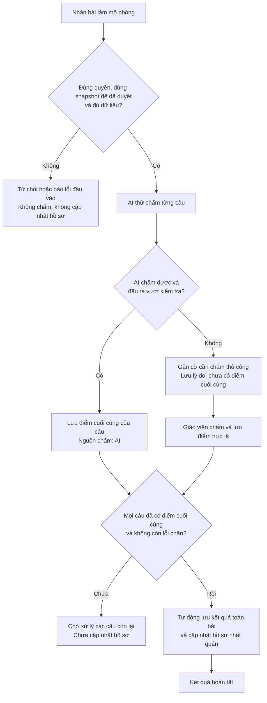

# W06 Luồng chấm bài và tiêu chí nghiệm thu

**Người phụ trách:** Ngô Nhất Nghi - Project & Product Lead  
**Trạng thái:** Bản nháp

Tài liệu xác định cách hệ thống chấm từng câu trả lời, chuyển câu không chấm được cho giáo viên, chốt kết quả toàn bài và cập nhật hồ sơ. Điểm AI chấm hợp lệ được chốt tự động; giáo viên chấm những câu AI không chấm được. Kết quả toàn bài chỉ được chốt khi tất cả các câu có điểm số sau cùng và việc lưu kết quả, cập nhật hồ sơ đều thành công.

## 1. Mục tiêu và ranh giới W06

W06 bàn giao bản mô tả quy trình và quy tắc xử lý, tiêu chí nghiệm thu và các quyết định cần thống nhất để triển khai nhất quán trong W07–W08.

Phạm vi:
- Luồng AI chấm thành công và luồng chấm thủ công cho câu AI không chấm được.
- Điều kiện chốt kết quả, thời điểm cập nhật mastery/evidence và nguyên tắc tránh cộng lặp.
- Trường hợp lỗi, giới hạn quyền truy cập và bằng chứng cần có khi nghiệm thu.

 Bài làm mô phỏng được cung cấp qua dữ liệu mẫu; nguồn dữ liệu đó vẫn phải xác định được học sinh, đề và phiên bản đề. Class diagram, API chi tiết, prompt chấm bài và rubric đánh giá chất lượng sinh đề thuộc các tài liệu riêng của thành viên phụ trách.

## 2. Cơ sở và các nguyên tắc bắt buộc

### 2.1. Cơ sở từ dự án

- Planner, API và dữ liệu mẫu cho sinh đề đã tích hợp; backend sinh đề đang gần hoàn tất.
- Code hiện có trạng thái đề `pending_teacher_review`/`approved`, cơ chế `revision`, duyệt đề và tạo lại câu. Đây là trạng thái của **đề**, không phải trạng thái chấm **bài làm**.
- Mỗi câu trong contract hiện có `max_score`, đáp án, lời giải và barem `rubric`. Điểm đề hiện tổng cộng 10; điểm được tính theo bội số của 0.25.
- Hồ sơ mẫu hiện được thiết lập sẵn để thử tính năng sinh đề, nên mastery/evidence có thể không tương ứng với lịch sử bài làm. Khi triển khai cập nhật hồ sơ sau chấm bài, cần chuẩn bị bộ dữ liệu thử nghiệm có lịch sử và chỉ số hồ sơ khớp nhau.
- Teacher token hiện dùng chung chưa xác định danh tính riêng từng giáo viên; grading, phân quyền theo bản ghi và cập nhật hồ sơ cần được bổ sung ở giai đoạn triển khai.

### 2.2. Nguyên tắc nghiệp vụ theo phạm vi workflow hiện tại

| Mã | Nguyên tắc |
|---|---|
| BR-01 | Câu được AI chấm thành công và vượt kiểm tra đầu ra có điểm cuối cùng ngay, không chờ giáo viên duyệt điểm. |
| BR-02 | Câu AI không chấm được phải gắn cờ và chuyển giáo viên; không tự gán 0 để hoàn tất bài. |
| BR-03 | Chỉ chốt toàn bài khi tất cả câu cần đánh giá đều có điểm cuối cùng hợp lệ và không còn lỗi chặn. |
| BR-04 | Chưa chốt toàn bài thì chưa dùng kết quả của bài đó để cập nhật mastery/evidence. |
| BR-05 | Chỉ người có quyền mới được xem kết quả hoặc chấm câu cần xử lý thủ công. Backend phải kiểm tra quyền trên bản ghi, không chỉ ẩn nút trên giao diện. |
| BR-06 | Barem chấm bài học sinh và rubric đánh giá chất lượng sinh đề là hai tài liệu khác nhau. Mục tiêu 80/100 của chất lượng sinh đề không phải ngưỡng điểm cho bài làm học sinh. |

## 3. Vai trò và điều kiện đầu vào

| Vai trò | Trách nhiệm trong luồng |
|---|---|
| Giáo viên được cấp quyền | Xem tiến độ và kết quả; chấm các câu AI không chấm được đã được chuyển sang xử lý thủ công. |
| Backend | Kiểm tra đầu vào và quyền; gọi AI; kiểm tra kết quả; lưu điểm và thông tin lần chấm; xác định đủ điều kiện chốt bài; cập nhật hồ sơ. |
| AI local | Đề xuất điểm và nhận xét theo barem, hoặc báo không chấm được. Không tự thay đổi barem, quyền truy cập hoặc trạng thái hồ sơ. |
| Học sinh | Là chủ thể của bài làm và hồ sơ. Không có quyền sửa điểm hoặc mastery/evidence. Không yêu cầu triển khai màn hình nộp bài trong W06. |

Trước khi bắt đầu chấm, backend phải xác định được:

1. Học sinh có thông tin trong hệ thống và giáo viên được phép xem, chấm bài của học sinh đó.
2. Bài làm có định danh riêng, gắn đúng học sinh và một snapshot phiên bản đề đã được giáo viên duyệt.
3. Snapshot chứa đủ nội dung câu, đáp án, lời giải, barem, điểm tối đa và liên kết kỹ năng cần thiết. Tạo lại đề không làm thay đổi snapshot đang được chấm.
4. Mỗi câu có một bản ghi câu trả lời. Cần phân biệt rõ **học sinh để trống** với **dữ liệu câu trả lời bị thiếu do lỗi truyền/đọc**.
5. Các câu trả lời thuộc đúng đề, không trùng hoặc có câu lạ. Barem và tổng điểm nhất quán; không lấy một rubric chất lượng sinh đề để thay barem.

Đầu vào không hợp lệ bị từ chối trước khi chấm hoặc bị chặn để xử lý dữ liệu; không tự sửa ID, bịa câu trả lời hoặc bỏ câu để đủ điều kiện chốt.

## 4. Tổng quan luồng xử lý

## 5. Các luồng nghiệp vụ chi tiết

### GF-01 AI chấm thành công

1. Backend lấy câu trả lời và dữ liệu chấm từ snapshot đã duyệt, rồi gửi dữ liệu cần thiết cho AI local.
2. AI trả điểm, nhận xét và thông tin chấm theo cấu trúc do AI Lead và Architecture Lead thống nhất. Bài làm là nội dung cần đánh giá, không được dùng làm chỉ dẫn thay đổi quy tắc chấm.
3. Backend kiểm tra cấu trúc, định danh câu, phạm vi điểm và tính nhất quán giữa điểm thành phần với tổng điểm câu. Điểm phải hữu hạn và nằm trong `[0, max_score]`.
4. Nếu đầu ra đạt các điều kiện kỹ thuật và quy tắc chấm đã thống nhất, backend lưu điểm cuối cùng của câu với nguồn AI. Việc vượt kiểm tra kỹ thuật không phải bằng chứng AI luôn chấm đúng về chuyên môn; độ chính xác phải được QA đánh giá bằng bộ ví dụ có điểm tham chiếu.
5. Backend kiểm tra điều kiện hoàn tất toàn bài. Nếu mọi câu đều đủ điều kiện thì tự chuyển sang GF-03.

**Kết quả:** Câu không xuất hiện trong danh sách bắt buộc chấm thủ công. Nếu AI chấm được toàn bộ bài thì không cần thêm thao tác giáo viên để chốt kết quả.

### GF-02 Chuyển câu AI không chấm được sang giáo viên

1. AI báo không thể đánh giá, đầu ra không hợp lệ hoặc việc gọi model thất bại sau giới hạn thử lại đã cấu hình.
2. Backend gắn cờ cần chấm thủ công cho câu, lưu lý do và giữ điểm cuối cùng là chưa có. Điểm AI không hợp lệ không được dùng làm điểm chính thức.
3. Giáo viên xem đề, bài làm, barem và lý do chuyển thủ công; nhập điểm kèm nhận xét.
4. Backend kiểm tra quyền, xác nhận câu vẫn đang chờ chấm thủ công và tính hợp lệ của điểm giáo viên nhập. Nếu câu đã có điểm cuối cùng, yêu cầu lỗi thời không được ghi đè điểm đã lưu.
5. Backend lưu điểm cuối cùng với nguồn giáo viên, bỏ cờ chờ chấm của câu và kiểm tra lại điều kiện chốt toàn bài.

**Kết quả:** Chỉ những câu chưa có điểm cuối cùng mới chặn việc chốt bài. Điểm các câu đã chấm thành công được giữ nguyên.

Lỗi model không đồng nghĩa bài làm sai. Nếu chính đề/đáp án/barem bị lỗi thì ghi nhận lỗi chặn và yêu cầu xử lý dữ liệu; không ép giáo viên nhập một điểm tùy ý để đóng bài.

### GF-03 Chốt kết quả toàn bài và cập nhật hồ sơ

Backend chỉ thực hiện khi đồng thời thỏa mãn:

- Toàn bộ câu trong snapshot có đúng một câu trả lời tương ứng, kể cả bản ghi để trống hợp lệ.
- Mọi câu đã có điểm cuối cùng hợp lệ từ AI hoặc giáo viên.
- Không còn câu chờ chấm thủ công hoặc lỗi chặn về dữ liệu, điểm hay quy tắc cập nhật hồ sơ.
- Học sinh, kỹ năng, phiên bản đề và phiên bản kết quả được xác định nhất quán.
- Chính sách tính mastery và nguồn hồ sơ có thể ghi đã được nhóm thống nhất và cấu hình cho bộ thử nghiệm.

Các bước:

1. Tính tổng từ điểm cuối cùng của các câu; đối chiếu với tổng điểm tối đa của snapshot. Với contract hiện tại, bài có tổng tối đa 10 điểm.
2. Chuẩn bị đóng góp của bài làm cho từng kỹ năng theo chính sách đã thống nhất; chỉ dùng điểm cuối cùng đã lưu từ AI hoặc giáo viên chấm thủ công.
3. Lưu kết quả, đóng góp bằng chứng và cập nhật hồ sơ trong cùng một lần xử lý: hoặc lưu thành công tất cả thay đổi, hoặc không lưu thay đổi nào.
4. Chỉ báo kết quả `FINALIZED` sau khi các thay đổi đã lưu thành công.
5. Nếu lưu hoặc cập nhật hồ sơ thất bại, giữ các điểm câu đã lưu trước đó; không công bố bài đã hoàn tất với hồ sơ cập nhật dở. Lần thử lại không tạo thêm kết quả hoặc bằng chứng.

**Kết quả:** Kết quả toàn bài và hồ sơ phản ánh cùng một phiên bản điểm

## 6. Trạng thái nghiệp vụ đề xuất

### 6.1. Cấp câu trả lời

| Trạng thái | Ý nghĩa | Điều kiện ra khỏi trạng thái |
|---|---|---|
| `PENDING` | Chưa có điểm, chưa được AI xử lý. | Bắt đầu chấm. |
| `AI_GRADING` | AI đang xử lý; chưa có điểm chính thức. | Đầu ra hợp lệ → `GRADED`; không chấm được → `MANUAL_REQUIRED`. |
| `MANUAL_REQUIRED` | Cần giáo viên chấm; chưa có điểm cuối cùng. | Giáo viên lưu điểm hợp lệ → `GRADED`. |
| `GRADED` | Có điểm cuối cùng từ AI hoặc giáo viên chấm thủ công. | Được dùng để kiểm tra điều kiện chốt toàn bài; kết quả trùng lặp không được ghi đè. |

Nguồn điểm phải phân biệt AI và giáo viên chấm thủ công. **0 điểm hợp lệ** vẫn là `GRADED`; **chưa có điểm** không được biểu diễn bằng 0.

### 6.2. Cấp bài làm

| Trạng thái | Ý nghĩa |
|---|---|
| `RECEIVED` | Bài làm đã được kiểm tra và ghi nhận, chưa bắt đầu chấm. |
| `GRADING` | Còn câu đang chờ hoặc đang được AI xử lý. |
| `AWAITING_MANUAL` | Không còn câu AI đang xử lý nhưng vẫn còn câu bắt buộc giáo viên chấm. |
| `READY_TO_FINALIZE` | Mọi câu có điểm hợp lệ; đang chờ lưu kết quả và đồng bộ hồ sơ thành công. |
| `FINALIZED` | Kết quả và hồ sơ đã lưu thành công, nhất quán. |
| `BLOCKED` | Có lỗi dữ liệu/chính sách chặn xử lý tiếp; cần khắc phục trước khi trở lại trạng thái phù hợp. |

Nếu vừa có câu đang AI chấm vừa có câu chờ giáo viên, bài hiển thị `GRADING` cùng số câu chờ chấm thủ công. 
Khi AI đã xử lý xong tất cả câu, backend kiểm tra kết quả: nếu còn câu cần chấm thủ công thì chuyển bài sang AWAITING_MANUAL; nếu mọi câu đã có điểm hợp lệ thì chuyển sang READY_TO_FINALIZE; nếu có lỗi chặn thì chuyển sang BLOCKED.
Bài đã hoàn tất giữ kết quả đã lưu; yêu cầu xử lý trùng lặp không được thay đổi điểm hoặc tạo thêm bằng chứng.

## 7. Quy tắc cập nhật hồ sơ và tránh cộng lặp

1. **Thời điểm cập nhật:** Chỉ cập nhật mức độ thành thạo (mastery) và bằng chứng học tập (evidence) khi chốt kết quả toàn bài. Việc lưu điểm từng câu hoặc mở trang kết quả không làm thay đổi hồ sơ.
2. **Cách tính bằng chứng:** Đề xuất mỗi bộ `(bài làm, câu hỏi trong snapshot, kỹ năng)` được tính là một bằng chứng. Nếu một câu đánh giá nhiều kỹ năng, mỗi kỹ năng được nhận một bằng chứng theo liên kết đã thống nhất. Một câu có nhiều bước giải vẫn chỉ tạo một bằng chứng cho mỗi kỹ năng, không tính riêng từng bước.
3. **Không cộng trùng:** Mỗi bằng chứng chỉ được ghi nhận một lần khi chốt bài. Gửi lại yêu cầu chốt hoặc thử lại sau lỗi không được làm tăng số bằng chứng đã ghi nhận.
4. **Phân biệt chưa có dữ liệu với làm sai:** Kỹ năng chưa có bằng chứng nghĩa là chưa đủ dữ liệu để đánh giá, không có nghĩa là học sinh làm sai. Câu đã chấm và nhận 0 điểm hợp lệ có thể là bằng chứng làm sai; câu chưa chấm thì không.
5. **Dữ liệu ban đầu:** Data Lead cần cung cấp hồ sơ dùng khi chạy hệ thống (runtime), có lịch sử khớp với các chỉ số trong hồ sơ, hoặc có dữ liệu nền (baseline) đủ để áp dụng công thức cập nhật đã chọn. Không dùng riêng mastery/evidence giả lập để suy ra trọng số của các kết quả cũ. Không tính lại hồ sơ planner từ lịch sử không khớp với hồ sơ đó.
6. **Câu được điểm một phần:** Công thức hiện có trong tài liệu Data chỉ dựa trên `is_correct` (đúng/sai), chưa xử lý điểm một phần. Nhóm phải thống nhất tại DEC-01 cách dùng điểm tự luận để cập nhật mastery trước khi nghiệm thu phần đồng bộ hồ sơ. Tài liệu này không tự đưa ra công thức thay thế.
7. **Nơi lưu và đọc dữ liệu:** Đề xuất lưu kết quả chấm và hồ sơ thử nghiệm trong kho runtime riêng; màn hình Profile phải đọc từ cùng kho này. Không ghi thay đổi vào database M3 nguồn. Khi backend báo đồng bộ thành công, Profile phải hiển thị hồ sơ đã cập nhật, không tiếp tục hiển thị dữ liệu cũ.

## 8. Tiêu chí nghiệm thu cho giai đoạn triển khai

Các tiêu chí sau là đầu vào để QA viết test cases. Chúng chưa được đánh dấu đạt chỉ vì tài liệu thiết kế đã hoàn thành. Ngưỡng đánh giá độ chính xác AI trên cả bộ dữ liệu do AI Lead và QA đề xuất riêng.

| Mã | Tình huống / Điều kiện | Kết quả phải quan sát được |
|---|---|---|
| AC-01 | Bài hợp lệ, mọi câu được AI chấm thành công. | Mỗi câu có điểm cuối cùng nguồn AI; bài tự hoàn tất và cập nhật hồ sơ mà không cần giáo viên duyệt điểm. |
| AC-02 | AI chấm được một số câu, một câu không chấm được. | Giữ điểm các câu thành công; câu còn lại có cờ và lý do chờ giáo viên; toàn bài chưa hoàn tất, hồ sơ chưa đổi. |
| AC-03 | Giáo viên chấm xong câu thủ công cuối cùng. | Cờ chờ chấm được giải quyết; backend tự kiểm tra và hoàn tất bài nếu không còn lỗi chặn. |
| AC-04 | Giáo viên nhập điểm âm, vượt điểm tối đa hoặc sai bước điểm đã thống nhất. | Từ chối lưu; giữ điểm và trạng thái trước thao tác; thông báo lỗi rõ ràng. |
| AC-05 | AI trả JSON lỗi, sai ID, điểm không hữu hạn, vượt phạm vi hoặc điểm thành phần không khớp. | Không lưu điểm đó làm điểm cuối cùng; sau giới hạn thử lại đã chốt, chuyển thủ công và lưu lý do. |
| AC-06 | Model không sẵn sàng, timeout hoặc hết số lần thử. | Các câu bị ảnh hưởng chuyển thủ công với lý do kỹ thuật; không tự cho 0; không mất bài làm hay điểm câu khác. |
| AC-07 | Có một câu chưa có điểm cuối cùng, kể cả khi tổng tạm tính đã cao. | Mọi yêu cầu chốt toàn bài bị chặn; không cập nhật hồ sơ từ bài này. |
| AC-08 | Giáo viên không mở bước xem lại điểm AI. | Bài có đủ điểm hợp lệ vẫn được tự hoàn tất; không xuất hiện yêu cầu duyệt điểm AI bắt buộc. |
| AC-09 | Gửi lại yêu cầu chốt kết quả toàn bài hoặc lưu điểm giáo viên đã chấm vì chưa nhận được phản hồi từ hệ thống. | Không tạo bản kết quả, lần chấm hoặc evidence trùng; trả kết quả đã lưu hoặc phản hồi trùng lặp rõ ràng. |
| AC-10 | Lưu kết quả hoặc cập nhật hồ sơ lỗi giữa chừng. | Chưa báo bài hoàn tất; giữ nguyên điểm từng câu đã lưu và hồ sơ trước khi lỗi; thử lại không cộng trùng bằng chứng. |
| AC-11 | Thiếu quyền, sai học sinh hoặc truy cập bài ngoài phạm vi. | Backend từ chối xem/chấm/chốt; không đổi điểm, hồ sơ hay tiết lộ nội dung bản ghi không được phép. |
| AC-12 | Đề chưa được duyệt hoặc bài làm tham chiếu phiên bản đề không tồn tại. | Không bắt đầu chấm. Với đề được tạo lại sau đó, bài cũ vẫn dùng snapshot gốc đã duyệt. |
| AC-13 | Bài làm thiếu câu trả lời do lỗi dữ liệu, có câu lạ hoặc trùng câu. | Báo lỗi cấu trúc; không tự biến dữ liệu thiếu thành câu học sinh bỏ trống. |
| AC-14 | Học sinh thực sự để trống một câu. | Xử lý theo chính sách DEC-02 đã chốt; có bản ghi rõ ràng. Chỉ điểm 0 hợp lệ mới được dùng khi chốt và tính evidence. |
| AC-15 | Lời giải hợp lệ khác phương pháp trong đáp án mẫu. | Không cho sai chỉ vì khác cách trình bày; chấm theo barem hoặc chuyển giáo viên nếu AI không đánh giá được. QA đối chiếu bộ ví dụ đã được người review chuyên môn xác nhận. |
| AC-16 | Câu có điểm một phần. | Lưu đúng điểm câu; cập nhật mastery theo chính sách DEC-01 đã thống nhất; không ngầm đổi thành sai hoàn toàn hoặc đúng hoàn toàn. |
| AC-17 | Câu có nhiều kỹ năng hoặc nhiều bước chấm. | Evidence tuân thủ đơn vị đã chốt; không tăng theo số bước, số lượt AI hay yêu cầu lưu điểm thủ công trùng lặp. |
| AC-18 | Bài có điểm 0 hợp lệ ở tất cả câu. | Vẫn chốt được nếu dữ liệu đủ; hồ sơ ghi nhận bằng chứng làm sai, không coi đây là chưa có dữ liệu. |
| AC-19 | Tải lại trang, đọc kết quả nhiều lần hoặc khởi động lại backend sau khi lưu. | Điểm và phiên bản vẫn được giữ; các thao tác đọc không làm đổi mastery/evidence. |
| AC-20 | Mở Profile sau khi bài hoàn tất. | Profile hiển thị đúng dữ liệu của lần cập nhật vừa thành công, không đọc nhầm database nguồn chưa đổi. |

## 9. Ví dụ dùng để trao đổi và nghiệm thu

Ví dụ giả lập có ba câu Q1, Q2, Q3, điểm tối đa lần lượt **3, 3, 4**, cùng tổng **10**. Q1 đánh giá A001, Q2 đánh giá A002, Q3 đánh giá A003. Bộ hồ sơ dùng cho ví dụ phải là fixture grading có dữ liệu nền nhất quán, không ghi đè fixture planner.

| Bước | Xử lý | Kết quả |
|---|---|---|
| 1 | AI chấm Q1 = 2/3, Q2 không chấm được, Q3 = 3/4. | Q1 và Q3 có điểm cuối cùng; Q2 chờ giáo viên. Tổng tạm là 5/10, chưa phải kết quả cuối cùng; hồ sơ chưa đổi. |
| 2 | Giáo viên chấm Q2 = 2/3. | Mọi câu có điểm; hệ thống tự chốt 7/10 và cập nhật hồ sơ. Nếu không có bằng chứng nền thì mỗi kỹ năng A001, A002, A003 có thêm một evidence từ bài này. |
| 3 | Ứng dụng gửi lại yêu cầu lưu điểm Q2 hoặc chốt bài vì chưa nhận được phản hồi từ hệ thống. | Tổng vẫn 7/10; điểm Q1 và Q3 do AI chấm được giữ nguyên; không tạo thêm lần chấm hoặc evidence. |

Ví dụ không gán số mastery cụ thể khi DEC-01 chưa được thống nhất. Nếu đồng bộ hồ sơ ở bước 2 thất bại, bài chưa được công bố `FINALIZED`; các điểm câu vẫn được giữ để thử chốt lại.

## 10. Quyết định cần thống nhất trong W06

Các đề xuất dưới đây là phương án để nhóm review, chưa phải quyết định được các thành viên phê duyệt. Nếu thay phương án, cần cập nhật đồng bộ workflow, data model, API, ví dụ AI và test cases.

| Mã | Vấn đề cần chốt | Đề xuất cho MVP / Nội dung phải xác nhận | Phối hợp chính | Cần trước |
|---|---|---|---|---|
| DEC-01 | Điểm một phần và mastery. | Xác định cách dùng tỷ lệ điểm cuối cùng/điểm tối đa, độ khó và mapping kỹ năng; giữ thang mastery 0–4. Data và AI cần cung cấp công thức cùng ví dụ số. Chưa mặc định dùng công thức đúng/sai cũ. | Nghi, Ánh Dương, Yến Trân | Bản chốt mô hình dữ liệu ngày 5; trước triển khai đồng bộ hồ sơ. |
| DEC-02 | Câu trả lời trống. | Đề xuất bản ghi được xác nhận là để trống nhận 0 điểm theo quy tắc xác định, không gọi AI; được tính là bằng chứng sai khi toàn bài chốt. Dữ liệu thiếu do lỗi vẫn bị chặn. | Nghi, Yến Trân, Hoài Thương | Chốt thiết kế AI và fixture ngày 5. |
| DEC-03 | Thang điểm và làm tròn. | Đề xuất giữ tổng 10, bước 0.25 để tương thích contract hiện tại; tính tổng từ các điểm hợp lệ, không ép/làm tròn đầu ra sai của AI thành điểm hợp lệ một cách âm thầm. | Nghi, Yến Trân, Khánh Như | Draft API ngày 4. |
| DEC-04 | Kho lưu và dữ liệu nền cho cập nhật hồ sơ. | Đề xuất dùng kho dữ liệu riêng để lưu kết quả chấm và hồ sơ khi chạy hệ thống, kèm bộ dữ liệu mẫu chấm bài có lịch sử và chỉ số hồ sơ khớp nhau. Màn hình Profile phải đọc từ cùng kho này. Cần thống nhất dữ liệu nền ban đầu, cách tính lại hồ sơ và cơ chế lưu kết quả cùng cập nhật hồ sơ: hoặc tất cả thành công, hoặc không lưu thay đổi nào. Database M3 nguồn chỉ được đọc, không được chỉnh sửa. | Ánh Dương, Khánh Như, Chi Mai | Bản chốt data ngày 5, API và tích hợp ngày 6. |
| DEC-05 | Evidence, mapping nhiều kỹ năng và lần làm lại. | Đề xuất mỗi câu hỏi trong một bài làm tạo một bằng chứng học tập (evidence) cho mỗi kỹ năng được đánh giá. Nếu hệ thống chỉ thử xử lý lại do lỗi kỹ thuật, giữ nguyên bài làm cũ và không tính thêm bằng chứng. Xác nhận kỹ năng nào được nhận đóng góp khi câu có nhiều skill. | Nghi, Ánh Dương, Yến Trân | Bản chốt mô hình và dữ liệu mẫu ngày 5. |
| DEC-06 | Khi nào AI được coi là không chấm được. | Chốt điều kiện theo barem, đầu ra bắt buộc, lỗi cần chuyển giáo viên, giới hạn thử lại và timeout riêng của grading. Không tự dùng confidence do model khai báo làm bằng chứng đủ tin cậy. | Yến Trân, Khánh Như, Hoài Thương | Thiết kế AI ngày 5; API ngày 6. |
| DEC-07 | Danh tính giáo viên và phạm vi quyền. | Chốt cách xác định giáo viên và bài/học sinh được truy cập. Nếu dùng danh tính giả lập cho demo, ghi rõ cơ chế kiểm thử; không coi teacher token dùng chung là danh tính cá nhân. | Nghi, Khánh Như, Hoài Thương | API và test cases ngày 6. |
|  |

DEC-01, DEC-04 và DEC-05 phải được giải quyết trước khi tuyên bố luồng cập nhật hồ sơ đạt nghiệm thu. Trong lúc chưa chốt, nhóm vẫn có thể thiết kế API và kiểm thử các phần chấm điểm không phụ thuộc công thức mastery.

## 11. Bàn giao và tiêu chí hoàn thành tài liệu W06

| Thành viên nhận bàn giao | Nội dung sử dụng từ tài liệu này |
|---|---|
| Ánh Dương - Data | Định danh bài làm/snapshot, trạng thái, nguồn điểm AI/thủ công, đơn vị bằng chứng và cập nhật không cộng lặp. |
| Khánh Như - Architecture | Điều kiện từng thao tác, quyền truy cập, kiểm tra revision, chống trùng và tính nhất quán khi lưu. |
| Yến Trân - AI | Điểm cuối cùng của AI, các điều kiện chuyển thủ công, nhiều lời giải hợp lệ, điểm một phần và giới hạn retry. |
| Chi Mai - UI/UX | Phân biệt điểm tạm/điểm cuối cùng, số câu chờ giáo viên, lỗi và trạng thái hồ sơ; phối hợp nguồn Profile. Thiết kế màn hình Grading chi tiết thuộc giai đoạn sau. |
| Hoài Thương - QA | BR-01–BR-06, GF-01–GF-03, AC-01–AC-20 và ví dụ để lập bộ test; rubric chất lượng sinh đề vẫn là đầu việc riêng. |

**Ngày 2:** Cung cấp bản nháp workflow, trạng thái, tiêu chí nghiệm thu và danh sách quyết định để các thành viên dùng làm cơ sở thiết kế.

**Ngày 6:** Tổng hợp phản hồi; ghi quyết định và người xác nhận trong bảng DEC; đối chiếu với data model, API, thiết kế AI và test cases. Bản chốt không được còn mâu thuẫn về điều kiện chốt điểm, cập nhật hồ sơ hoặc luồng bắt buộc giáo viên chấm.

Checklist review, chưa đánh dấu hoàn thành thay cho các thành viên:

- [ ] Data xác nhận đơn vị evidence, nguồn ghi và cách cập nhật khi chốt bài mà không cộng lặp.
- [ ] AI xác nhận đầu ra thành công, điểm một phần và điều kiện chuyển thủ công.
- [ ] Architecture xác nhận API đáp ứng các thao tác, quyền, chống trùng và revision.
- [ ] QA đối chiếu đầy đủ các nhánh chính/lỗi với bộ test cases.
- [ ] Các quyết định DEC có kết luận, ngày và người xác nhận hoặc nêu rõ phần triển khai còn bị chặn.
- [ ] Bản chốt giữ nguyên nguyên tắc AI chấm hợp lệ tự chốt điểm câu; chỉ câu không chấm được mới bắt buộc giáo viên chấm.

## Tài liệu đối chiếu trong dự án

- [Kế hoạch và tiến độ trong midterm report](../../Team01_Midterm_Project_Report.docx), mục 4.2–4.3; dùng cùng cập nhật W06–W10 mới nhất của nhóm.
- [README](../../README.md): giới hạn hiện tại, database nguồn chỉ đọc, teacher token và UI đang có.
- [ADR-004](../decisions/ADR-004-modular-generation-and-review.md): duyệt đề, snapshot và kiểm tra revision.
- [Contract hiện tại](../../src/api/schemas.py): điểm, barem, trạng thái đề và hồ sơ theo từng kỹ năng.
- [Data notes](../notes/N02_knowledge_data.md), mục 6–7: công thức đúng/sai hiện có và giới hạn điểm một phần.
- [Hướng dẫn hồ sơ mẫu](../../data/sample/memory/USAGE.md): mastery/evidence giả lập cho planner không được tái tính từ lịch sử cũ.
