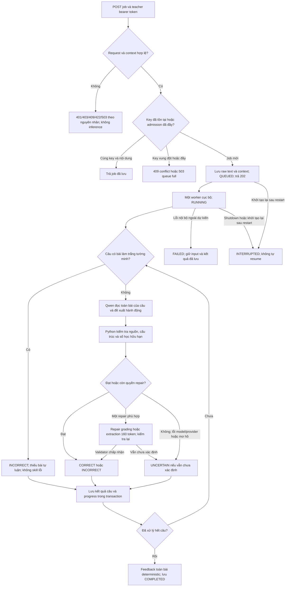

# W08 — Tích hợp backend chấm tự luận AI

**Tác giả:** Phạm Yến Trân — AI & Algorithm Lead  
**Ngày triển khai và kiểm chứng:** 20/11/2026 (Asia/Saigon)  
**Engine kế thừa:** `R2026-11-17-scoped-skill-guidance-v11`  
**Integration revision:** `W08-2026-11-20-v1`

## 1. Phạm vi tôi đã triển khai

Tôi đã đưa engine Qwen độc lập vào FastAPI hiện có, bổ sung API job bất đồng bộ,
kho SQLite runtime và trang `/grading`. Tôi giữ nguyên trang sinh đề `/`, việc duyệt
đề trước khi giao, các lựa chọn launcher cũ và grader post-extraction cũ.

Tôi thực hiện công việc trong repository thực tế
`D:/HCMUS/TDTT/TH/Main_Project/MIRA/adaptive-learning`. Nguồn độc lập được đọc từ
`../MIRA_Standalone_AI_Grading_Test_v2/run_test.py`; SHA-256 đã xác nhận là
`f5d2b37ff9bf2a807d0107946c473a68f397b19b335feae8c3c5bcfd76d0cc0c`,
trùng bản v11 đã được chọn trong current-state/changelog của standalone. Tôi không
sử dụng các thử nghiệm dịch prompt v12/v13 đã bị loại. Backend không import hoặc
phụ thuộc thư mục standalone khi chạy. Tôi lưu nguồn gốc và hash AST trong
[`grading_source_manifest.json`](../notes/grading_source_manifest.json).

“Final” ở tên tài liệu có nghĩa tôi đã mô tả bản tích hợp này; không có nghĩa độ
chính xác ngữ nghĩa của v11 đã được chứng nhận để triển khai production tự động.

Tài liệu này **thay thế các quy tắc GRADING mâu thuẫn** trong
`W06_AI_Grading_Design.md` và `W06_Grading_Workflow_and_Acceptance_Criteria.md`:
không có điểm số câu hỏi, điểm thành phần, teacher override hoặc yêu cầu nhập kết
quả chấm thủ công. Tôi không triển khai PCM/EAP, `observed_level` hoặc cập nhật
mastery/profile, và không thay thế thiết kế sinh đề hay thiết kế mastery riêng
của thành viên khác. Tôi không sửa tài liệu PCM/EAP hoặc wireframe sinh đề.

## 2. Luồng đang chạy



Repair chỉ chạy khi engine v11 chọn nhánh đó. Timeout hoặc lỗi provider dừng gọi
model cho câu đang xử lý; worker vẫn xử lý các câu còn lại. Sau repair, kết quả vẫn
phải qua validator; không có lần gọi thứ ba. Node `L` sau repair chỉ được dùng khi
validator chấp nhận; nhánh không đạt đi tới `U`.

Tôi dùng trạng thái xử lý `QUEUED`, `RUNNING`, `COMPLETED`, `FAILED`, `INTERRUPTED`.
`COMPLETED` nghĩa tất cả câu đã được xử lý và lưu, có thể còn `UNCERTAIN`; tôi không
dùng `FINALIZED` theo nghĩa cũ mọi câu đều có kết luận xác định.

## 3. Đầu vào và ranh giới adapter

### Chế độ experimental

Request chứa `mode: experimental`, `idempotency_key`, mã test/học sinh thử nghiệm,
`questions` và `answers`. Mỗi câu có `question_id`, `question_text`,
`reference_answer`, `rubric`, `skill_ids`; `reference_solution` là trường tùy chọn
được bảo toàn trong snapshot input.

Rubric được hỗ trợ có đúng cấu trúc:

```json
[
  {"id":"R1","description":"Nhận diện hai nhóm lựa chọn loại trừ nhau.","skill_ids":["A001"]},
  {"id":"R2","description":"Cộng số lượng và kết luận có 5 cách.","skill_ids":["A001","A008"]}
]
```

Tôi kiểm tra ID, bounds, rubric ID không trùng, skill thuộc A001–A009 và mapping
rubric thuộc danh sách kỹ năng của câu. A008 là ứng viên số học ngầm định đã có
trong v11, không phải skill được tự gán cho mọi bước. Không có phép chuyển đổi
tự động từ `criteria/sub_score` hoặc `step/description` sang rubric chuẩn trên.
Không gọi Qwen để tạo rubric có thẩm quyền.

Mỗi bài có 1–10 câu, mỗi raw answer tối đa 16.000 ký tự. Tôi từ chối bản ghi answer
trùng, câu lạ hoặc thiếu câu; không suy diễn answer bị thiếu là bài trắng. Thứ tự
xử lý và xuất kết quả theo `questions`, không theo thứ tự transport của `answers`.
Đáp án tham chiếu phải parse được trong tập biểu thức hữu hạn của engine trước
khi inference, để context hệ thống không bị biến thành lỗi của học sinh.

Engine v11 gửi **đúng năm trường** `question_text`, `rubric`, `reference_answer`,
`student_answer`, `skill_ids`. Lập luận tham chiếu phục vụ model nằm trong mô tả
rubric. Tôi không thêm `reference_solution` thành trường prompt mới, vì điều đó
sẽ đổi request đã đóng băng; trường này nếu cung cấp vẫn được lưu để truy xuất.
Ví dụ UI là dữ liệu tổng hợp mới, không chứa verdict mong đợi/gold hoặc annotation
đánh giá benchmark. Metadata luôn ghi `experimental: true`, không tạo provenance
duyệt đề hoặc danh tính học sinh chính thức giả.

### Chế độ approved_snapshot

Client chỉ gửi exam ID, **đúng revision**, student ID và raw answers. Server đọc
snapshot revision tương ứng từ `exam_revisions` bằng SQLite read-only, rồi kiểm tra
exam/revision, trạng thái approved, review record, liên kết học sinh và toàn bộ
question membership. Không dùng đề mới nhất thay thế revision được yêu cầu, và
không nhận bản thay thế đáp án/rubric do client gửi.

Kho fake chỉ có bản đề hiện hành trong memory; revision không còn sẽ nhận
`GRADING_REVISION_UNAVAILABLE`, không tự chuyển sang revision mới. Snapshot tồn tại
nhưng chưa approved nhận `GRADING_EXAM_NOT_APPROVED`. Revision không tìm thấy nhận
`GRADING_SNAPSHOT_NOT_FOUND`. Sai học sinh hoặc membership có lỗi riêng.

Adapter có thể tiếp nhận snapshot server có đủ rubric `{id, description, skill_ids}`
và các trường tham chiếu được hỗ trợ. **Contract sinh đề hiện tại chưa cung cấp
rubric đó**, nên nhánh này chưa hoạt động trọn vẹn với đề đang sinh trong ứng dụng.
Nếu các kiểm tra approval/membership đã qua nhưng rubric chưa đủ, API trả
`409 GRADING_CONTEXT_NOT_READY` với hướng dẫn bổ sung mapping, trước mọi inference.
Tôi chỉ kiểm thử nhánh đủ context bằng snapshot tổng hợp; không gọi đó là dữ liệu
production đã duyệt.

`SubmissionRepository` là interface cho nguồn bài nộp tương lai, chưa có concrete
adapter đọc original answers từ database đội. Experimental không phụ thuộc interface
chưa triển khai này.

## 4. Vai trò Qwen và Python

Qwen đọc lời giải nguyên văn gồm văn xuôi và biểu thức, xác định hành động có ý
nghĩa, mô tả ngắn bằng tiếng Việt, trích nguyên văn evidence, liên hệ rubric và
đề xuất phán đoán. Nó phải đọc **toàn bộ lời giải của một câu trước khi chọn lỗi
đầu tiên**; một tích trung gian có thể được chia hoặc trừ ở phần sau.

Python kiểm tra proposal schema, rubric/skill IDs, evidence đúng nguyên văn, có
thứ tự, không chồng lấn, coverage của phần được đánh giá; một bài được chấp nhận
đúng phải phủ cả bài. Offset là chỉ số ký tự Unicode Python, khoảng `[start,end)`
trên đúng raw text đã lưu, không phải byte UTF-8 hoặc đơn vị UTF-16 của JavaScript.
UI không tự cắt raw text theo offset UTF-16. Tôi giữ nguyên exact quote bên trong
raw input/diagnostic; compact JSON chỉ chứa mô tả và offset theo formatter cũ.

Validator dùng AST/Fraction, không dùng `eval`, cho tập số học có giới hạn: số nguyên,
cộng/trừ/nhân/chia, tổ hợp/chỉnh hợp `C(n,k)`, `A(n,k)`, factorial có bounds. Phương
trình số học sai được kiểm tra từ nguồn có thể ghi nhận A008. Phương trình đúng
không chứng minh cách đếm hoặc điều kiện toán học đúng. Ký hiệu không hỗ trợ không
được biến thành lỗi tính toán đã xác minh.

Python không chứng minh suy luận tự nhiên tùy ý, tính đúng của phương pháp đếm,
tính đầy đủ của lập luận, hay chất lượng giải thích ngữ nghĩa. Mô tả chỉ có một
kiểm tra mâu thuẫn số rất hẹp. Bản thân việc lý do skill không rỗng và có liên kết
quotation không chứng minh skill đó được gán đúng về toán học.

Tôi giữ việc chấp nhận phương pháp hợp lệ khác tham chiếu: khác phương pháp không
tự động là sai hoặc uncertain. Sự hiểu đúng phương pháp thay thế vẫn phụ thuộc
Qwen; tôi không thêm rule từ khóa hoặc gold để sửa verdict cho từng case.

## 5. Dừng ở lỗi đầu tiên và bài thiếu lập luận

Sau khi model đọc đủ context, validator chấp nhận các hành động theo thứ tự nguồn.
Khi chấp nhận lỗi đầu tiên, nó dừng phần được đánh giá của câu tại đó. Các hành động
phía sau không bị gắn sai tự động và không được phân loại root/propagated error.
Một đáp số đúng không cứu một lập luận đã sai.

Nếu bài không có đủ lập luận bắt buộc, kết quả là `INCORRECT` /
`INCOMPLETE_SOLUTION`, lý do ngắn chính xác **`Bài làm tự luận chưa đầy đủ.`**,
không có skill lỗi được bịa thêm. Lời giải ngắn nhưng đủ không mặc nhiên là thiếu.

Tôi bổ sung chính sách tại boundary: answer record có string rỗng hoặc chỉ whitespace
và context hợp lệ là học sinh để trống, nhận cùng lý do thiếu bài tự luận, không gọi
Qwen, `answer: []`, `step_results: []`, không tạo quotation hoặc offset giả. Trường
`errors[0].step: 1` là vị trí lỗi thiếu bài theo compatibility result, không có nghĩa
học sinh đã viết một bước. Bản ghi answer vắng mặt hoặc `null` bị từ chối 422.
Tôi không đổi semantics của engine cho bài không rỗng.

## 6. Model, extraction và repair

Tôi tách cấu hình grading khỏi `QWEN_*` của sinh đề:

| Biến | Mặc định |
|---|---|
| `GRADING_MODEL` | `qwen3:4b-q4_K_M` |
| `GRADING_TIMEOUT_SECONDS` | `120` |
| `GRADING_NUM_PREDICT` | `1200` |
| `GRADING_NUM_CTX` | `8192` |
| `GRADING_MAX_REPAIRS` | `1`, chỉ cho phép 0 hoặc 1 |
| `OLLAMA_BASE_URL` | `http://127.0.0.1:11434`, dùng chung convention origin |
| `GRADING_QUEUE_CAPACITY` | `4`, gồm queued và running |

Payload luôn có `think=false`, `temperature=0`, `seed=42`, `stream=false`,
`keep_alive=10m`. Tôi giữ schema proposal và thứ tự instruction của standalone;
không tái sử dụng transport sinh đề vốn nhận output `{question: ...}`. Không có tự
download hoặc thay model nếu tag được chọn thiếu.

Final-answer extraction kiểm tra quote thuộc source và ranh giới biểu thức trước
khi normalize bounded wrapper/unit. Không chọn số cuối cùng, không dùng đáp án
tham chiếu để điền số. Repair extraction chỉ được thay `final_answer_quote`, giữ
steps và ngân sách `min(GRADING_NUM_PREDICT,160)`. Repair grading là một đề xuất
thay thế được đánh giá lại với toàn bộ dữ liệu cho phép, không giữ diagnosis cũ
như bằng chứng. Không có vòng retry tổng thể bên ngoài engine.

Lỗi model/provider, quotation không hợp lệ, extraction thất bại hoặc dữ liệu hệ
thống thiếu không được ghi là học sinh sai. Sau xử lý theo policy v11, các câu chưa
thể kết luận giữ `UNCERTAIN` và không có error skill giả.

## 7. API, lưu trữ và lifecycle

Tôi dùng teacher bearer dependency hiện có (`API_TEACHER_TOKEN` hoặc
`FAKE_API_TEACHER_TOKEN`), không tạo student auth mới. Trang HTML không chứa dữ liệu
bí mật; business API vẫn được bảo vệ. Token launcher đi qua URL fragment, được xóa
khỏi URL và chỉ giữ trong memory trình duyệt. Các response có `Cache-Control: no-store`.

| Endpoint | Kết quả |
|---|---|
| `POST /api/v1/grading/jobs` | Validate và lưu bền vững, trả 202 envelope; không đợi inference |
| `GET /api/v1/grading/jobs/{job_id}` | Metadata/progress và compact phần đã lưu, feedback null nếu chưa đủ câu |
| `GET /api/v1/grading/jobs/{job_id}/result` | Envelope đã completed; trả 409 nếu chưa xử lý hết |

Request experimental đầy đủ nằm ở
[`src/ui/static/grading-example.json`](../../src/ui/static/grading-example.json).
Ví dụ approved request (IDs minh họa, không khẳng định đề đó đang có thật):

```json
{
  "mode":"approved_snapshot",
  "idempotency_key":"approved-submission-001",
  "exam_id":"EX_example",
  "exam_revision":3,
  "student_id":"SYN_STUDENT",
  "answers":[{"question_id":"Q1","student_answer":""}]
}
```

Envelope có dạng `{metadata: {...}, result: {...}}`. Metadata tách riêng engine/
integration revision, model/options, exact exam revision, experimental provenance,
timestamps UTC, state, số câu processed/definite/uncertain/provider failures, thời
gian từng câu và số model/repair calls. Trường đếm call là null nếu đọc bản ghi cũ
chưa lưu trường đó; không suy đoán thành không gọi model. `elapsed_seconds` là tổng
thời gian xử lý các câu đã lưu, chưa gồm queue wait hoặc câu hiện còn chạy.

Tôi dùng `data/runtime/grading.db`, với `grading_jobs` chứa request nguyên bản,
context snapshot, state/metadata và compact JSON; `grading_questions` lưu từng câu
và progress. Tôi dùng transaction admission (`BEGIN IMMEDIATE`) cho key/capacity,
và transaction chung cho kết quả câu + progress + trạng thái. Với câu cuối, feedback
và `COMPLETED` được lưu trong cùng transaction. Lỗi giữa transaction rollback.
GET chỉ đọc lại JSON, không chấm lại, regenerate feedback hoặc cập nhật profile.

Idempotency key là unique trong runtime DB. Request giống nhau, cùng key trả lại
job cũ kể cả sau restart; payload khác cùng key trả 409. Thay key tường minh nếu
muốn một lần thử mới. Job bị interrupted dùng lại key vẫn mở job interrupted,
không âm thầm chạy lại inference.

Worker được tạo lazy tại **lần truy cập grading đầu tiên** sau khi app chạy; các
phiên chỉ sinh đề không tạo grading DB/worker. Trước khi nhận việc, worker giữ file
lease của cùng DB và đánh dấu mọi queued/running cũ là `INTERRUPTED`. Completed
không bị đổi. Shutdown chủ động cũng đánh dấu unfinished interrupted, giữ phần kết
quả đã commit. Call HTTP đang chạy có timeout hữu hạn và không được lưu thành
completed sau khi job đã interrupted. Lease được giữ tới khi thread đó thoát.

Đây là thiết kế **một process ứng dụng / một grading worker**. Admission mặc định
cho bốn job active, không tạo thread vô hạn theo request. Lease ngăn hai process
cục bộ sở hữu cùng store; không triển khai worker phân tán, Redis/Celery, tự resume,
cancellation API hoặc public multi-tenant access control. Lỗi nội bộ bất ngờ có
thể đặt `FAILED`; provider failure được xử lý ở mức câu và cho phép job completed.

## 8. Compact output

Tôi gọi formatter `exam_payload` của v11 nguyên trạng, rồi gắn test/student ID từ
trusted context. `repeat` và `complete` của benchmark không trở thành cột nghiệp
vụ bắt buộc; processing completion nằm trong metadata. Tôi giữ nguyên các trường
compact grading và cách chọn assessed steps, kể cả khi uncertain không công bố
answer descriptions. Ví dụ dưới đây minh họa bài trắng hợp lệ, không phải model
inference hoặc benchmark mới:

```json
{
  "test_id":"SYN_BLANK_TEST",
  "student_id":"SYN_STUDENT",
  "submissions":[{
    "question_id":"Q1",
    "answer":[],
    "grading_result":{
      "grading_status":"AI_GRADED",
      "requires_teacher":false,
      "overall_result":"INCORRECT",
      "final_answer_correct":null,
      "step_results":[],
      "errors":[{"step":1,"error_type":"INCOMPLETE_SOLUTION","skill_ids":[],"reason":"Bài làm tự luận chưa đầy đủ."}],
      "missing_steps":[],
      "teacher_comment":null
    }
  }],
  "feedback":"Trong 1 câu được yêu cầu ở lượt này, em được xác định đúng 0 câu, sai 1 câu; 0 câu cần xem lại. Cần trình bày đầy đủ lập luận và phép tính ở các câu: Q1. Hệ thống dừng ở lỗi đầu tiên mỗi câu; chưa đánh giá toàn bộ lỗi trong bài."
}
```

Một câu đúng có `overall_result: CORRECT`, `final_answer_correct: true`. Một câu
sai ở lỗi được chấp nhận giữ `final_answer_correct: null` nếu final answer chưa
được xác minh; tôi không tự đổi thành false. Khi unresolved, v11 giữ
`grading_status: NEEDS_REVIEW`, `overall_result: UNCERTAIN`, `errors: []` và legacy
`requires_teacher: true`. `requires_teacher`/`teacher_comment` chỉ là **compatibility
fields chờ contract Data/API cuối**, không kích hoạt hàng đợi hoặc form giáo viên.
UI dùng “Chưa kết luận”. Không có feedback theo bước/câu; chỉ có short error reason.

Feedback toàn bài vẫn là code deterministic đã có trong formatter, chỉ xuất sau
khi toàn bộ câu được yêu cầu xử lý xong. Tôi không gọi model thứ hai để viết nhận xét.

## 9. Diagnostics và bảo toàn dữ liệu

Raw answers, context và compact results luôn nằm trong runtime SQLite. Console
không in toàn bộ raw answers hoặc exception có thể chứa dữ liệu riêng. Public
response chỉ có issue code trung tính như `provider_timeout`, `provider_failure`,
`invalid_model_output`, `unresolved_judgment`, không trả raw exception/prompt/trace.

Mặc định không lưu detailed trace. Khi `GRADING_DEBUG=true`, service giữ row chứa
calls/proposal/validator trong memory qua transaction lưu kết quả, rồi ghi file
`data/runtime/grading_debug/G_<uuid>/<position>.json`. Lỗi ghi debug không biến
kết quả đã lưu thành bài sai. File này nhạy cảm vì có raw text và model responses.

Tôi cung cấp `python -m src.grading.cleanup --older-than-days 7`: chỉ xóa file
trace đúng tên trong thư mục job đúng pattern, cũ hơn retention; không đi theo
symlink, không xóa database, raw submission hoặc compact result. Không có TTL xóa
business records. `/data/runtime/` và pytest scratch đã được `.gitignore` hiện có
bao phủ, nên tôi không cần thêm ignore mới. Tôi không ghi canonical databases.

## 10. Kiểm chứng database hiện tại và phần còn thiếu

Tôi kiểm tra bằng SQLite URI `mode=ro` cùng `PRAGMA query_only=ON`, chỉ in schema,
số lượng và cấu trúc; không in tên, ngày sinh hoặc thông tin cá nhân. Báo cáo máy
nằm ở [`w08_grading_database_audit.json`](../report/w08_grading_database_audit.json).

| Nguồn | Thực tế checkout ngày 20/11/2026 |
|---|---|
| `question_bank.db` | 121 questions, tất cả status draft; 121 answers; 9 skills; 18 templates; 159 question-skill links và 40 template-skill links |
| Rubric questions | 121/121 có JSON các mục `{step, description}`, thiếu rubric IDs và per-step skill IDs |
| Rubric templates | 15/18 có cùng dạng step/description; 3 chuỗi rubric không phải JSON hợp lệ |
| `student_profiles_sample.db` | 20 Students, 11 Tests, 40 test_questions, 135 student_skill_mastery |
| `student_answer_attempt` | Bảng **đã tồn tại**, các cột test_id/question_id/answer/student_id, nhưng **0 bản ghi** |
| `test_questions` | Có is_correct và các cột observed_level/theta_eap/question_mastery_score/version/AI mới hơn snapshot cũ; **không có original essay text** |
| Cột `AI` lịch sử | 40 giá trị kiểu integer flag, không phải raw answer hoặc evidence JSON |
| `data/runtime/exams.db` tại thời điểm audit | 2 drafts, 3 revisions, **0 approved revisions**; rubric keys criteria/sub_score |

Schema đã có một số cột PCM và rubric; tôi không gọi chúng là “chưa có” chỉ vì
tài liệu W06 từng là đề xuất. Ngược lại, việc có cột không chứng minh grading,
approval provenance hoặc pipeline cập nhật hồ sơ đã hoạt động. Canonical bank
có reference answers nhưng không có immutable approved exam revision binding.
Tôi không dùng `is_correct`, `AI` hoặc lịch sử điểm làm original student answer.

Hai canonical SHA-256 trước/sau kiểm chứng vẫn là:

```text
question_bank.db
3fb49333eb900160e153410d2b13c34e58931a4afb161c1db70318e6de0ff57b
student_profiles_sample.db
ea74d2cc5fae3edfd6067c5566e474af08ac2cac850a4e65265e55e2709b597e
```

Để concrete database adapter được triển khai sau này, tôi cần Data/API bàn giao:
submission ID ổn định; student association; exam ID và exact revision/snapshot
đã approved; exact membership/question instance IDs; một raw text record cho mỗi
câu kể cả blank; question text/answer/reference reasoning gắn đúng revision;
rubric IDs/version, description và per-step skill mappings được xác nhận; allowed
skill catalogue và approval provenance. Ranh giới đó không được tự lấy phiên bản
mới nhất hoặc tự gán toàn bộ skill của câu vào mọi bước. Tôi chưa tạo migration
hay giả lập canonical submissions thay Data Lead.

## 11. Trách nhiệm các file

| File | Trách nhiệm |
|---|---|
| `src/grading/engine.py` | Prompt, schema proposal, parser/validator/extraction/repair/stopping/formatter v11; chỉ thêm injection client |
| `src/grading/qwen_client.py` | Ollama transport độc lập, response bound/strict JSON, provider checks v11, injectable transport |
| `src/grading/config.py` | Cấu hình grading có validation, tách generation |
| `src/grading/adapter.py` | Explicit experimental context, đọc exact approved revision, future repository protocols |
| `src/grading/schemas.py` | External requests, trusted context, metadata và compact DTO riêng |
| `src/grading/service.py` | Single worker, blank boundary, orchestration toàn bài, progress và optional debug |
| `src/grading/store.py` | Admission/key/transactions, raw/context/result persistence, recovery và local process lease |
| `src/grading/routes.py` | Ba endpoints dùng bearer dependency cũ |
| `src/grading/cleanup.py` | Retention chỉ cho optional diagnostic files |
| `src/api/main.py` | Mount service/routes và cleanup lifecycle, kiểm tra tách đường dẫn storage |
| `src/ui/grading_routes.py`, `src/ui/routes.py` | Trang riêng, CSP/security headers và static serving cũ |
| `src/ui/static/grading.*`, `grading-example.json` | UI nhập context/raw text, import, poll/reopen/download; text-safe DOM |
| `src/ui/__main__.py` | Thêm `--grading`, giữ các launcher options cũ |
| `tools/run_grading_smoke.py` | Chạy live tổng hợp qua API và worker khi truyền `--live` |

Tôi giữ `src/ai/answer_grading.py`, test cũ và `scripts/grading/run_demo.py` nguyên
trạng. Chúng không phải engine mới và không có semantics tương đương v11.

## 12. Cách chạy trong Git Bash

Từ repository `MIRA/adaptive-learning`, Python 3.11 trở lên:

```bash
python -m venv .venv
source .venv/Scripts/activate
python -m pip install -r requirements.txt
# Terminal khác nếu Ollama chưa chạy:
ollama serve
ollama list
# Chỉ chủ động cài nếu tag còn thiếu:
# ollama pull qwen3:4b-q4_K_M
export GRADING_MODEL='qwen3:4b-q4_K_M'
export GRADING_TIMEOUT_SECONDS=120
python -m src.ui --grading
```

Tôi chọn **Nạp ví dụ tổng hợp**, sửa raw answer nếu cần, bấm **Bắt đầu chấm bằng
AI**, theo dõi processed/total và definite/uncertain, rồi tải compact JSON. Để nhập
file, tôi có thể dùng JSON ví dụ đã có ở static. Để mở lại, tôi dùng job ID đã lưu.
Trang không có manual result entry hoặc teacher override. Student/model content
được gán bằng `textContent`, không dùng unsafe HTML interpolation.

Chạy headless hoặc API (tự đặt token bí mật, không dùng placeholder làm secret):

```bash
export API_TEACHER_TOKEN="$(python -c 'import secrets; print(secrets.token_urlsafe(32))')"
python -m src.ui --grading --no-browser
# Hoặc:
python -m uvicorn src.api.main:app --host 127.0.0.1 --port 8000 --workers 1
```

Terminal khác dùng cùng token đã được cấp và request mẫu:

```bash
curl -sS -X POST http://127.0.0.1:8000/api/v1/grading/jobs \
  -H "Authorization: Bearer $API_TEACHER_TOKEN" -H 'Content-Type: application/json' \
  --data-binary @src/ui/static/grading-example.json
export JOB_ID='G_<job_id thực tế được trả về>'
curl -sS "http://127.0.0.1:8000/api/v1/grading/jobs/$JOB_ID" \
  -H "Authorization: Bearer $API_TEACHER_TOKEN"
curl -sS "http://127.0.0.1:8000/api/v1/grading/jobs/$JOB_ID/result" \
  -H "Authorization: Bearer $API_TEACHER_TOKEN"
```

Đổi idempotency key trong bản request riêng khi muốn lần chạy mới. `.env.example`
chỉ là mẫu, app không tự load `.env`. Tôi dừng server bằng **Ctrl+C**. Lệnh riêng
`python tools/run_grading_smoke.py --live` sử dụng cấu hình grading và lưu evidence
runtime; không cần mở browser hoặc tự tạo bài trong canonical DB.

## 13. Kết quả kiểm thử thực tế

Tôi đọc `.github/workflows/ci.yml`: check hiện tại cài requirements và chạy
`pytest -q` trên Python 3.11/Ubuntu. Không có CI lint/browser job bổ sung được
giả định. Tôi chạy trên Windows bằng Python 3.13.13 trong workspace và thư mục basetemp
mới nằm trong `.pytest_tmp_mira/` để tránh quyền temporary directory cũ.

Các lớp kiểm chứng tôi đã thực hiện:

- Replay 20 recorded responses của hai full selected-v11 runs P/N: payload hash,
  grading result, assessed offsets/descriptions và feedback khớp standalone. Có
  correct, method error, arithmetic error, incomplete, phương pháp thay thế,
  invalid evidence và unresolved uncertainty. Tôi bỏ gold/annotation khỏi fixture
  inference input; AST hashes bảo vệ các định nghĩa đóng băng ngoài injection.
- Integration: auth, validation/membership, provenance, approved exact revision,
  context-not-ready trước model, blank/missing, async progress, partial persistence,
  feedback chỉ sau toàn bài, idempotency, capacity, local process lease, restart,
  provider timeout/unavailable, unexpected failure, debug cleanup và canonical
  database hashes. Extraction repair dùng 160 token; không có third inference call.
- JavaScript: chạy actual shipped `grading.js` bằng Node với DOM/fetch giả lập,
  **12 tình huống** import/input/edit, job/poll, correct/uncertain, actionable
  error, reopen, download và text-safe rendering. Bộ generation UI cũ có **20
  tình huống** cũng được chạy trong full pytest khi Node có trên PATH.
- Regression toàn repository: **670 passed, không skipped/failure, 1 cảnh báo
  deprecation Starlette có sẵn**, lần chạy cuối ghi nhận 107,90 giây, bao gồm
  kiểm tra gửi job đồng thời và transaction rollback.
  Tôi không dùng kết quả mocked/replay để công bố độ chính xác Qwen.
- `git diff --check` và Ruff cho code integration mới (không reformat source engine
  đóng băng) đạt. Không có dependency mới trong requirements.

Live Qwen **đã được gọi thật** qua `POST job → SQLite → worker → Ollama → GET`:

| Thuộc tính | Quan sát thực tế |
|---|---|
| Job | `G_705b5e794cab49a2a83962644c7c5aa2` |
| Model | `qwen3:4b-q4_K_M`, exact installed tag |
| Thời điểm | 20/11/2026, 20:32 Asia/Saigon; timestamps lưu UTC |
| Input | Hai câu tổng hợp của `grading-example.json` |
| Processing | COMPLETED, 2/2 câu, 0 uncertain, 0 provider failure |
| Verdict | SYN_SUM CORRECT; SYN_PRODUCT INCORRECT |
| Final answer | true cho câu đúng, null cho câu sai |
| Thời gian | 32,513 s và 19,611 s theo câu; tổng xử lý 52,123 s; command wall 52,666 s |
| Evidence runtime | `data/runtime/grading_smoke/G_705b5e794cab49a2a83962644c7c5aa2.json` và `grading.db` |

Tôi không lặp lại live inference chỉ để làm đẹp số đo. Đây là smoke integration
hai câu, **không phải benchmark accuracy, reliability hoặc latency SLA**. Tôi không
suy ra mọi bài sẽ có cùng verdict hay thời gian. Runtime artifact không được commit.

## 14. Giới hạn tôi giữ nguyên và việc còn lại

Engine kế thừa còn phụ thuộc Qwen về first faulty action, phương pháp đếm, đủ lập
luận, skill attribution và description fidelity. N07 trong source notes chọn sai
hành động đầu dù labels/skills khớp; P07 vẫn gặp evidence không nguyên văn sau một
repair; một số span rộng có thể che diagnosis không tốt. English skill guidance
có thể bị model chép vào description/reason dù prompt yêu cầu tiếng Việt. Tôi không
sửa các lỗi ngữ nghĩa này trong nhiệm vụ tích hợp và không tuyên bố Python đã
xác minh chúng.

Arithmetic, answer units và expression normalization chỉ hỗ trợ tập hữu hạn.
Vị trí quote trùng có thể mơ hồ; việc quote đúng nguồn chưa chứng minh nó là kết
luận cuối mà học sinh muốn đưa ra. Raw input dài có thể vượt ngân sách context;
truncation/provider output không hợp lệ vẫn không là lỗi học sinh.

Tôi chưa triển khai concrete canonical submission adapter, chuyển đổi rubric
authoritative mới trong generator, migration, multi-process/distributed jobs,
teacher grading/override, student auth hoặc mastery update. Teacher token còn là
shared workspace gate. Detailed traces là tùy chọn; không có semantic teacher
certification hay browser visual certification từ các test DOM/fetch. Việc nạp,
khởi động, hiển thị và tải JSON đã được kiểm tra ở mức mã UI và HTTP.

Tôi ghi trạng thái hiện tại tại
[`W08_Grading_Current_State.md`](../notes/W08_Grading_Current_State.md) và bàn giao
file/commands/API/PR tại [`W08_AI_Grading_Handoff.md`](../report/W08_AI_Grading_Handoff.md).
