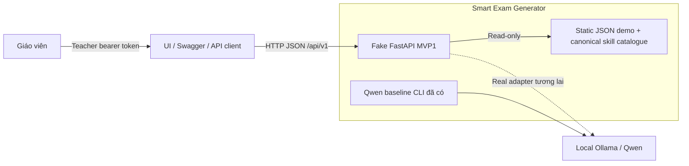
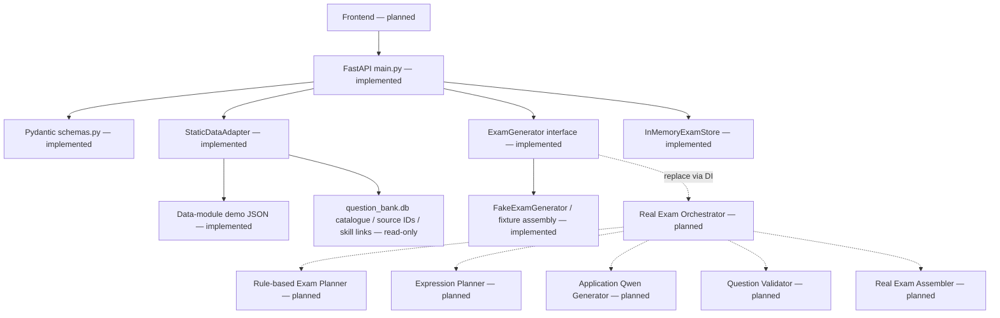
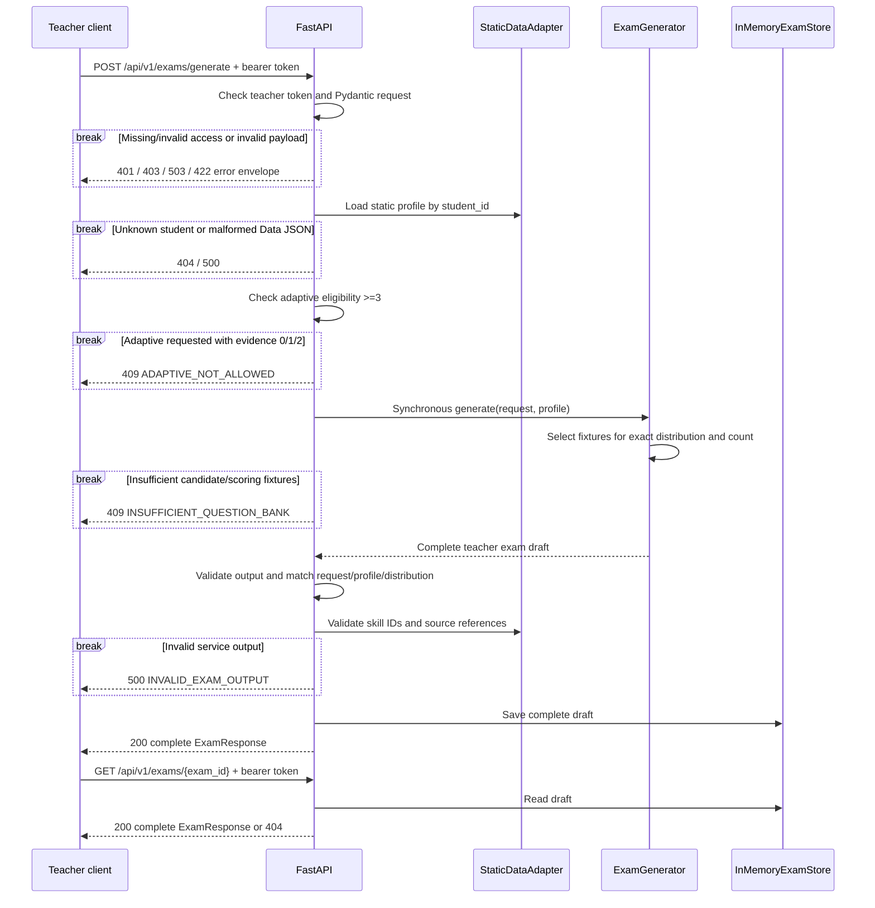

# N04 — Kiến trúc hệ thống và API Contract MVP1

* **Mã tài liệu:** N04 (System Architecture & API Contract — MVP1)
* **Owner:** Doan Khanh Nhu (Architecture Lead)
* **Reviewer:** Trần Lộc Chi Mai (UI Lead), Nguyễn Ngọc Ánh Dương (Data Lead)
* **Ngày cập nhật:** 23/10/2026

**Trạng thái:** Fake backend đã triển khai; real AI pipeline vẫn là kế hoạch.
**Căn cứ:** bản draft và quyết định được review trong cuộc trò chuyện. File N04 trên
đĩa trước implementation còn rỗng; tài liệu này ghi rõ contract thực thi, không
khẳng định mọi proposal trước đó đã có code hoặc được toàn nhóm approve.

Nguồn repository: `docs/design/wireframes.md` §1.3/2.2/3.2;
`docs/notes/N01_problem_usecases.md` §2/4;
`docs/notes/N03_algorithm_ai.md` §4/7;
`data/sample/memory/get_student_profiles.py`;
`data/sample/dataset/get_database.py`; hai SQLite sample databases.

## 1. System Context Diagram



Ollama là verified dependency của `src/ai/qwen_spike.py::run_case()`, không phải
dependency được fake API gọi. `src/ui/` hiện chỉ là skeleton; wireframe không phải
Frontend runtime. Không có student HTTP API hoặc hệ thống student login trong MVP này.

## 2. Component Architecture



- `src/api/main.py`: `create_app()`, teacher access, routes, error handling, request/
  output checks. Router prefix `/api/v1`; tất cả business endpoints teacher-only.
- `src/api/schemas.py`: strict typed DTOs, evidence/count/order/scoring validators,
  `ExamResponse.student_view()` và độc lập `StudentExamResponse`.
- `src/api/data_adapter.py`: validate JSON, map raw `name`, read canonical skills,
  lazy-load catalogue/profiles/questions riêng, kiểm tra returned references;
  không gọi legacy status/mastery writers.
- `src/api/services.py`: replaceable `ExamGenerator` protocol, fake fixture assembly,
  deterministic largest-remainder slot rounding và single-process draft store.

Fake không triển khai 60% skill-priority policy, expression personalization hoặc
semantic validation. Nó chỉ kiểm tra eligibility và đáp ứng contract/count/
distribution bằng static fixtures. Thuật toán thật vẫn thuộc N03 và chưa bị sửa.

## 3. Sequence Diagram



Không có `job_id`, background task, queue, polling hoặc `202 Accepted`.
Low-evidence Default routing áp dụng cho valid Default requests; adaptive request
không đủ evidence nhận 409, không silently downgrade. Model retry/deadline và
operational fallback chưa cần trong fake vì không có inference. Real service phải
bổ sung bounded retry/deadline theo thiết kế N03, không thay HTTP lifecycle.

## 4. API Contract

### 4.1. Access và shared schemas

Tất cả routes dưới `/api/v1` yêu cầu:

```http
Authorization: Bearer <FAKE_API_TEACHER_TOKEN>
```

Đây là compatibility/security bổ sung để bảo vệ teacher answers khi repository
chưa có authentication. Không có hardcoded default secret. Không cấu hình token
trả 503; thiếu credentials trả 401; token sai trả 403. Không phát teacher token cho
student clients. Swagger `/docs` và `/openapi.json` chỉ công khai schema, không có
student records/answer values. Responses đặt `Cache-Control: no-store`.

Model source of truth: `src/api/schemas.py`; machine-readable schema ở `/openapi.json`.

| Schema | Required fields |
|---|---|
| `StudentSummary` | `student_id`, `student_name`, `grade_level` (10), root `evidence_count`, `data_status` |
| `StudentProfileResponse` | StudentSummary + `skill_mastery[]`, `recommended_blueprint_mode` |
| `SkillMastery` | `skill_id`, `mastery_score` (0–4), per-skill `evidence_count` |
| `GenerateExamRequest` | `student_id`, `generation_mode`, `selected_topic_ids`, `total_questions`, `duration_minutes`, `difficulty_distribution`; optional `advanced_options` |
| `ExamResponse` | `exam_id`, `student_id`, `grade_level`, `topic_id`, `title`, `generation_mode`, `evidence_count`, `data_status`, `total_questions`, `duration_minutes`, `total_score`, `status`, `provenance`, complete `questions[]` |
| `ExamQuestion` | `question_id`, `source_ref`, `order_index`, `topic_tag`, `skill_ids`, `cognitive_level`, `generate_type`, `content_latex`, `answer`, `max_score`, `step_solutions`, `rubric`, `validation` |
| `StudentExamResponse` | Explicit safe allowlist; không có answers/solutions/rubric/source/validation/profile identity. Chưa có student endpoint. |

Request rules: unknown fields bị reject; strict integers cho counts/duration;
question count 1–10; duration 1–180; topic array đúng một `combinatorics`;
modes `adaptive/default_blueprint`; bốn percentages 0–100 có tổng 100.
`advanced_options` mặc định real-world context = true, granularity = 0.25;
fake chỉ hỗ trợ các giá trị này, lựa chọn khác nhận 422 thay vì bị ignore.
OpenAPI biểu diễn hai giới hạn bằng `const: true` và `const: 0.25`; integer `1`
không được chấp nhận thay JSON boolean `true`.

### 4.2. Endpoint inventory

| Method / path | Purpose và UI justification | Request | Response | Status codes |
|---|---|---|---|---|
| GET `/api/v1/students` | Chọn static profile; N01 journey/UC01 | Không body/query | `StudentListResponse`: `{items: StudentSummary[]}` | 200; auth 401/403/503; source 500 |
| GET `/api/v1/students/{student_id}/profile` | Profile screen; wireframe §1.3 | Path student ID | `StudentProfileResponse` | 200; 404 unknown; auth 401/403/503; source 500 |
| GET `/api/v1/topics` | Topic/skill selector; wireframe §2.2 | Không body/query | `TopicListResponse`: `{items:[{topic_id,topic_name,grade_level,skills:[{skill_id,name}]}]}` | 200; auth 401/403/503; source 500 |
| POST `/api/v1/exams/generate` | Mandatory synchronous generation; wireframe §2.2 | `GenerateExamRequest` | Complete `ExamResponse`, không job wrapper | 200; 422 invalid request; 404 student; 409 eligibility/bank; auth 401/403/503; source/output 500 |
| GET `/api/v1/exams/{exam_id}` | Reopen Preview; wireframe §3.2 | Path exam ID | Cùng complete `ExamResponse` | 200; 404 unknown/restarted draft; auth 401/403/503 |

Sources/dependencies: profile routes đọc `student_profiles.json` qua
`StaticDataAdapter`; topics đọc existing `question_bank.db::skills`; POST đọc
`questions.json` qua fake service; GET exam dùng `InMemoryExamStore`. Không đọc/
ghi student SQLite history trong API này. GET exam là retrieval, không polling.
Question JSON chỉ được load khi generation/fixture-reference validation cần dùng;
file này thiếu hoặc sai không làm hỏng Profile/Topics endpoints. Topics cũng không
phụ thuộc profile JSON. Returned references được đối chiếu với demo question IDs
và existing `questions`, `question_skills`, `question_templates` qua read-only SQL.

### 4.3. JSON examples

GET students response (một phần tử minh họa; actual fixture có 4 profiles):

```json
{"items":[{"student_id":"DEMO_NEW_001","student_name":"Học sinh mới — demo","grade_level":10,"evidence_count":0,"data_status":"no_data"}]}
```

GET profile response:

```json
{
  "student_id": "DEMO_NEW_001",
  "student_name": "Học sinh mới — demo",
  "grade_level": 10,
  "evidence_count": 0,
  "data_status": "no_data",
  "skill_mastery": [],
  "recommended_blueprint_mode": "default_blueprint"
}
```

GET topics response có canonical skills A001…A007 (ví dụ rút gọn một skill):

```json
{"items":[{"topic_id":"combinatorics","topic_name":"Đại số tổ hợp","grade_level":10,"skills":[{"skill_id":"A001","name":"Quy tắc cộng"}]}]}
```

POST request cho một câu; default UI distribution có thể dùng 20/40/30/10:

```json
{
  "student_id": "DEMO_NEW_001",
  "generation_mode": "default_blueprint",
  "selected_topic_ids": ["combinatorics"],
  "total_questions": 1,
  "duration_minutes": 15,
  "difficulty_distribution": {
    "recognition": 100,
    "understanding": 0,
    "application": 0,
    "advanced_application": 0
  }
}
```

Complete response example; generated IDs là minh họa, actual IDs có UUID suffix.
GET exam trả cùng schema và cùng draft đã lưu:

```json
{
  "exam_id": "FE_example",
  "student_id": "DEMO_NEW_001",
  "grade_level": 10,
  "topic_id": "combinatorics",
  "title": "Đề ôn tập Đại số tổ hợp — Fake MVP1",
  "generation_mode": "default_blueprint",
  "evidence_count": 0,
  "data_status": "no_data",
  "total_questions": 1,
  "duration_minutes": 15,
  "total_score": 10.0,
  "status": "pending_teacher_review",
  "provenance": {"generator": "fake", "model": null},
  "questions": [{
    "question_id": "FQ_example",
    "source_ref": {"kind": "question", "id": "DEMO_Q01"},
    "order_index": 1,
    "topic_tag": "combinatorics",
    "skill_ids": ["A001"],
    "cognitive_level": "recognition",
    "generate_type": "direct",
    "content_latex": "Có 3 bút đỏ và 5 bút xanh, tất cả các bút phân biệt. Có bao nhiêu cách chọn một bút?",
    "answer": {"correct_answer": "8", "explanation": "Chọn bút thuộc một trong hai nhóm không giao nhau: 3 + 5 = 8 cách."},
    "max_score": 10.0,
    "step_solutions": [
      {"step_number": 1, "explanation": "Nhận ra hai nhóm bút không giao nhau.", "score": 5.0},
      {"step_number": 2, "explanation": "Áp dụng quy tắc cộng: 3 + 5 = 8.", "score": 5.0}
    ],
    "rubric": [
      {"criteria": "Nhận diện quy tắc cộng.", "sub_score": 5.0},
      {"criteria": "Tính đúng và kết luận 8 cách.", "sub_score": 5.0}
    ],
    "validation": {
      "auto_status": "not_evaluated",
      "teacher_approved": false,
      "review_notes": ["Synthetic fake fixture; không gọi Qwen hoặc thực hiện semantic validation."]
    }
  }]
}
```

### 4.4. Errors và invariants

```json
{"error":{"code":"ADAPTIVE_NOT_ALLOWED","message":"Adaptive yêu cầu evidence_count >= 3.","details":[]}}
```

Implemented codes: `TEACHER_ACCESS_NOT_CONFIGURED` (503),
`TEACHER_AUTH_REQUIRED` (401), `TEACHER_ACCESS_DENIED` (403),
`REQUEST_VALIDATION_ERROR` (422), `STUDENT_NOT_FOUND` / `EXAM_NOT_FOUND` (404),
`ADAPTIVE_NOT_ALLOWED` / `INSUFFICIENT_QUESTION_BANK` (409),
`INVALID_PROFILE_DATA` / `DATA_SOURCE_ERROR` / `INVALID_EXAM_OUTPUT` /
`INTERNAL_ERROR` (500). Validation details chỉ chứa field/reason, không echo input.

Real replacement service có thể raise `ApiFailure` với 502/503/504 typed codes;
fake không giả lập Qwen availability, timeout, busy hoặc retries.

Output invariants: exact question count; consecutive order; distinct generated và
source IDs; evidence/mode consistency; total question points = exam score; mỗi
solution/rubric total = question max; 0.25 increments. Route kiểm tra output khớp
student/profile, duration, requested mode/count/topic và exact rounded distribution
trước khi lưu. Response từ fake không được claim model invocation hoặc semantic pass.
Generator chỉ nhận deep copies của request/profile; output được so với originals
đã validate, không so với working copies có thể bị service sửa. Unknown skill/source
IDs, sai source kind, duplicate skill IDs hoặc skill không thuộc source question
bị reject bằng `500 INVALID_EXAM_OUTPUT`, không lưu draft.
Canonical templates chưa có skill links nên chỉ kiểm tra template ID và global
skill membership; không tự tạo template-skill mapping hoặc coi source đã được approve.
Unexpected exceptions được chuyển thành error envelope bên trong CORS boundary,
để allowed origins đọc được cả HTTP 500; origins ngoài allowlist không nhận CORS header.

## 5. Data Mapping

Chi tiết fixture provenance và handoff: `data/sample/api_demo/README.md`.

| Raw / source | Public mapping | Lưu ý |
|---|---|---|
| JSON `name` | `student_name` | Explicit rename, không expose birthday |
| `grade_level` | `grade_level` | Grade 10 strict integer, không `class_name` |
| Root JSON `evidence_count` | Root response count | New explicit synthetic field, không suy từ SQLite hoặc sum nested counts |
| Root count 0/1–2/>=3 | `data_status` và recommended mode | Không reuse `update_status()` vốn dùng số test >=2 và typo `sufficent` |
| `skill_mastery` | Giữ scores 0–4 và per-skill count | Không normalize/recalculate mastery |
| Raw `learning_history` | Không đưa vào MVP public DTO | Không dùng để tính evidence |
| Existing `skills` table | Topic/skill catalogue | Read-only; topic text map sang `combinatorics` |
| Demo `content` | `content_latex` | Không tự thêm LaTeX hoặc đổi nghĩa |
| Demo `question_id` | `source_ref.id` | Generated instance có ID khác |
| Demo solution/rubric text | Typed scored steps/rubric | Demo metadata mới, không phải canonical SQL columns |

Data getters hiện chưa trả root evidence. SQLite `answers` có cột `explaination`;
real adapter sau này cần normalize sang `explanation`. Numeric difficulty không
được tự map sang cognitive labels. Synthetic JSON có annotations riêng để fake
contract chạy được; không copy/alter Data DB hoặc coi annotations đã được review.

## 6. Architecture Decisions

1. **FastAPI modular monolith:** một API app, supporting modules nhỏ; không thêm microservices.
2. **Static profiles:** backend chỉ đọc JSON, không grading/mastery/history update.
3. **Synchronous generation:** complete JSON trong một request, không jobs/queues/polling.
4. **Pydantic boundaries:** strict request, loaded fixtures, final output và safe projection.
5. **Eligibility:** count 0/1/2 chỉ Default; >=3 eligible adaptive. Explicit Default vẫn được chọn khi đủ evidence; invalid adaptive trả 409.
6. **Rule/Qwen separation:** fake không gọi AI; real planner/math/expression/semantic rules không bị thay bằng thuật toán mới ở fake.
7. **Teacher review:** fake draft luôn pending review, `teacher_approved=false`, `auto_status=not_evaluated`.
8. **Answer isolation:** tất cả business routes yêu cầu teacher token; safe student DTO không kế thừa answer fields. Chưa có student HTTP delivery cho đến khi có ownership/authentication.
9. **Draft store:** in-memory, một worker, không TTL/durability; mất khi restart.
10. **Failure rõ ràng:** thiếu source trả 409; thiếu root evidence trả 500; không silent fallback.

## 7. Remaining Integration Tasks

- **Finding #1 vẫn pending xác nhận của Ánh Dương — Data Lead.** Data/Team Lead chốt
  student/topic evidence definition và bàn giao canonical static
  JSON; không tự aggregate per-skill counts. ADR-001 còn threshold >=2 cần đồng bộ.
  Các fixes #2–#6 không thay đổi hoặc hoàn tất M3 schema/fixture handoff.
- Data/AI cung cấp curated math specs, canonical cognitive annotations, skill mapping
  và reviewed scoring. Existing bank có 111 draft questions và 27 câu thiếu skill links.
- UI dùng `grade_level/evidence_count`, attach teacher authorization, consume POST
  response trực tiếp; configure explicit origin bằng `FAKE_API_CORS_ORIGINS` khi cần.
- Thay fake qua `ExamGenerator` DI; implement real N03 skill-priority/expression,
  deterministic math, Qwen adapter, validators, bounded retry/deadline và review.
- Teacher token chỉ là local demo access gate; cần identity/roles/ownership trước
  student delivery hoặc multi-teacher deployment.
- Giữ lại các proposal về approved source eligibility, cognitive mapping, root
  deduplication và real performance budgets như integration work, không coi fake đã
  chứng minh correctness/personalization/performance.
- Hoãn regenerate/edit persistence/export/publish như scope first slice đã review.

Run/test commands: `README.md`. Automated coverage: `tests/integration/test_fake_api.py`.
