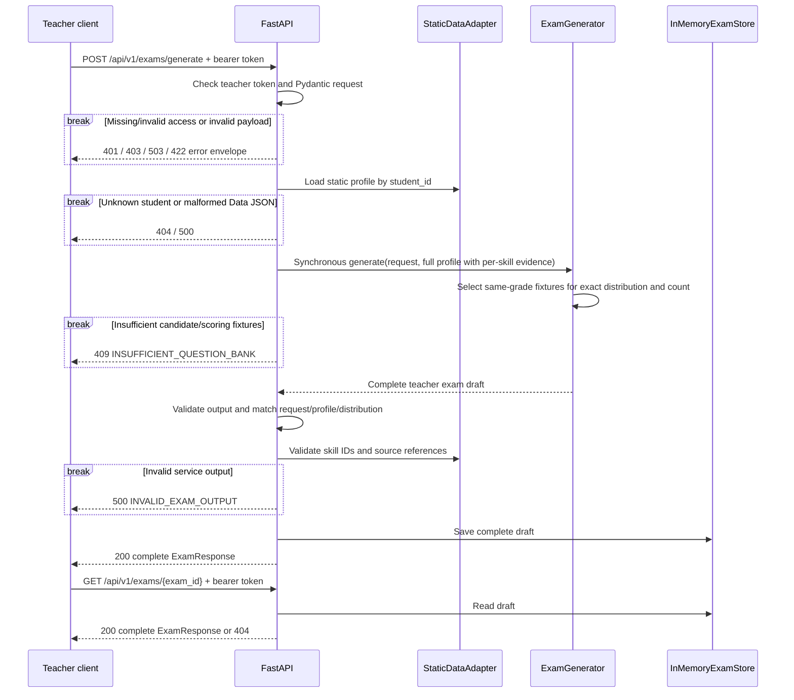

# N04 — Kiến trúc hệ thống và API Contract MVP1

* **Mã tài liệu:** N04 (System Architecture & API Contract — MVP1)
* **Owner:** Doan Khanh Nhu (Architecture Lead)
* **Reviewer:** Trần Lộc Chi Mai (UI Lead), Nguyễn Ngọc Ánh Dương (Data Lead)
* **Ngày cập nhật:** 27/10/2026

**Trạng thái 27/10/2026:** Backend mặc định là M3 + rule-based Planner + local
Qwen, với SQLite store riêng cho exam drafts. Fake API được giữ cho test/demo.
Planner hiện dùng evidence theo từng skill, ngưỡng tối thiểu 3 và mastery target
3.0/4 theo [ADR-003](../decisions/ADR-003-rule-based-planner-mvp.md).
Pipeline đã tách Planner/Selector, Expression, Validation, Orchestration và
Assembler; có API duyệt đề, tạo lại câu và quản lý revision theo
[ADR-004](../decisions/ADR-004-modular-generation-and-review.md).
UI giáo viên cơ bản đã có tại `/`: chọn hồ sơ, xem kế hoạch, tạo/xem đề và tải
JSON. Giao diện duyệt đề, giao diện học sinh, AI grading, xác minh điểm và cập
nhật mastery sau chấm bài vẫn là phần đề xuất. Generation giữ thiết kế synchronous.

**Phạm vi tài liệu:** Mục 1–2 trình bày kiến trúc tổng quan dành cho proposal,
dựa trên source hiện tại. Mục 3–7 giữ lại tài liệu Fake API baseline để tham chiếu;
các mô tả JSON-only, in-memory storage và real integration chưa triển khai trong
baseline không đại diện cho backend mặc định hiện tại. Contract thực thi được
xác định bởi `src/api/main.py`, `src/api/schemas.py` và ADR-003. Qwen cần Ollama
đang chạy; integration code không đồng nghĩa với chất lượng model đã được xác nhận.

Student contract được cập nhật theo `data/notes/Format_dictionary.md` và xác nhận
của người dùng về format Ánh Dương đã chốt: evidence thuộc từng skill. API giữ
nguyên `name`, trả `learning_history.wrong_questions`, không thêm evidence chung,
`data_status` hoặc `recommended_blueprint_mode`. Chính sách sử dụng evidence để
lập đề thuộc service thuật toán, do Algorithm Lead thống nhất với Data Lead.

Nguồn kiến trúc hiện tại: `src/api/`, `src/adaptation/`, `src/ai/qwen_client.py`
và hai SQLite sample databases. Wireframes và các ghi chú MVP trước đây là tài
liệu thiết kế tham khảo; không dùng chúng để khẳng định chức năng đã triển khai.

## 1. High-Level System Architecture

*Figure 3.1. High-Level Architecture of the AI-Powered Personalized Mathematics Assessment System.*

The diagram presents the proposed system for Section 3.1 of the project proposal.
Blue indicates **Implemented**, yellow **Partially Implemented**, and grey
**Planned**. Solid connections represent implemented communication; dashed
connections represent proposed integration, including the future feedback loop.
Arrows show logical communication and data dependencies, not a strict execution
sequence or separate deployments. Status refers to repository implementation,
not production readiness or verified model accuracy.

```mermaid
flowchart LR
    subgraph CLIENT["Client / Presentation Layer"]
        USERS["Students & Teachers"]
        UI["Web Interface<br/>Profiles · Exams · Submissions"]
        USERS <-.-> UI
    end

    subgraph APP["Backend / Application Layer"]
        API["FastAPI Backend<br/>Request Validation & Routing"]
        PROFILE["Student Learning Profiles"]
        EXAM["Intelligent Exam Generation<br/>Orchestration & Output Checks"]
        REVIEW["Exam Review & Release"]
        ASSESS["Submission & AI Grading<br/>Teacher Grade Verification"]

        API -->|"Profile queries"| PROFILE
        API -->|"Exam requirements"| EXAM
        API -.->|"Teacher exam decisions"| REVIEW
        API -.->|"Student solutions / teacher grade decisions"| ASSESS
        EXAM -.->|"Validated draft"| REVIEW
        REVIEW -.->|"Approved assessment"| ASSESS
    end

    subgraph AI["AI & Processing Layer"]
        RULES["Assessment Planner<br/>Rule-Based · Adaptive / Standard"]
        MODEL["Local Qwen Model"]
    end

    subgraph DATA["Data / Persistence Layer"]
        ACCESS["Data Access"]
        DB[("SQLite Storage<br/>Profiles · Questions · Exam Drafts")]
        ACCESS <-->|"Read sources / store drafts"| DB
    end

    UI <-->|"HTTP JSON requests / results / errors"| API

    PROFILE -->|"Mastery & evidence"| RULES
    EXAM <-->|"Constraints / question selection"| RULES
    EXAM <-->|"Question wording"| MODEL
    ASSESS <-.->|"Solutions & preliminary grades"| MODEL

    PROFILE <-->|"Learning data"| ACCESS
    EXAM <-->|"Source questions & exam drafts"| ACCESS

    ASSESS -.->|"Teacher-verified results"| PROFILE
    PROFILE -.->|"Update mastery & learning history"| ACCESS

    classDef implemented fill:#EAF3FA,stroke:#24577A,color:#102A43;
    classDef partial fill:#FFF4D6,stroke:#946C00,color:#513C00;
    classDef planned fill:#F4F4F4,stroke:#666666,stroke-dasharray:5 4,color:#333333;

    class API,EXAM,RULES,MODEL,DB implemented;
    class PROFILE,ACCESS,REVIEW,UI partial;
    class ASSESS planned;
```



The layers are logical responsibility boundaries. The profile-to-planner arrow
represents the trusted profile passed through generation orchestration, not an
additional service call. Python application modules belong to the modular
monolith; Ollama provides the separate local inference
runtime. The storage block groups existing SQLite databases rather than proposing
a single merged database. Current data access reads source profiles/questions
and persists generated drafts. Assessment records and profile writes remain
planned; their operational schema and ownership require confirmation.

## 2. Architecture Explanation and Status

The system follows a client–server architecture with a modular monolithic backend.
The proposed web interface supports profile viewing, exam configuration, student
submissions, and teacher review. FastAPI validates and routes requests to the
application modules. Exam generation coordinates a rule-based planner, local
Qwen inference, and output checks. The planner uses student mastery and evidence
for adaptive practice, or teacher-defined requirements for standard assessments.
Qwen rewrites selected question wording while source answers remain unchanged.
Generation returns a complete draft synchronously. Teacher approval and question
regeneration are implemented with revision checks; student release remains planned.

The proposed assessment workflow receives student solutions, produces preliminary
AI-assisted grades, and lets teachers confirm or revise them. Only verified
results contribute to mastery and learning-history updates. These updated
profiles inform subsequent planning, completing the adaptive learning loop.
The persistence layer reads existing SQLite profiles and question sources and
stores generated exam drafts. Operational storage for submissions, verified
grades, and profile updates remains planned.

The two workflows are distinct:

1. **Exam preparation:** request → planning → Qwen wording → output checks →
   synchronous draft response → teacher review → planned student release.
2. **Learning assessment (planned):** student submission → preliminary grading →
   teacher grade verification → profile update → subsequent exam planning.

Output checks cover structure, numeric preservation, source references, and exam
constraints; they do not prove mathematical or semantic correctness. Invalid
model output has bounded retries, and model failures return explicit API errors
without saving a partial draft. Automatic fallback to stored questions is not
implemented or assumed by this proposal. Teacher exam review and teacher grade
verification are separate decisions; approval of an exam does not verify a
student's grade.

| Component | Responsibility | Current Status |
|---|---|---|
| Web Interface | Teacher profile/plan/generation preview implemented; student and review interfaces planned | Partially Implemented |
| FastAPI Backend | Request validation, routing and error responses | Implemented |
| Student Learning Profiles | Profile retrieval; progress analysis and assessment feedback | Partially Implemented |
| Intelligent Exam Generation | Synchronous orchestration, output checks and draft assembly | Implemented |
| Assessment Planner | Rule-based skill targeting and adaptive/standard assessment constraints | Implemented |
| Local Qwen Model Integration | Question wording; grading integration remains planned | Implemented |
| Exam Review & Release | Teacher approval and regeneration implemented; student delivery planned | Partially Implemented |
| Submission & AI Grading / Teacher Grade Verification | Receive solutions, propose grades and record teacher-confirmed results | Planned |
| Data Access | Source reads and draft persistence; assessment/profile writes planned | Partially Implemented |
| SQLite Storage | Existing profiles, questions and exam drafts | Implemented |

Implementation evidence:

- [API server](../../src/api/main.py) and [schemas](../../src/api/schemas.py):
  profile access, synchronous generation, draft retrieval and teacher-only routes.
- [Planner](../../src/adaptation/planner.py), [generation orchestration](../../src/api/real_generator.py)
  and [Qwen client](../../src/ai/qwen_client.py): deterministic selection and local model integration.
- [M3 adapter](../../src/api/m3_adapter.py), [JSON adapter](../../src/api/data_adapter.py)
  and [exam store](../../src/api/exam_store.py): existing data-access and persistence boundaries.
- [Exam service](../../src/orchestration/exam_service.py),
  [question generation](../../src/orchestration/question_generation.py) and
  [review service](../../src/orchestration/review_service.py): modular pipeline,
  a single retry budget, explicit teacher approval and revision validation.
- [Teacher UI](../../src/ui/static/index.html), [UI logic](../../src/ui/static/app.js)
  and [local launcher](../../src/ui/__main__.py): buildless same-origin interface
  for profile selection, plan preview and synchronous exam generation.
- `src/assessment/` and `src/competency/`: empty package placeholders;
  grading and persistent mastery updates are not implemented.

Team confirmation is required for the frontend technology and user roles,
submission and grading contracts, the mastery-update policy, and operational
storage for verified assessment results. Student participation and AI grading
extend the earlier [MVP scope](N01_problem_usecases.md). The proposal must retain
the synchronous generation contract even though older wireframes describe jobs.
Fake fixture generation remains a test/demo alternative, not the proposed system
architecture.

## 3. Sequence Diagram — Fake API Baseline

Sections 3–7 retain the earlier Fake API baseline for reference. Their source,
storage and integration assumptions apply to that baseline only; use Sections
1–2 and the current source/ADR-003 for the real backend architecture.



Không có `job_id`, background task, queue, polling hoặc `202 Accepted`.
API chuyển nguyên hồ sơ kỹ năng và lịch sử cho service, giữ mode client yêu cầu.
Fake nhận cả hai mode mà không đánh giá evidence eligibility; điều này không chứng
minh đề đã cá nhân hóa. Real service chịu trách nhiệm chính sách evidence theo từng
skill và có thể trả typed `ApiFailure` nếu không đáp ứng được yêu cầu.
Model retry/deadline và operational fallback thuộc real service khi có inference.

## 4. API Contract — Fake API Baseline

### 4.1. Access và shared schemas

Tất cả routes dưới `/api/v1` yêu cầu:

```http
Authorization: Bearer <FAKE_API_TEACHER_TOKEN>
```

Đây là compatibility/security bổ sung để bảo vệ teacher answers khi repository
chưa có authentication. Không có hardcoded default secret. Không cấu hình token
trả 503; thiếu credentials trả 401; token sai trả 403. Không phát teacher token cho
student clients. Swagger `/docs` và `/openapi.json` chỉ công khai schema, không có
student records/answer values. Responses đặt `Cache-Control: no-store`.

Model source of truth: `src/api/schemas.py`; machine-readable schema ở `/openapi.json`.

| Schema | Required fields |
|---|---|
| `StudentSummary` | `student_id`, `name`, `grade_level` (strict positive integer) |
| `StudentProfileResponse` | StudentSummary + `skill_mastery[]`, `learning_history[]` |
| `SkillMastery` | `skill_id`, `mastery_score` (0–4), per-skill `evidence_count` |
| `LearningHistoryItem` | `test_id`, `wrong_questions[]` |
| `GenerateExamRequest` | `student_id`, `generation_mode`, `selected_topic_ids`, `total_questions`, `duration_minutes`, `difficulty_distribution`; optional `advanced_options` |
| `ExamResponse` | `exam_id`, `student_id`, `grade_level`, `topic_id`, `title`, `generation_mode`, `total_questions`, `duration_minutes`, `total_score`, `status`, `provenance`, complete `questions[]` |
| `ExamQuestion` | `question_id`, `source_ref`, `order_index`, `topic_tag`, `skill_ids`, `cognitive_level`, `generate_type`, `content_latex`, `answer`, `max_score`, `step_solutions`, `rubric`, `validation` |
| `StudentExamResponse` | Explicit safe allowlist; không có answers/solutions/rubric/source/validation/profile identity. Chưa có student endpoint. |

Request rules: unknown fields bị reject; strict integers cho counts/duration;
question count 1–10; duration 1–180; topic array đúng một `combinatorics`;
modes `adaptive/default_blueprint`; bốn percentages 0–100 có tổng 100.
`advanced_options` mặc định real-world context = true, granularity = 0.25;
fake chỉ hỗ trợ các giá trị này, lựa chọn khác nhận 422 thay vì bị ignore.
OpenAPI biểu diễn hai giới hạn bằng `const: true` và `const: 0.25`; integer `1`
không được chấp nhận thay JSON boolean `true`.

### 4.2. Endpoint inventory

| Method / path | Purpose và UI justification | Request | Response | Status codes |
|---|---|---|---|---|
| GET `/api/v1/students` | Chọn static profile; N01 journey/UC01 | Không body/query | `StudentListResponse`: `{items: StudentSummary[]}` | 200; auth 401/403/503; source 500 |
| GET `/api/v1/students/{student_id}/profile` | Profile screen; wireframe §1.3 | Path student ID | `StudentProfileResponse` | 200; 404 unknown; auth 401/403/503; source 500 |
| GET `/api/v1/topics` | Topic/skill selector; wireframe §2.2 | Không body/query | `TopicListResponse`: `{items:[{topic_id,topic_name,grade_level,skills:[{skill_id,name}]}]}` | 200; auth 401/403/503; source 500 |
| POST `/api/v1/exams/generate` | Mandatory synchronous generation; wireframe §2.2 | `GenerateExamRequest` | Complete `ExamResponse`, không job wrapper | 200; 422 invalid request; 404 student; 409 insufficient bank; auth 401/403/503; source/output 500 |
| GET `/api/v1/exams/{exam_id}` | Reopen Preview; wireframe §3.2 | Path exam ID | Cùng complete `ExamResponse` | 200; 404 unknown/restarted draft; auth 401/403/503 |

Sources/dependencies: profile routes đọc `student_profiles.json` qua
`StaticDataAdapter`; topics đọc existing `question_bank.db::skills`; POST đọc
`questions.json` qua fake service; GET exam dùng `InMemoryExamStore`. Không đọc/
ghi student SQLite history trong API này. GET exam là retrieval, không polling.
Question JSON chỉ được load khi generation/fixture-reference validation cần dùng;
file này thiếu hoặc sai không làm hỏng Profile/Topics endpoints. Topics cũng không
phụ thuộc profile JSON. Returned references được đối chiếu với demo question IDs
và existing `questions`, `question_skills`, `question_templates` qua read-only SQL.

Profile chấp nhận khối lớp là số nguyên dương, gồm lớp 11 trong ví dụ Data.
Topic catalogue và question fixtures hiện chỉ có lớp 10. Fake chỉ chọn câu cùng
lớp; profile lớp khác vẫn đọc được, nhưng sinh đề thiếu câu nhận 409.

### 4.3. JSON examples

GET students response (một phần tử minh họa; actual fixture có 4 profiles):

```json
{"items":[{"student_id":"DEMO_NEW_001","name":"Học sinh mới — demo","grade_level":10}]}
```

GET profile response:

```json
{
  "student_id": "DEMO_NEW_001",
  "name": "Học sinh mới — demo",
  "grade_level": 10,
  "skill_mastery": [],
  "learning_history": []
}
```

Hồ sơ có dữ liệu trả nguyên các mảng theo format Data, ví dụ:

```json
{
  "student_id": "DEMO_PARTIAL_001",
  "name": "Hồ sơ một evidence — demo",
  "grade_level": 10,
  "skill_mastery": [
    {"skill_id": "A001", "mastery_score": 1.5, "evidence_count": 1}
  ],
  "learning_history": [
    {"test_id": "DEMO_T01", "wrong_questions": ["DEMO_Q01"]}
  ]
}
```

GET topics response có canonical skills A001…A007 (ví dụ rút gọn một skill):

```json
{"items":[{"topic_id":"combinatorics","topic_name":"Đại số tổ hợp","grade_level":10,"skills":[{"skill_id":"A001","name":"Quy tắc cộng"}]}]}
```

POST request cho một câu; default UI distribution có thể dùng 20/40/30/10:

```json
{
  "student_id": "DEMO_NEW_001",
  "generation_mode": "default_blueprint",
  "selected_topic_ids": ["combinatorics"],
  "total_questions": 1,
  "duration_minutes": 15,
  "difficulty_distribution": {
    "recognition": 100,
    "understanding": 0,
    "application": 0,
    "advanced_application": 0
  }
}
```

Complete response example; generated IDs là minh họa, actual IDs có UUID suffix.
GET exam trả cùng schema và cùng draft đã lưu:

```json
{
  "exam_id": "FE_example",
  "student_id": "DEMO_NEW_001",
  "grade_level": 10,
  "topic_id": "combinatorics",
  "title": "Đề ôn tập Đại số tổ hợp — Fake MVP1",
  "generation_mode": "default_blueprint",
  "total_questions": 1,
  "duration_minutes": 15,
  "total_score": 10.0,
  "status": "pending_teacher_review",
  "provenance": {"generator": "fake", "model": null},
  "questions": [{
    "question_id": "FQ_example",
    "source_ref": {"kind": "question", "id": "DEMO_Q01"},
    "order_index": 1,
    "topic_tag": "combinatorics",
    "skill_ids": ["A001"],
    "cognitive_level": "recognition",
    "generate_type": "direct",
    "content_latex": "Có 3 bút đỏ và 5 bút xanh, tất cả các bút phân biệt. Có bao nhiêu cách chọn một bút?",
    "answer": {"correct_answer": "8", "explanation": "Chọn bút thuộc một trong hai nhóm không giao nhau: 3 + 5 = 8 cách."},
    "max_score": 10.0,
    "step_solutions": [
      {"step_number": 1, "explanation": "Nhận ra hai nhóm bút không giao nhau.", "score": 5.0},
      {"step_number": 2, "explanation": "Áp dụng quy tắc cộng: 3 + 5 = 8.", "score": 5.0}
    ],
    "rubric": [
      {"criteria": "Nhận diện quy tắc cộng.", "sub_score": 5.0},
      {"criteria": "Tính đúng và kết luận 8 cách.", "sub_score": 5.0}
    ],
    "validation": {
      "auto_status": "not_evaluated",
      "teacher_approved": false,
      "review_notes": ["Synthetic fake fixture; không gọi Qwen hoặc thực hiện semantic validation."]
    }
  }]
}
```

### 4.4. Errors và invariants

```json
{"error":{"code":"STUDENT_NOT_FOUND","message":"Không tìm thấy học sinh.","details":[]}}
```

Implemented codes: `TEACHER_ACCESS_NOT_CONFIGURED` (503),
`TEACHER_AUTH_REQUIRED` (401), `TEACHER_ACCESS_DENIED` (403),
`REQUEST_VALIDATION_ERROR` (422), `STUDENT_NOT_FOUND` / `EXAM_NOT_FOUND` (404),
`INSUFFICIENT_QUESTION_BANK` (409),
`INVALID_PROFILE_DATA` / `DATA_SOURCE_ERROR` / `INVALID_EXAM_OUTPUT` /
`INTERNAL_ERROR` (500). Validation details chỉ chứa field/reason, không echo input.

Real replacement service có thể raise `ApiFailure` với typed codes, ví dụ 409 cho
chính sách Planner hoặc 502/503/504 cho provider. API giữ nguyên lỗi service;
fake không giả lập Qwen availability, timeout, busy hoặc retries.

Output invariants: exact question count; consecutive order; distinct generated và
source IDs; requested mode consistency; total question points = exam score; mỗi
solution/rubric total = question max; 0.25 increments. Route kiểm tra output khớp
student/profile, duration, requested mode/count/topic và exact rounded distribution
trước khi lưu. Response từ fake không được claim model invocation hoặc semantic pass.
Generator chỉ nhận deep copies của request/profile; output được so với originals
đã validate, không so với working copies có thể bị service sửa. Unknown skill/source
IDs, sai source kind, duplicate skill IDs hoặc skill không thuộc source question
bị reject bằng `500 INVALID_EXAM_OUTPUT`, không lưu draft.
Canonical templates chưa có skill links nên chỉ kiểm tra template ID và global
skill membership; không tự tạo template-skill mapping hoặc coi source đã được approve.
Unexpected exceptions được chuyển thành error envelope bên trong CORS boundary,
để allowed origins đọc được cả HTTP 500; origins ngoài allowlist không nhận CORS header.

## 5. Data Mapping — Fake API Baseline

Chi tiết fixture provenance và handoff: `data/sample/api_demo/README.md`.

| Raw / source | Public mapping | Lưu ý |
|---|---|---|
| JSON `name` | `name` | Giữ đúng tên trường đã chốt, không expose birthday |
| `grade_level` | `grade_level` | Strict positive integer; fake fixtures hiện chỉ có lớp 10 |
| `skill_mastery` | Giữ scores 0–4 và per-skill count | Không normalize/recalculate mastery |
| `learning_history` | Giữ nguyên `test_id`, `wrong_questions` trong profile response | Không suy evidence từ số bài hoặc số câu sai |
| Existing `skills` table | Topic/skill catalogue | Read-only; topic text map sang `combinatorics` |
| Demo `content` | `content_latex` | Không tự thêm LaTeX hoặc đổi nghĩa |
| Demo `question_id` | `source_ref.id` | Generated instance có ID khác |
| Demo solution/rubric text | Typed scored steps/rubric | Demo metadata mới, không phải canonical SQL columns |

Legacy Data getter còn dùng `wrongs`; API JSON dùng `wrong_questions` theo format
đã chốt. Khi nối trực tiếp getter cần chuẩn hóa trường này trong adapter.
SQLite `answers` có cột `explaination`;
real adapter sau này cần normalize sang `explanation`. Numeric difficulty không
được tự map sang cognitive labels. Synthetic JSON có annotations riêng để fake
contract chạy được; không copy/alter Data DB hoặc coi annotations đã được review.

## 6. Architecture Decisions — Fake API Baseline

1. **FastAPI modular monolith:** một API app, supporting modules nhỏ; không thêm microservices.
2. **Static profiles:** backend chỉ đọc JSON, không grading/mastery/history update.
3. **Synchronous generation:** complete JSON trong một request, không jobs/queues/polling.
4. **Pydantic boundaries:** strict request, loaded fixtures, final output và safe projection.
5. **Evidence theo skill:** API truyền nguyên `skill_mastery[].evidence_count` và history cho service, không tự đặt ngưỡng adaptive hoặc tính evidence chung. Algorithm Lead chốt chính sách Planner và cập nhật hồ sơ sau chấm bài.
6. **Rule/Qwen separation:** fake không gọi AI; real planner/math/expression/semantic rules không bị thay bằng thuật toán mới ở fake.
7. **Teacher review:** fake draft luôn pending review, `teacher_approved=false`, `auto_status=not_evaluated`.
8. **Answer isolation:** tất cả business routes yêu cầu teacher token; safe student DTO không kế thừa answer fields. Chưa có student HTTP delivery cho đến khi có ownership/authentication.
9. **Draft store:** in-memory, một worker, không TTL/durability; mất khi restart.
10. **Failure rõ ràng:** thiếu source cùng lớp trả 409; profile sai format trả 500; không silent fallback.

## 7. Remaining Integration Tasks — Fake API Baseline

- Student format đã được người dùng xác nhận theo Ánh Dương: evidence thuộc từng
  skill, không có count chung của student. Data bàn giao canonical JSON theo format
  này; demo hiện vẫn là synthetic fixtures. Algorithm/Data Lead chốt định nghĩa một
  evidence và cách Planner dùng evidence từng skill; đồng bộ các ngưỡng trong tài
  liệu thuật toán/ADR khi quy tắc được chốt.
- Data/AI cung cấp curated math specs, canonical cognitive annotations, skill mapping
  và reviewed scoring. Existing bank có 111 draft questions và 27 câu thiếu skill links.
- UI dùng `name`, `grade_level`, evidence từng skill và `learning_history`, attach teacher authorization, consume POST
  response trực tiếp; configure explicit origin bằng `FAKE_API_CORS_ORIGINS` khi cần.
- Thay fake qua `ExamGenerator` DI; implement real N03 skill-priority/expression,
  deterministic math, Qwen adapter, validators, bounded retry/deadline và review.
- Teacher token chỉ là local demo access gate; cần identity/roles/ownership trước
  student delivery hoặc multi-teacher deployment.
- Giữ lại các proposal về approved source eligibility, cognitive mapping
  và real performance budgets như integration work, không coi fake đã
  chứng minh correctness/personalization/performance.
- Hoãn regenerate/edit persistence/export/publish như scope first slice đã review.

Run/test commands: `README.md`. Automated coverage: `tests/integration/test_fake_api.py`.
