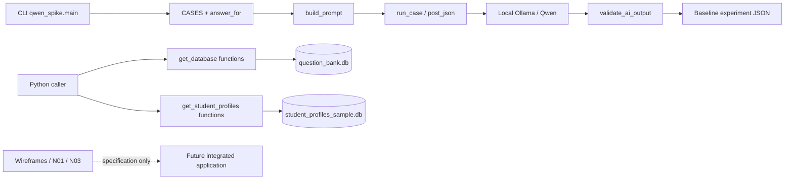
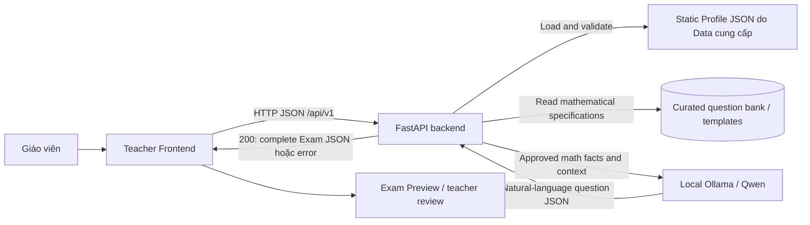

# Architecture Review & Implementation Plan — AI Personalized Math Exam Generator

**Ngày review:** 22/10/2026, Asia/Bangkok.  
**Snapshot:** branch `main`, commit `543a25231221933cd3ede3540f1a1c480ece09cc`.  
**Trạng thái:** Draft để Architecture Lead review; chưa triển khai kế hoạch.  
**Phạm vi thay đổi của lần làm việc này:** chỉ tạo báo cáo Markdown này theo yêu cầu cuối của người dùng. Không sửa source code, database, dependencies hoặc tài liệu có sẵn.

## Cách đọc và phạm vi bằng chứng

- **[CONFIRMED]:** xác nhận trực tiếp từ file, source code hoặc truy vấn SQLite read-only trong checkout hiện tại.
- **[DOCUMENTED]:** có trong tài liệu/pseudocode; chưa đồng nghĩa với runtime đã triển khai.
- **[PROPOSED]:** kiến trúc, contract hoặc implementation plan đề xuất để review.
- **[OPEN]:** chưa đủ bằng chứng hoặc cần nhóm thống nhất; không tự giả định thành quyết định chính thức.

Đường dẫn trong báo cáo tính từ repository root `adaptive-learning/`. Tham chiếu `path:line — symbol` chỉ vị trí tại snapshot trên; SQLite được tham chiếu bằng file, table, column và record ID vì không có line number. Các tên class/function trong phần kế hoạch là **tên dự kiến**, trừ khi ghi rõ đang tồn tại.

Đã đọc các source Python, documentation, JSON, workflow và nội dung text của một trang PDF schema; đã truy vấn schema và sample records của cả hai SQLite file, đồng thời chạy các hàm đọc dữ liệu với connection bị ép sang read-only. Không chạy inference, không gọi API ngoài, không cài package, không checkout/merge/fetch Git. Các remote-tracking refs chỉ được xem metadata/tree sẵn có; không khẳng định trạng thái GitHub mới nhất. Kết luận implementation áp dụng cho checkout `main`, không suy ra mọi commit trên mọi branch đều đã được tích hợp.

**Kết luận chính:** repository hiện là **skeleton + Data access utilities + local Qwen feasibility spike + design documents**. Chưa có một ứng dụng Frontend–FastAPI–AI tích hợp chạy được. Công việc Architecture Lead cần bắt đầu bằng thống nhất contract và policy, sau đó cung cấp Pydantic schemas cùng synchronous fake backend để các module tích hợp.

## A. Repository structure overview

### A1. Cấu trúc thực tế

```text
adaptive-learning/
├── .env.example                     # Biến cấu hình mẫu; chưa có settings loader
├── .gitignore
├── .github/
│   ├── workflows/ci.yml             # Python 3.11, install pytest, smoke test
│   ├── ISSUE_TEMPLATE/{bug,feature}.md
│   └── pull_request_template.md
├── README.md                        # Chỉ có tên repository
├── CONTRIBUTING.md                  # Rỗng
├── requirements.txt                 # Rỗng
├── src/
│   ├── ai/qwen_spike.py             # Runtime AI duy nhất trong src/
│   ├── api/__init__.py              # Rỗng
│   ├── ui/__init__.py               # Rỗng
│   ├── orchestration/__init__.py    # Rỗng
│   ├── adaptation/__init__.py       # Rỗng
│   ├── assessment/__init__.py       # Rỗng
│   ├── competency/__init__.py       # Rỗng
│   ├── exercise/__init__.py         # Rỗng
│   └── knowledge/__init__.py        # Rỗng
├── data/
│   ├── data_inventory.md            # Một source URL
│   ├── raw/.gitkeep
│   ├── processed/.gitkeep
│   ├── notes/
│   │   ├── N02_knowledge_data.md
│   │   ├── Format_dictionary.md
│   │   ├── Issue.md
│   │   └── DataLogicalSchema.pdf
│   └── sample/
│       ├── dataset/{get_database.py,question_bank.db}
│       └── memory/{get_student_profiles.py,student_profiles_sample.db,USAGE.md}
├── docs/
│   ├── notes/
│   │   ├── N01_problem_usecases.md
│   │   ├── N02_knowledge_data.md     # Rỗng; bản có nội dung nằm trong data/notes/
│   │   ├── N03_algorithm_ai.md
│   │   ├── N04_architecture_api.md  # Rỗng; chưa có architecture/API document
│   │   └── N05_eval_risks.md
│   ├── design/wireframes.md
│   ├── decisions/ADR-001-thresholds-fallback.md
│   ├── risks/failure_catalogue.md
│   ├── logbook/weekly_log.md        # Rỗng
│   └── report/                     # Báo cáo review này
├── eval/
│   ├── benchmarks/test_situations_v1.json
│   ├── results/{baseline_spike_output.json,README.md}
│   └── metrics/.gitkeep
└── tests/
    ├── unit/test_smoke.py
    └── {integration,e2e,safety}/.gitkeep
```

**[CONFIRMED]** Các package `src/` còn lại chỉ chứa `__init__.py` rỗng; chưa có router, service, component hoặc model ẩn trong các package này. Không có `package.json`, frontend assets, `pyproject.toml`, OpenAPI artifact, Dockerfile hoặc database migration trong working tree. Hai SQLite file **được Git track**, dù `rg --files` mặc định không liệt kê do `.gitignore:230–231` khớp `*.sqlite3`/`*.db`; ignore rule không làm mất các file đã track.

### A2. Technology stack và dependencies

| Layer | Bằng chứng | Tình trạng |
|---|---|---|
| Python | `.github/workflows/ci.yml:18`, `src/ai/qwen_spike.py`, Data utilities | CI chọn Python 3.11; baseline artifact ghi Python 3.14.4; interpreter review là 3.14.6. Chưa có môi trường runtime được khóa thống nhất. |
| FastAPI / Uvicorn | `src/api/__init__.py`, `requirements.txt` đều rỗng | Yêu cầu kiến trúc của người dùng; **chưa được khai báo hoặc triển khai**. |
| Pydantic | Không có `BaseModel`, import Pydantic hoặc schema module trong source | Bắt buộc cho contract tương lai; chưa có hiện tại. |
| SQLite | `get_database.py:8 — DB_PATH`, `get_student_profiles.py:5 — DB_PATH` | Hai database độc lập; dùng Python `sqlite3`, không có ORM. |
| Qwen + Ollama | `qwen_spike.py:217 — run_case()`, `:254 — main()` | Qwen `qwen3:1.7b`, local Ollama REST, blocking `urllib.request`; không dùng inference SDK. |
| Resource monitoring | `qwen_spike.py:105 — gpu_inventory()`, `:137 — ResourceMonitor` | `psutil` optional; `nvidia-smi` optional executable; không phải dependency của math logic. |
| Frontend | `docs/design/wireframes.md`, `src/ui/__init__.py` | Chỉ có ASCII wireframes và contract tables; chưa xác định React/Vue/Streamlit hay stack khác. |
| Testing / CI | `.github/workflows/ci.yml:24`, `tests/unit/test_smoke.py:4` | Workflow cài `pytest` riêng; chỉ một test kiểm tra tồn tại thư mục. |
| Configuration | `.env.example:1–10` | Có `PORT`, `ENVIRONMENT`, `OPENAI_API_KEY`, `LOCAL_MODEL_ENDPOINT`, `DATABASE_URL`; chưa có code load chúng. |

`requirements.txt` rỗng nên chưa có manifest tái lập dependencies. `qwen_spike.py:258` nhận `--base-url`, không đọc `LOCAL_MODEL_ENDPOINT`; Data code dùng hai đường dẫn cố định, không đọc `DATABASE_URL`. `OPENAI_API_KEY` là placeholder không có consumer trong source, không phải bằng chứng hệ thống đang gọi cloud API.

### A3. Inventory tài liệu và dữ liệu đáng chú ý

| File | Vai trò và giới hạn |
|---|---|
| `docs/notes/N01_problem_usecases.md:17,39,83` | Teacher journey, MVP scope và UC01–UC11; một số UC rộng hơn scope tĩnh đã nêu trong cùng tài liệu. |
| `docs/design/wireframes.md:8,69,121` | Ba màn hình Profile, Configuration, Preview; là UI specification, chưa phải UI implementation. |
| `docs/notes/N03_algorithm_ai.md:79,216` | Profile branching pseudocode và kiến trúc generation dự kiến; tài liệu tự ghi rõ chưa triển khai runtime. |
| `data/notes/N02_knowledge_data.md:30,82,177,299` | Data dictionary, mastery/evidence proposal; có các đoạn mâu thuẫn về MVP và trạng thái implementation. |
| `data/notes/Format_dictionary.md:3,52,77` | Dictionary examples cho Question, Answer, Skill, Student, test records; không phải JSON fixture hợp lệ. |
| `data/notes/DataLogicalSchema.pdf`, trang 1 | Logical diagram cho questions, answers, parts, skills, students, tests, mastery; thiếu một số table thực có và lệch tên cột/table. |
| `data/notes/Issue.md:2–6` | Data Lead liệt kê difficulty, mastery formula, math normalization và AI I/O là các vấn đề chưa chốt. |
| `data/data_inventory.md:1–2` | Chỉ có source URL; chưa có provenance theo record, trạng thái review hoặc extraction pipeline. |
| `docs/decisions/ADR-001-thresholds-fallback.md:15,30` | ADR ghi accepted nhưng còn threshold `>=2` và fallback rộng, xung đột với yêu cầu hiện tại. |
| `docs/notes/N05_eval_risks.md:13` | Quality rubric 100 điểm, không phải per-question scoring rubric để chấm bài học sinh. |
| `docs/risks/failure_catalogue.md:17–22` | Risk register; còn assumptions cũ như queues, RAG, difficulty 1–6, CoT và self-correction. |
| `eval/benchmarks/test_situations_v1.json` | Sáu manual scenarios TS-A1…TS-F1, tất cả `actual_result="Not Run"`; không phải automated tests. |
| `eval/results/baseline_spike_output.json` | Hai output Qwen được lưu kèm hardware/latency; không phải complete-exam fixture. |
| `eval/results/README.md:1–2` | Yêu cầu dùng kết quả thực nghiệm thật, không bịa timing/RAM/VRAM. |
| `.github/pull_request_template.md:20–30` | PR cần khai báo AI use, verification và đồng bộ các artifact chạm critical path. |

## B. Existing architecture explained

### B1. Runtime thực sự tồn tại

**[CONFIRMED]** Hiện có ba nhánh độc lập, chưa nối thành application:



Các cạnh solid trên phản ánh source: `qwen_spike.py:27 — CASES`, `:49 — answer_for()`, `:60 — build_prompt()`, `:217 — run_case()`, `:254 — main()`; `get_database.py:12–252`; `get_student_profiles.py:11–190`. Không có code gọi Data utilities từ Qwen spike, không có HTTP API inbound, không có UI caller hiện thực.

Qwen spike sử dụng hai case hardcoded, tính đáp án bằng `math.comb`/`math.perm`, yêu cầu model viết lại câu hỏi và copy metadata/answer. Output được kiểm tra kiểu và giá trị; trạng thái tốt nhất là `needs_teacher_review`. Đây là feasibility experiment cho **một câu mỗi call**, không phải Exam Generator service.

### B2. Kiến trúc được tài liệu hướng tới

**[DOCUMENTED]** `N03_algorithm_ai.md:13–23,224–234` phân vai khá phù hợp với yêu cầu:

1. Backend/rule planner đọc profile và quyết định blueprint.
2. Dataset cung cấp mathematical facts và verified answers.
3. Content & Expression Planner quyết định context cùng `direct`/`indirect`.
4. Qwen chỉ verbalize natural-language question.
5. Validator sàng lọc candidate; Exam Assembler ghép full draft.
6. Giáo viên review trước khi sử dụng đề.

**[CONFIRMED]** Các bước planner, context planner, layered validator, assembler và teacher-review workflow trên mới là pseudocode/design: package tương ứng rỗng. Không được diễn giải `select_exam_blueprint()` hay `qwen_generate_question()` trong N03 thành function đã import và chạy được.

### B3. Context Diagram đề xuất cho MVP

**[PROPOSED]** Một backend FastAPI là application boundary; Qwen/Ollama là local external inference service. Data JSON và question bank là sources được backend đọc, không phải các HTTP microservice đang tồn tại.



Backend giữ request mở tới khi hoàn thành hoặc trả lỗi trong deadline. `POST /api/v1/exams/generate` phải trả toàn bộ exam; không có `job_id`, queue, polling hoặc status-job API. HTTP synchronous lifecycle này khác với lựa chọn kỹ thuật `def`/`async def`: dùng `async def` không tự biến request thành background job; nếu giữ blocking `urllib`, không chạy trực tiếp nó trên event loop. Đây là quyết định implementation cần chốt ở giai đoạn tích hợp AI.

## C. Data flow across modules

### C1. Student Profile → Configuration → Generation → Preview

| Bước | Input / xử lý mong muốn | Output / consumer | Tình trạng và nguồn |
|---|---|---|---|
| 1. Nạp hồ sơ | Static JSON do Data cung cấp; Pydantic validate ở boundary | `StudentProfile` cho UI và planner | [DOCUMENTED] `N03:83–85`; [CONFIRMED] hiện chỉ có SQLite reader `get_student_by_id()`, chưa có standalone Profile JSON. |
| 2. Hiển thị Profile | `grade_level`, `evidence_count`, skill scores, data status | Profile screen, đề xuất mode | [DOCUMENTED] `wireframes.md:46–65`; source `get_student_profiles.py:148` trả field names khác và thiếu root count. |
| 3. Cấu hình đề | Teacher chọn topic, số câu, thời lượng, distribution, mode | Validated generation request | [DOCUMENTED] `wireframes.md:101–110`; chưa có form/component/request builder. |
| 4. Server lookup & gate | Backend load trusted profile theo `student_id`; kiểm tra count và request | Default/adaptive blueprint hoặc lỗi rõ ràng | [DOCUMENTED] `N03:116–174`; runtime chưa có. Không tin client tự khai `evidence_count`. |
| 5. Plan math | Chọn source/template, skill coverage, difficulty slots, params; deterministic answer | `QuestionSpec[]` | [DOCUMENTED] `N03:236–278`; Data DB có templates nhưng chưa có executable rule registry. |
| 6. Generate wording | Gửi math spec/context cho Qwen; không gửi student PII | Candidate `{"question":"..."}` | [DOCUMENTED] `N03:283–342`; spike đang dùng schema 5 field khác. |
| 7. Validate & assemble | Validate output, constraints, source answer, count/order/points; bounded retries | Complete `Exam` draft | [DOCUMENTED] `N03:344–422`; chưa có runtime. |
| 8. Response | Trả `200 application/json` với exam trực tiếp trong cùng request | Preview dùng ngay response | [PROPOSED theo yêu cầu] thay response khởi tạo job trong `wireframes.md:112–117`. |
| 9. Teacher review | Render nội dung, lời giải, rubric và review notes | Người dạy đánh giá draft | [DOCUMENTED] `N01:176–199`; chưa có UI implementation. |

**Điểm đứt đầu tiên:** chưa có JSON profile contract đúng student-level evidence. **Điểm đứt kế tiếp:** chưa có HTTP application nhận cấu hình. Qwen spike không bridge được các điểm này.

`evidence_count` là điều kiện về **mức đủ bằng chứng**, không phải score yếu/mạnh (`N03:23,187`). Profile ít bằng chứng không được tự động gán mastery bằng 0 để biểu diễn yếu. Unknown student khác known student có `evidence_count=0`; profile malformed cũng khác valid no-data profile.

### C2. Existing application endpoints: không có runtime endpoint

**[CONFIRMED]** Không có `FastAPI()`, `APIRouter`, route decorators hoặc `BaseModel` trong source; `src/api/__init__.py` rỗng. Vì vậy chưa có endpoint inbound nào chứng minh gọi được, kể cả health check và endpoint generate bắt buộc.

Các URL dưới đây **được tài liệu mô tả**, chưa triển khai:

| Method / path | Request hiện được mô tả | Response hiện được mô tả | Nguồn |
|---|---|---|---|
| `POST /api/v1/exams/generate` | `student_id`, `generation_mode: adaptive/default_blueprint`, `selected_topic_ids: string[]`, `total_questions: int`, `duration_minutes: int`, `difficulty_distribution: {recognition,understanding,application,advanced_application}`, optional `advanced_options: {include_real_world_context,step_scoring_granularity}` | `job_id` hoặc `exam_id`, processing status, `estimated_wait_seconds`; chưa trả full exam | `docs/design/wireframes.md:101–117`, §2.2. Response xung đột trực tiếp yêu cầu synchronous. |
| `GET /api/v1/exams/{exam_id}` | Path `exam_id`; tài liệu viết dạng `:exam_id` | Exam gồm `exam_id`, `student_id`, `title`, `total_score`, `questions[]`; mỗi question có `question_id`, `order_index`, `content_latex`, `topic_tag`, `cognitive_level`, `max_score`, `step_solutions[]`, `rubric[]` | `wireframes.md:153–171`, §3.2. Chưa có store/lookup implementation. |
| `POST /api/v1/exams/{exam_id}/questions/{question_id}/regenerate` | Hai path IDs, body `{reason: string}` | Question object thay thế | `wireframes.md:173–177`. Chưa định nghĩa lại scoring, generated ID, invalidation hoặc deadline. |

Profile contract có `student_id` và optional `time_range` trong bảng query (`wireframes.md:48–65`) nhưng **chưa ghi HTTP method và API path**. `/students/:id/profile`, `/students/:id/generate`, `/exams/:exam_id/preview` là **Frontend page routes**, không được tính thành backend endpoints. UC09/UC10 có hành vi sửa/phê duyệt/giao đề, nhưng không có contract HTTP đầy đủ trong `N01:189–211`.

### C3. HTTP calls thực sự có trong AI code: outbound Ollama

| Method / path | Request thực tế | Response code sử dụng | Source |
|---|---|---|---|
| `GET {base_url}/api/version` | Không có body | Object có `version`; main dùng để kiểm tra availability | `qwen_spike.py:90 — model_metadata()`, `:267 — main()` |
| `GET {base_url}/api/tags` | Không có body | `models[]` với `name/model`, `digest`, `size`, `details.quantization_level` | `qwen_spike.py:94 — model_metadata()` |
| `POST {base_url}/api/generate` | `model`, `prompt`, `format: OUTPUT_SCHEMA`, `stream:false`, `think:false`, `keep_alive:"5m"`, `options:{temperature:0,seed:42,num_predict:250}` | Outer object có `response` là **JSON string**, cùng duration/token metrics; code parse string thành object 5 field | `qwen_spike.py:217–250 — run_case()` |

`OUTPUT_SCHEMA` tại `qwen_spike.py:37` yêu cầu `{question: string, task: choose_group|assign_roles, n: integer, k: integer, answer: integer}`, cấm extra properties. Đây là **historical model-output JSON Schema**, không phải Pydantic model, không phải FastAPI request, không phải complete Exam JSON.

`run_case()` trả experiment record: `case_id`, `input`, `expected_answer`, timestamp, API timing, Ollama metrics, model output hoặc raw/error, validation errors, `json_valid`, status, resources. Status gồm `needs_teacher_review`, `failed_validation`, `failed_json`, `runtime_error`. Frontend không nên bind trực tiếp vào record này.

### C4. Nội dung SQLite đã xác nhận

| Database / table | Số record | Nhận xét |
|---|---:|---|
| `data/sample/dataset/question_bank.db :: questions` | 111 | Tất cả `question_type=essay`, `grade_level=10`, `status=draft`. Difficulty 1: 41; 2: 46; 3: 17; 4: 6; 5: 1. |
| `... :: answers` | 111 | Mỗi question hiện có đúng một answer; `correct_answer` TEXT, cột giải thích thật là `explaination`. |
| `... :: question_parts / answer_parts` | 10 / 10 | Có multipart content và answer, chưa có scoring rubric. |
| `... :: skills / question_skills` | 7 / 119 | Skill IDs `A001`…`A007`; 27 câu `QA0085`…`QA0111` chưa có link skill. |
| `... :: terminology` | 121 | Text definitions; chưa có normalization pipeline. |
| `... :: question_templates` | 18 | `EA0001`…`EA0018`; `parameter_rules` là JSON được lưu dưới TEXT; answer/solution rules là TEXT. |
| `... :: answer_options` | 0 | Có schema cho multiple choice nhưng dữ liệu hiện là essay, không có bằng chứng MCQ feature. |
| `data/sample/memory/student_profiles_sample.db :: Students` | 20 | IDs `ST001`…`ST020`; không có root-level `evidence_count` hoặc persisted `status`. |
| `... :: Tests / test_questions` | 11 / 40 | Có history sample; liên kết question bank được kiểm tra ở application level. |
| `... :: student_skill_mastery` | 11 | `mastery_score` có SQL CHECK 0–4; toàn bộ 11 dòng có per-skill `evidence_count=1`. |

Hai DB đều có `PRAGMA quick_check = ok`, `foreign_key_check` không báo lỗi; các cross-file question/skill IDs trong memory đều tìm được trong bank. Những kiểm tra này xác nhận structural consistency hiện có, **không chứng minh mathematical correctness** hoặc consistency giữa stored mastery và learning history.

Ví dụ `ST001`: có 2 tests, reader trả `status="sufficent"` nhưng skill A001 chỉ có `evidence_count=1`. `ST011`: không có history, reader trả `no_data`, nhưng có skill A004 với mastery 3.0 và evidence 1. Nguồn: `student_profiles_sample.db` các record tương ứng; `get_student_profiles.py:11 — update_status()`, `:148 — get_student_by_id()`.

## D. Current functions, models, and interfaces có thể tái sử dụng

### D1. Data access functions hiện có

| File / function | Input → output hiện tại | Tái sử dụng / điều kiện |
|---|---|---|
| `data/sample/dataset/get_database.py:12 — get_all_questions()` | Không args → list `{question_id,question_type,difficulty,content,grade_level,status,part[]}` | Có thể làm nguồn bank adapter; chưa trả `skill_ids`, answers hoặc structured math spec; không filter status/grade. |
| `...:42 — get_question(question_id)` | ID → question dict + `part[]`, hoặc `None` | Dùng lookup source; `SELECT *` của part thêm `question_id` so với list-reader projection. |
| `...:65 — get_all_answers()` | Không args → list answer dict + `part[]` | Cần normalize `explaination` → `explanation`, join theo question ID và đóng connection rõ ràng. |
| `...:103 — get_answer(answer_id)` | **Answer ID**, không phải question ID → dict hoặc `None` | Không truyền `question_id` vào hàm này; cần repository method lookup answer theo question. |
| `...:138 — get_all_terminology()`; `:158 — get_terminology(term)` | List `{term,text}`; exact-term lookup hoặc `None` | Có thể cấp context dictionary; chưa có retriever/ranking/RAG implementation. |
| `...:169 — get_all_skills()`; `:187 — get_skill(skill_id)` | Skill dict có `skill_id,topic,name,grade_level,description` | Tái sử dụng catalogue A001…A007; không đồng nhất ngầm với SK01…SK07. |
| `...:199 — get_question_template()` | Không args → **list** templates | Tên singular nhưng output list; cần parse `parameter_rules`, validate custom rule DSL, map topic/skills. |
| `...:225 — get_question_template_by_id(template_id)` | ID → template dict / `None` | Lỗi SQL cũng trả `None`; hiện không phân biệt not-found với storage failure. |
| `data/sample/memory/get_student_profiles.py:60 — get_test(student)` | Dict chứa `student_id` → `[{test_id,wrongs:[question_id]}]` | Read utility có thể tham khảo; lỗi SQL trả `[]`, có nguy cơ bị hiểu thành no-data. |
| `...:106 — get_all_student()` | Không args → list profile dict | Có thể làm công cụ export phía Data; chưa phải JSON-provider contract MVP. |
| `...:148 — get_student_by_id(student_id)` | ID → profile dict hoặc `None` | Dùng để hiểu legacy data shape; production MVP nên dùng Data-owned static JSON adapter. |
| `...:11 — update_status(student)` | Mutate dict dựa `len(learning_history)` | **Không tái sử dụng routing policy hiện tại:** sai metric, sai threshold và typo `sufficent`. |
| `...:20 — add_test(test,student,test_questions)` | Insert DB + mutate history; return `None` | Có implementation nhưng lỗi interface/table và ngoài scope static-profile MVP; không gọi từ generate. |

Các read functions đã được gọi thử với `sqlite3.connect` bị ép sang URI `mode=ro` và `PRAGMA query_only=ON`; không gọi `add_test()`.

### D2. AI/math functions hiện có

| Symbol | Khả năng đã có | Giới hạn khi reuse |
|---|---|---|
| `src/ai/qwen_spike.py:49 — answer_for(case)` | Tính `math.comb(n,k)` cho choose_group, `math.perm(n,k)` cho assign_roles; kiểm tra `0<=k<=n` | Chỉ hai task. Không tự validate `replacement`, `order_matters`, role cardinality, strict types hoặc upper bounds; không dùng như solver cho mọi template. |
| `:60 — build_prompt(case)` | Đặc tả constraints, giữ số liệu, tránh thêm điều kiện; cung cấp deterministic answer | Có thể tham khảo prompt discipline; adapter target phải dùng contract question-only, không giữ output 5 field làm authoritative API. |
| `:78 — get_json()`; `:83 — post_json()` | Blocking JSON HTTP, UTF-8, timeout | Có thể bọc transport adapter; hiện chưa có app deadline, exception mapping, cancellation hoặc service DI. |
| `:199 — validate_ai_output(output,case)` | Exact key set, strict int check cho n/k/answer, task equality, question string length >=25 | Không chứng minh question giữ facts/constraints; không kiểm tra answer equivalence từ câu chữ, duplication, rubric hoặc exam totals. |
| `:217 — run_case()` | Ollama structured format, collect metrics, catch inference/parse failures | Orchestration của experiment; trả measurement record, chưa phải Qwen service interface. |
| `:90 — model_metadata()` | Version, model digest/size/quantization | Có thể dùng health/diagnostics; không đưa hardware metadata vào exam contract. |
| `:105 — gpu_inventory()`; `:123 — gpu_used_mib()`; `:137 — ResourceMonitor` | Hardware sampling | Chỉ diagnostics. Thread ở đây phục vụ monitoring, không phải background exam job. |
| `:254 — main()` | CLI chạy 1 hoặc 2 cases và ghi report | Không dùng làm API handler; có side effect ghi baseline output. |

**[CONFIRMED]** `baseline_spike_output.json` lưu hai call 5.403s và 4.208s; cả hai có `validation_errors=[]`, status `needs_teacher_review`. Revalidate saved payload bằng `answer_for()`/`validate_ai_output()` vẫn ra 56, 210 và không có baseline validation error. Không có teacher semantic-review result và không có benchmark full exam.

### D3. Models và pseudocode

Không có Pydantic model để reuse trực tiếp. Có thể reuse **ý tưởng và shape sau khi thống nhất**, gồm:

- SQL tables và dict-returning functions của Data.
- Historical `OUTPUT_SCHEMA` trong spike, với đúng phạm vi experiment.
- `classify_evidence()` và `select_exam_blueprint()` **pseudocode** tại `N03:116–174`.
- `qwen_generate_question()` và `create_candidate_with_retry()` **pseudocode** tại `N03:283–387`.
- Preview question structure tại `wireframes.md:156–171`, source provenance/validation structure tại `N03:389–422`.
- Quality rubric tại `N05_eval_risks.md:13–26` để QA đánh giá output; không dùng thay scoring rubric từng câu.

## E. Missing components

| Component cần có | Thiếu gì cụ thể | Evidence / ownership đề xuất |
|---|---|---|
| Architecture baseline | System Context Diagram, component responsibilities, source-of-truth contract, timeout/error policy | `docs/notes/N04_architecture_api.md` rỗng. Architecture Lead. |
| FastAPI application | App entrypoint, `/api/v1` router, exception handlers, CORS cho origin UI thực tế, settings | `src/api/__init__.py` rỗng. Architecture Lead. |
| Pydantic schemas | Profile/request/response/QuestionSpec/exam/errors; field constraints và cross-field validators | Không có model source. Architecture Lead, Data/AI review. |
| Static Profile JSON | Valid machine-readable fixtures với root evidence, score scale và representative cases | `data/sample/memory/` chỉ có DB, reader, USAGE. Data Lead cung cấp. |
| Fake backend | Contract-correct profile/catalogue/generate responses, đủ số câu, deterministic scenarios và errors | Không có mock/fake service hoặc complete-exam fixture. Architecture Lead. |
| Data adapter | Join question↔skills↔answer; parse rules; canonical topic mapping; eligible-source policy | `get_database.py` chỉ có generic getters. Data Lead phối hợp Architecture Lead. |
| Rule planner | Evidence classifier runtime, skill priority policy, deterministic rounding và selection | `src/adaptation/`, `src/orchestration/` rỗng; N03 chỉ pseudocode. AI Lead/Architecture Lead thống nhất ownership. |
| Executable math specification | Params/constraints/operation schema, supported rule registry, verified answers, source traceability | `question_templates.answer_rule`/`solution_rule` là text; questions chỉ có prose. Data/AI. |
| Qwen application adapter | Question-only contract, typed results, bounded deadline, logging và exception mapping | `run_case()` còn experiment format. AI Lead. |
| Generation orchestration | Planner → source selection → wording → validation → assembly trong một request | `src/orchestration/__init__.py` rỗng. Architecture Lead define interfaces; runtime chia task với AI. |
| Validator & exam assembly | Constraints, expected count/order/points, answer/rubric shape, review status, bounded retry | Baseline `validate_ai_output()` không đáp ứng. AI/QA với schemas của Architecture Lead. |
| Frontend runtime | Profile/configuration/preview components, API client, loading/error states, LaTeX rendering | `src/ui/__init__.py` rỗng; chỉ wireframe. UI Lead. |
| Reproducible run setup | Dependency declarations, agreed Python version, startup instructions, sample-data loading | `requirements.txt` rỗng, `README.md` một dòng. Architecture Lead. |
| Integration tests | Schema fixtures, routing boundaries, synchronous endpoint, error handling, fake→real adapter substitution | `tests/integration/`, `tests/e2e/`, `tests/safety/` chỉ `.gitkeep`. Architecture Lead/QA. |

**Có mô tả nhưng nên tách khỏi critical path của assigned task:** time-range analytics, per-question regeneration/edit persistence, export PDF/Word, publish/assignment/student notifications, grading và mastery updates. Các ý tưởng xuất hiện ở `N01:125–132,162–211` và `Format_dictionary.md:77–103`, nhưng không nên làm trước luồng profile tĩnh → generate → preview đã hoạt động.

## F. Integration conflicts và schema mismatches

### F1. Những xung đột cần chốt trước code

| ID | Finding và bằng chứng cụ thể | Hệ quả | Hướng giải quyết đề xuất |
|---|---|---|---|
| F01 | `wireframes.md:112–117` trả `job_id`, job states; `failure_catalogue.md:22` đề xuất Message Queue/Redis | UI/API có thể xây sai kiến trúc bắt buộc | Thay bằng synchronous full-exam response; bỏ queue/polling khỏi MVP contract. |
| F02 | `wireframes.md:59` dùng `class_name`; Data reader `get_student_by_id():157` dùng numeric `grade_level` | Section name `10A1` và grade `10` không cùng ngữ nghĩa | Canonical dùng `grade_level`; không parse/copy `class_name` để tự suy grade. |
| F03 | `wireframes.md:61` dùng `total_tests_taken` | Dễ dùng số bài test thay evidence gate | Canonical dùng `evidence_count`; không rename count bài test thành count câu được đánh giá. |
| F04 | ADR-001 `:16,22,26` định nghĩa topic-level câu được chấm, sufficient `>=2`; N03 `:85,106–110` cần student-level supplied count và `>=3`; `update_status():12–18` dùng số test `>=2` | Ba metric/scope và hai threshold khác nhau; adaptive có thể mở sai | Yêu cầu hiện tại `>=3` có ưu tiên. Data/Product xác định count scope; cập nhật ADR và classifier, không tự sum/max skill counts. |
| F05 | `student_profiles_sample.db :: student_skill_mastery` chỉ có per-skill count; `N03:93` minh họa root count | Planner không nhận được field bắt buộc | Data cung cấp root/student-topic evidence value đã định nghĩa; giữ nested skill count nếu hữu ích, phân biệt scope rõ ràng. |
| F06 | Data `status="sufficent"` tại `get_student_profiles.py:14`; UI `data_status="sufficient"`; N03 planner trả `evidence_status` | Enum/key mismatch khiến branch/UI badge sai | Canonical profile field `data_status`; recompute từ count có authority, không chỉ alias typo rồi giữ threshold sai. |
| F07 | Data `name`, UI `student_name`; Data `learning_history[].wrongs`, dictionary `wrong_questions` (`Format_dictionary.md:67`); list `skill_mastery`, UI `topic_mastery` | Binding mất field; topic/skill bị gộp sai | Giữ raw Data DTO riêng; explicit mapping sang API. Topic score không tự suy từ skill scores khi chưa có aggregation policy. |
| F08 | `Format_dictionary.md:55–74` dùng smart quotes, thiếu dấu phẩy và object wrapper trong array; grade example 11 | Không load được như JSON; có ví dụ lệch Grade 10 | Tạo Data-owned strict JSON fixtures sau review; không dùng Markdown snippet làm fixture runtime. |
| F09 | DB `answers.explaination`; dictionary/PDF/N03 dùng `explanation` | `response_model` hoặc consumer không nhận lời giải | Normalize ở Data adapter; migration sửa cột là task riêng nếu nhóm chọn. |
| F10 | Dictionary Answer có `solution_method` (`Format_dictionary.md:26`); DB `answers` không có cột này | Preview thiếu solution/scoring data | Không bịa field; Data cung cấp từ nguồn xác minh hoặc contract cho phép representation khác được chốt. |
| F11 | Data docs thang difficulty 1–6 (`data/notes/N02:55–64`); SQL thực có 1–5; N03 `:252–259` dùng 4 labels; UI dùng `cognitive_level` | Không thể map chính xác chỉ bằng đổi type | Chốt domain rubric/mapping do Data/AI review, không chia dải số tùy ý. |
| F12 | N03 dùng `comprehension`; UI request dùng `understanding` (`wireframes:109`) | Enum và distribution keys lệch | Đề xuất canonical `understanding` để giảm thay đổi public UI contract; explicit AI translation. Cần AI Lead duyệt. |
| F13 | Default distribution N03 `:261`: 20/40/30/10; UC06 `N01:155`: 40/30/20/10; wireframe `:92`: 25/25/30/20 | Cùng input cho blueprint khác, tests không thống nhất | Có một versioned default policy; wireframe có thể là user override nếu được ghi rõ. |
| F14 | N03 policy dùng 7 capability groups SK01…SK07 (`:240–250`); SQL 7 subject skills A001…A007 | Cùng số lượng nhưng khác taxonomy; không phải rename 1:1 | Giữ A IDs làm source identifiers; capability taxonomy là metadata khác, mapping cần domain review. |
| F15 | SQL `skills.topic` là Vietnamese text; N03 `topic_id="combinatorics"`; UI `selected_topic_ids[]` | Catalogue và planner không join theo canonical ID | MVP một `topic_id` cố định; thêm topic mapping/canonical catalogue, array/multi-topic để giai đoạn sau. |
| F16 | UI `total_questions`, N03 `question_count`, QA `questionCount`; UI `adaptive/default_blueprint`, N03 `personalized/default` | Interface tên/enum không khớp | Chốt public snake_case và dịch tại module adapter; không đưa mọi alias lên API v1. |
| F17 | Spike output `{question,task,n,k,answer}`; N03 target chỉ `{question}` (`:342`); QA C2 yêu cầu `question,solution` (`N05:18`) | Validators có thể reject đúng output hoặc cho model quyết định answer | Tách model-output schema khỏi assembled-exam schema; QA chấm đúng boundary. |
| F18 | UI Preview `content_latex/order_index/topic_tag/cognitive_level/step_solutions/rubric`; N03 output `content/question_order/skill_ids/difficulty/answer/validation` | Preview không consume trực tiếp AI exam example | Một `ExamResponse` duy nhất; assemble/normalize thay vì UI hiểu hai format. |
| F19 | Bank toàn bộ `draft`, nhưng `data/notes/N02:80` chỉ dùng câu đã kiểm tra theo status | Strict selection có thể có 0 eligible questions | Data gắn review/eligibility cho curated subset; fake fixture không được coi là đã teacher-reviewed. |
| F20 | 27 question không có skill links; getters không expose cả 119 links (`get_all_questions():19`) | Adaptive không đảm bảo skill coverage | Adapter join explicit, exclude/flag chưa map; Data bổ sung links trước personalized demo. |
| F21 | `question_templates` không có `topic_id`, `skill_ids`, `grade_level`; `answer_rule` nhiều dòng là prose/conditional text | Template chưa đủ để deterministic instantiate/evaluate | Registry supported rule IDs + validated params; mapping metadata được review; không dùng `eval()` trên rule text. |
| F22 | `add_test():38` INSERT `test_question`, actual table là `test_questions`; function index một dict trong khi docs truyền list | Write path thất bại hoặc type error | Không nối write path vào MVP generate; nếu sửa sau phải loop list/transaction/idempotency riêng. |
| F23 | `add_test()` có INSERT/commit thực tế nhưng `USAGE.md:226` nói chưa INSERT; `data/notes/N02:416–423` nói `update_skill_mastery()` trong khi function không tồn tại | Tài liệu đánh dấu nhầm implementation | Ghi trạng thái theo source, sửa documentation sau review; mastery update ngoài MVP hiện tại. |
| F24 | `get_test():98–100` trả `[]` khi SQL lỗi; template getters `:217–219,:246–248` trả empty/None khi lỗi | Storage failure bị hiểu thành thiếu bằng chứng hoặc bank rỗng | Typed repository errors; không fallback silent từ malformed/inaccessible data. |
| F25 | ADR `:31–34` fallback Default khi malformed profile/timeout/invalid math; N03 `:193–199` reject/flag malformed, bounded retry | Có thể trả 200 dù dữ liệu sai, hoặc đổi blueprint nhưng Qwen vẫn timeout | Tách valid low-evidence Default routing khỏi operational failure. Deadline/error rõ ràng; curated fallback chỉ nếu được đồng ý và label minh bạch. |
| F26 | `Format_dictionary.md:77–103` gọi test có score/is_correct là AI output sau sinh đề; N01 `:44` bỏ grading feedback loop | Lẫn exam definition với test attempt/results; ghi kết quả chưa hề có | Generate trả draft questions/answers/rubric; không ghi score, is_correct hoặc mastery. |
| F27 | `test_situations_v1.json` dùng camelCase, difficulty int, hasTrap/prompt_injection, IDs HS_*; DB ST*, N03 HS001 | QA scenarios không chạy được trên canonical contract hiện tại | Viết lại fixture IDs/payload theo approved v1; rejected extra fields kiểm tra ở request boundary. |
| F28 | PDF trang 1 dùng `question_skill`, `answers.explanation`, `students.status`; SQL dùng `question_skills`, `explaination`, Students không status; PDF không có templates/options | Diagram không phải schema thực thi chính xác | Cập nhật logical/schema docs theo database và DTO boundaries đã chốt. |
| F29 | `.env.example:7,10` không được đọc; `requirements.txt` rỗng; CI 3.11 vs experiment 3.14.4 | Run setup khác nhau giữa các máy và module | Settings loader, dependency manifest, supported Python version, runbook. |
| F30 | N01 UC04/UC10 và wireframe examples Oxyz/tích phân (`wireframes:28–31,84–85,127–145`) vượt Grade 10 combinatorics/static MVP | UI có thể gửi unsupported topic và kéo thêm assignment/history features | Thay sample display đúng scope; defer feature ngoài approved vertical slice. |

### F2. Một số giới hạn kỹ thuật bổ sung

- `get_all_questions()` và các answer/profile readers dùng nhiều query lồng nhau; đủ tham khảo cho sample nhỏ nhưng chưa có snapshot/query strategy cho application (`get_database.py:29–37,75–99`; `get_student_profiles.py:121–138`). Với MVP JSON tĩnh, ưu tiên validate/load một lần và tránh recompute analytics mỗi request.
- `with sqlite3.connect(...)` trong lookup readers quản lý transaction, không thể hiện explicit close giống các function dùng `conn.close()`; adapter cần chịu trách nhiệm connection lifecycle rõ ràng (`get_database.py:43,66,104,159,188`).
- `questions.difficulty/grade_level` có thể NULL theo DDL, không có SQL enum/check cho `question_type/status`; `question_templates.difficulty` chỉ kiểm tra `>=1`; `Tests.score` và `test_questions.is_correct` thiếu domain constraints chặt tương ứng. Pydantic/Data validation vẫn cần dù snapshot hiện tại hợp lệ về FK.
- `get_all_questions().part[]` chỉ chọn `part_id,label,content`, trong khi `get_question().part[]` lấy `SELECT *` thêm `question_id` (`get_database.py:31,57`). Khi bật `extra="forbid"`, cần normalize projection trước validation.
- `answer_for()` không phải generic mathematical verifier; `validate_ai_output()` chỉ so metadata với original case. Model có thể giữ `n,k,answer` nhưng đổi ý nghĩa câu hỏi. Phải giữ teacher-review gate và không gán automatic semantic proof (`qwen_spike.py:199–214`, `N03:346–348`).

## G. Architectural risks, ranked by severity

Mức dưới đây là đánh giá của reviewer cho integration readiness, không tự sửa ranking trong risk register hiện có.

| Rank | Severity | Risk / trigger | Evidence | Ưu tiên xử lý |
|---:|---|---|---|---|
| 1 | **Critical** | Chưa có HTTP app/schema/UI runtime; không có vertical slice để tích hợp | `src/api/__init__.py`, `src/ui/__init__.py` rỗng; `N04` rỗng | Chốt contract rồi dựng synchronous fake backend với schema thật. |
| 2 | **Critical** | Adaptive mở sai vì count scope/threshold/enum mâu thuẫn | F04–F06; `ADR:26`, `update_status():13`, `N03:85` | Một Data-owned evidence definition, `>=3` gate ở backend; test 0/1/2/3. |
| 3 | **Critical** | Sai Toán được coi là đúng chỉ vì JSON/metadata đúng; source chưa được xác nhận verified | `validate_ai_output():213`, toàn bộ `questions.status=draft`, baseline teacher review chưa có | Curated supported math subset, deterministic answer rules, reject malformed math và explicit teacher review. |
| 4 | **High** | Public/API/AI/Data contracts không tương thích, Preview thiếu lời giải/rubric | F09–F18; `wireframes:156–171`, `N03:389–422` | Typed canonical DTOs và adapters; complete request/response fixtures cùng owner review. |
| 5 | **High** | UI xây job/polling hoặc backend thêm queue trái yêu cầu | `wireframes:112–117`, `failure_catalogue:22` | Synchronous response contract thành acceptance criterion; bỏ job artifacts trước UI integration. |
| 6 | **High** | Bank không đủ eligible/mapped/structured problems; personalized output chỉ mang nhãn | F19–F21; 27 unmapped questions, templates thiếu skill mapping | Review một tập nhỏ đủ coverage; trả rõ missing slots thay vì tự bịa source/skill. |
| 7 | **High** | Timeout full exam vì nhiều calls/retries, cạnh tranh local model, backend chặn event loop | `run_case():228`, `main():259` timeout 180s/call; chỉ hai timing samples | End-to-end deadline, bounded attempts, blocking transport isolation và test full-exam latency trên máy demo. |
| 8 | **High** | Silent fallback làm profile lỗi thành no-data, hoặc 200 cho nội dung không đạt | `get_test():98`, template getters catch errors; ADR fallback rộng | Tách lỗi storage/profile/inference với valid default routing; typed errors và provenance mode. |
| 9 | **Medium** | Tích hợp nhầm test-result write path, thay đổi static profiles hoặc ghi thiếu dữ liệu | `add_test():20–57`, F22/F26 | Giữ generation read-only với profiles; defer grading/mastery workflow. |
| 10 | **Medium** | CI xanh tạo cảm giác integration đã đạt; thiếu dependencies/runbook | `test_smoke.py:4` chỉ kiểm thư mục; requirements rỗng | Meaningful contract/integration tests, manifest, demo commands và owner acceptance matrix. |
| 11 | **Medium** | Scope tăng vì topic ngoài chương trình, export/assignment/time analytics | `N01:125–132,203–211`, wireframe Oxyz/tích phân | MVP slice rõ ràng; các action chưa có contract không hiển thị như sẵn sàng. |
| 12 | **Medium** | Gửi student identity hoặc authoritative answer ra sai consumer | `N03:202,391`; Data có name/birthday; teacher draft có answers | Qwen chỉ nhận math/context; current teacher API giữ answers, future student/export projection tách riêng. |

**Không có cơ sở** để kết luận latency SLA, khả năng phục vụ đồng thời, 80/100 quality rubric hoặc semantic correctness rate từ hai case baseline. Timing không được ngoại suy thành cam kết full-exam throughput; RAM là system-wide sampled usage, VRAM null không phải bằng 0 (`N03:72–77`, `baseline_spike_output.json:19,53–61`).

## H. Recommended implementation sequence cho Architecture Lead

### H1. Các nguyên tắc cố định của implementation plan

1. Dùng **FastAPI**, public base path **`/api/v1`**.
2. Endpoint chính **`POST /api/v1/exams/generate`** xử lý **synchronous** và trả **complete Exam JSON trực tiếp**.
3. Không `job_id`, queue, polling hoặc background-job lifecycle. `exam_id` là ID đề, không phải task ID.
4. Canonical dùng **`grade_level`** và **`evidence_count`**. Không dùng `class_name`, `total_tests_taken` thay thế.
5. Chỉ cho adaptive khi **`evidence_count >= 3`**, sau khi Data/Product chốt chính xác metric/scope. Không suy count từ history hoặc tự aggregate nested counts.
6. MVP1 đọc **static Profile JSON do Data cung cấp**. Không thực hiện grading, history writes hoặc mastery recalculation trong generate.
7. **Pydantic** validate inbound requests, loaded data DTOs, AI candidates và outbound exam/error responses theo schema từng boundary.
8. Deterministic rules quyết định mathematical specs, answer, skills, difficulty, context compatibility; Qwen chỉ sinh wording.

### H2. Thứ tự triển khai và review gates

| Phase | Công việc cụ thể | Artifact / đường dẫn dự kiến | Owner / dependency | Acceptance gate |
|---|---|---|---|---|
| 0. Chốt contract/policy | Resolve F01–F18: evidence scope, names/enums, difficulty, default distribution, mode behavior, error semantics và rubric shape | Hoàn thiện `docs/notes/N04_architecture_api.md`; cập nhật ADR-001, wireframe/N03 sau khi được review | Architecture Lead điều phối; Data/AI/UI/Product xác nhận policy thuộc domain của mình | Một contract có authority, không còn hai threshold hoặc hai response lifecycle. |
| 1. Architecture & context | Ghi System Context Diagram, module responsibilities, sequence synchronous, boundary DTOs, fake/real substitution points | `docs/notes/N04_architecture_api.md`, bổ sung `docs/design/context_diagram.md` nếu nhóm muốn tách diagram | Architecture Lead | UI/Data/AI biết input/output và owner từng boundary; không yêu cầu microservices cho MVP. |
| 2. Pydantic models | Implement strict constrained fields, enums và cross-field invariants theo approved contract | `src/api/schemas/{profile,exam,error}.py`; internal math/candidate DTO đặt ở domain module phù hợp | Architecture Lead; cần approved examples từ Data/AI/UI | Valid fixtures parse được; malformed request/profile/response bị phân biệt đúng. |
| 3. Data-owned fixtures & interfaces | Nhận Profile JSON 0/1/2/3+ evidence; define `StudentProfileRepository`, `QuestionBankRepository`, `ExamGenerator`; thêm fake exam fixtures có provenance | `data/sample/profiles/*.json` (Data cung cấp); `src/orchestration/interfaces.py`; `data/sample/exams/*.json` (fake fixtures được đánh dấu) | Data sở hữu profile values; Architecture Lead sở hữu interfaces/fake response | Không auto aggregate evidence, không viết vào DB; representative profiles đủ cho demo và boundary tests. |
| 4. FastAPI fake backend | App factory, `/api/v1` router, DI fake services, profile/catalogue endpoints và synchronous generate; standardized errors và CORS/settings | `src/api/main.py`, `src/api/routes/{students,catalog,exams}.py`, `src/orchestration/fake_exam_generator.py`, settings module | Architecture Lead | Request generate trả đủ đề trong một response; fake respect số câu/mode/topic và cùng schemas với real. |
| 5. Integration readiness | UI consume fake API, Preview nhận response trực tiếp; publish OpenAPI/examples/runbook; QA contract tests | `docs/notes/N04_architecture_api.md`, `README.md`, `requirements.txt`, `tests/unit/test_schemas.py`, `tests/integration/test_api_contract.py`, CI | Architecture Lead + UI + QA | End-to-end fake slice chạy được từ selected profile → preview; lỗi giữ form, không polling. |
| 6. Nối real Data/AI | Curated bank adapter + executable supported math rules; planner, Qwen adapter, validator, assembler thay fake qua DI | `src/knowledge/`, `src/adaptation/`, `src/ai/`, `src/orchestration/`; tên file thống nhất với owners | Data/AI triển khai domain logic; Architecture Lead bảo đảm contract và orchestration boundary | Không đổi public JSON shape khi đổi fake sang real; server deadline/retry bounded; teacher review status đúng. |
| 7. Review thực nghiệm | Chạy full-exam tests máy demo, recorded failures, teacher review, so sánh blueprint giữa profiles | `eval/results/` artifact mới; không ghi đè historical baseline; tests và docs cập nhật theo kết quả | QA/AI + Architecture Lead | Count/points/skill coverage đúng; không có unreviewed claim về semantic proof hoặc performance. |

**Assigned-task milestone nên hoàn thành trước:** phases 0–5 tạo architecture/API contract/Pydantic/fake backend và integration handoff. Phases 6–7 là kế hoạch phối hợp tiếp theo, không biến toàn bộ Data/AI algorithm ownership thành công việc một mình Architecture Lead.

Nếu evidence definition hoặc difficulty mapping chưa chốt, vẫn có thể hoàn thiện kiến trúc và phần schema không phụ thuộc, nhưng không phát hành adaptive behavior giả như đã đúng policy. Fake không được hardcode một exam bất kể `total_questions`, topic hoặc requested mode.

### H3. Public API contract đề xuất để review

**[PROPOSED, chưa implemented]** Giữ phần tên gần UI nhất khi không xung đột yêu cầu, dùng một topic cho MVP:

| Method / path | Purpose | Response |
|---|---|---|
| `GET /api/v1/health` | Liveness của backend | Typed health object; liveness không tuyên bố Qwen readiness. |
| `GET /api/v1/students` | Danh sách static profiles cho teacher chọn | Typed list/envelope được chốt cùng UI. |
| `GET /api/v1/students/{student_id}/profile` | Profile normalized, evidence gate, skill info | `StudentProfileResponse`. Không đưa time-range filtering vào first slice. |
| `GET /api/v1/topics` | Canonical catalogue, MVP `combinatorics` | Topic IDs, names, supported grade, skill IDs. |
| `POST /api/v1/exams/generate` | Generate synchronous | `200 ExamResponse` trực tiếp; complete JSON, không wrapper job. |

`GET /api/v1/exams/{exam_id}` trong wireframe có thể bổ sung **chỉ khi** nhóm cần preview URL refresh/deep-link. Khi đó phải chốt exam store, TTL và not-found semantics; bản fake in-memory cần ghi rõ mất dữ liệu khi restart. Endpoint này không phải prerequisite để Preview hiển thị response vừa generate. Single-question regeneration và approval/publish để sau milestone đầu.

**Candidate request:**

```json
{
  "student_id": "REVIEW_PROFILE_SUFFICIENT",
  "topic_id": "combinatorics",
  "generation_mode": "adaptive",
  "total_questions": 4,
  "duration_minutes": 45,
  "difficulty_distribution": {
    "recognition": 25,
    "understanding": 25,
    "application": 25,
    "advanced_application": 25
  },
  "advanced_options": {
    "include_real_world_context": true,
    "step_scoring_granularity": 0.25
  }
}
```

ID trên là **placeholder cho fixture Data sẽ cung cấp**, không phải student đã tồn tại trong SQLite. `total_questions` đề xuất 1–10 theo wireframe; `duration_minutes` cần positive và upper limit được nhóm duyệt. Distribution tổng 100; chuyển % thành integer slots bằng deterministic largest-remainder rounding, tie-break theo thứ tự enum cố định. Difficulty label mapping phải được Data/AI chốt trước khi các slots này chọn source thực.

**Candidate profile DTO (field specification, không phải Data fixture đã bàn giao):**

| Field | Type / semantics |
|---|---|
| `student_id` | Nonempty string; không hardcode format HS/ST vào domain. |
| `student_name` | Display name, map explicit từ Data `name`. |
| `grade_level` | Strict integer; generation MVP chỉ hỗ trợ 10. |
| `evidence_count` | Strict nonnegative integer từ Data, scope bắt buộc được ghi trong contract. |
| `data_status` | `no_data / partial / sufficient`, phải consistent với root count 0 / 1–2 / >=3. |
| `skill_mastery` | List `{skill_id,mastery_score,evidence_count}`; nested evidence giữ nghĩa per-skill, không thay root gate. |
| `recommended_blueprint_mode` | `adaptive / default_blueprint`; là gợi ý, không để client override server evidence check. |

Không thêm `overall_mastery_score`, `topic_mastery`, `weak_areas` vào first required response nếu Data chưa có approved aggregation/priority policy. Có thể bổ sung optional hoặc derived metadata sau review. Data docs/SQL đang dùng mastery 0–4; candidate DTO có thể giữ raw scale này sau xác nhận Data. UI muốn % phải có explicit transformation được chốt, không áp dụng ngầm weak threshold 65% từ UC05.

**Candidate response shape:**

| Model | Required fields đề xuất |
|---|---|
| `ExamResponse` | `exam_id`, `student_id`, `grade_level`, `topic_id`, `title`, `generation_mode`, `data_status`, `evidence_count`, `total_questions`, `duration_minutes`, `total_score`, `status`, `provenance`, `questions` |
| `ExamQuestion` | `question_id` (generated instance), `source_question_id` hoặc `source_template_id`, `order_index`, `skill_ids`, `cognitive_level`, `generate_type`, `content_latex`, `answer`, `max_score`, `step_solutions`, `rubric`, `validation` |
| `Answer` | `correct_answer: string`, `explanation: string`; đáp án đa dạng nên không dùng global integer-only schema. |
| `SolutionStep` | `step_number`, `explanation`, `score`; semantics điểm theo bước phải thống nhất với rubric. |
| `RubricCriterion` | `criteria`, `sub_score`; total khớp question max. |
| `ValidationSummary` | `auto_status`, `teacher_approved:false`, `review_notes`; fake dùng trạng thái chưa evaluate, không giả pass semantic validation. |
| `Provenance` | `generator: fake/qwen`, model nếu có, source/rule identifiers cần thiết; không trả hardware/experiment record. |

`status` của exam đầu ra là `pending_teacher_review`, không phải `queued/processing`. Qwen success không được đặt `teacher_approved=true`. Mỗi generated question ID tách khỏi original source ID; không ghi đè ngân hàng câu hỏi khi chỉ verbalize một instance.

**Ví dụ complete response tối thiểu cho một request default 1 câu** dưới đây chỉ là contract illustration, không phải kết quả inference hay fixture đã được Data/teacher duyệt:

```json
{
  "exam_id": "EXAMPLE-EXAM-001",
  "student_id": "REVIEW_PROFILE_NO_DATA",
  "grade_level": 10,
  "topic_id": "combinatorics",
  "title": "Ôn tập Đại số tổ hợp",
  "generation_mode": "default_blueprint",
  "data_status": "no_data",
  "evidence_count": 0,
  "total_questions": 1,
  "duration_minutes": 15,
  "total_score": 10.0,
  "status": "pending_teacher_review",
  "provenance": {"generator": "fake", "model": null},
  "questions": [
    {
      "question_id": "EXAMPLE-QUESTION-001",
      "source_question_id": "QA0001",
      "source_template_id": null,
      "order_index": 1,
      "skill_ids": ["A001"],
      "cognitive_level": "recognition",
      "generate_type": "direct",
      "content_latex": "Có 7 quyển sách Tiếng Anh và 8 quyển sách Văn học, tất cả các quyển sách phân biệt. Có bao nhiêu cách chọn một quyển sách?",
      "answer": {
        "correct_answer": "15",
        "explanation": "Hai nhóm sách không giao nhau; theo quy tắc cộng có 7 + 8 = 15 cách chọn."
      },
      "max_score": 10.0,
      "step_solutions": [
        {"step_number": 1, "explanation": "Nhận ra chọn sách thuộc một trong hai nhóm không giao nhau.", "score": 4.0},
        {"step_number": 2, "explanation": "Áp dụng quy tắc cộng: 7 + 8 = 15 cách.", "score": 6.0}
      ],
      "rubric": [
        {"criteria": "Nhận diện đúng hai nhóm lựa chọn thay thế nhau.", "sub_score": 4.0},
        {"criteria": "Tính đúng và kết luận 15 cách chọn.", "sub_score": 6.0}
      ],
      "validation": {
        "auto_status": "not_evaluated",
        "teacher_approved": false,
        "review_notes": ["Fake contract example; source QA0001 hiện có status draft; difficulty/rubric cần review."]
      }
    }
  ]
}
```

Điểm trong `step_solutions` và `rubric` là **hai cách biểu diễn cùng barem**, không cộng chéo thành 20 điểm. Việc chia điểm ở ví dụ là đề xuất minh họa, không phải rubric hiện có trong DB.

### H4. Pydantic validation và error semantics đề xuất

Models dự kiến: `StudentProfileResponse`, `SkillMastery`, `GenerateExamRequest`, `DifficultyDistribution`, `AdvancedOptions`, `ExamResponse`, `ExamQuestion`, `Answer`, `SolutionStep`, `RubricCriterion`, `ValidationSummary`, `ApiErrorResponse`; internal models `QuestionSpec`, `GenerationContext`, `QuestionCandidate` nên tách khỏi public API DTO.

Validation bắt buộc:

- Reject extra public fields để phát hiện nhầm `studentId`, `class_name`, `total_tests_taken`, `job_id`; không silently ignore payload sai contract.
- Strict integer cho count/grade/order; reject bool, negative, fractional count; reject non-finite mastery/score values.
- `evidence_count` không missing ở trusted profile; không tự default về 0 khi dữ liệu thiếu.
- `data_status` consistent với count; adaptive gate dựa profile backend, không dựa badge/client mode.
- Topic/grade/skill/source IDs tồn tại và cùng scope; legacy difficulty phải qua approved adapter mapping.
- Difficulty distribution mỗi số trong 0–100, tổng đúng 100; `len(questions)==total_questions`; indexes liên tiếp, generated IDs không trùng.
- `sum(question.max_score)==total_score`; rubric/solution totals khớp max_score và scoring granularity. Nếu luôn tổng 10 điểm với granularity 0.25, dùng deterministic allocation theo đơn vị điểm thay vì chia đều rồi làm tròn sai tổng.
- Source reference có ít nhất một source ID hợp lệ, answer/solution không rỗng khi teacher Preview yêu cầu.
- Validate output từ fake/real service trước response. Invalid service output là lỗi phía server, không trả HTTP 422 như lỗi request của giáo viên.

Error envelope đề xuất: `{"error":{"code":"...","message":"...","details":[]}}`; normalize FastAPI request-validation error sang envelope này nếu chọn contract chung.

| HTTP | Error code đề xuất | Điều kiện |
|---:|---|---|
| 422 | `REQUEST_VALIDATION_ERROR` | Request sai type/enum/range/sum hoặc extra fields. |
| 404 | `STUDENT_NOT_FOUND` | ID không có trong static profiles; không tự tạo no-data profile. |
| 409 | `ADAPTIVE_NOT_ALLOWED` | Request adaptive nhưng trusted `evidence_count<3`; UI chuyển sang valid Default request. |
| 422 | `UNSUPPORTED_TOPIC_OR_GRADE` | Request/profile nằm ngoài generation domain đã công bố. |
| 409 | `INSUFFICIENT_QUESTION_BANK` | Không đủ approved/mapped sources để đáp ứng blueprint. |
| 503 | `MODEL_UNAVAILABLE` | Local Qwen không sẵn sàng. |
| 504 | `GENERATION_TIMEOUT` | Hết end-to-end generation deadline. |
| 502 | `INVALID_MODEL_OUTPUT` | Provider trả malformed/invalid candidate sau bounded attempts. |
| 500 | `INVALID_PROFILE_DATA` / `INVALID_EXAM_OUTPUT` | Static fixture hoặc service output vi phạm internal contract; log chi tiết, trả thông báo an toàn cho UI. |

Các status/code trên cần review, chưa là existing behavior. Với known profile count 0/1/2, UI nên đề xuất/khóa adaptive và dùng Default ngay từ đầu; backend vẫn kiểm tra request bị gửi trực tiếp. Cho phép người dạy chọn Default khi count >=3 là **product decision đang mở**: wireframe cho chọn, trong khi N03 pseudocode tự route personalized. Không trộn hai cách hiểu mà không ghi rõ.

Malformed profile, model timeout và low-evidence profile phải đi ba nhánh riêng. Đổi sang Default Blueprint không tự sửa được Qwen unavailable. Nếu nhóm muốn operational fallback sang curated stored questions, phải chốt source eligibility, provenance và response semantics trước; không đưa vào fake backend như policy đã được đồng ý.

### H5. Internal interfaces đề xuất

| Interface / function dự kiến | Input → output | Trách nhiệm |
|---|---|---|
| `StudentProfileRepository.get_by_id()` | student ID → validated static profile / not-found / typed storage error | Data JSON là source; không cập nhật score/history. |
| `QuestionBankRepository.find_candidates()` | topic, grade, skill IDs, approved difficulty, exclusions → structured sources | Join source/answer/skills, filter eligibility, không làm wording. |
| `classify_evidence()` | approved student-level count → data status + adaptive eligibility | Runtime hóa N03 với threshold >=3; không tính lại count. |
| `ExamPlanner.plan()` | profile + validated teacher config → `ExamBlueprint` | Slot counts/target skills/mode/reasons deterministic; không gọi Qwen. |
| `MathRuleRegistry.instantiate()` | supported rule ID + validated params → `QuestionSpec` + authoritative answer | Chỉ thực thi code đã định nghĩa; không eval text rules. |
| `ContentPlanner.plan()` | math spec + approved policy → context + `direct/indirect` | Giữ distinguishability/order/replacement và constraints. |
| `QuestionGenerator.generate()` | math spec + context + deadline budget → `QuestionCandidate` | Qwen chỉ trả natural-language question; không tự tạo answer/skills/difficulty. |
| `CandidateValidator.validate()` | source spec + wording → typed verdict/review notes | Bounded automated checks; uncertainty giữ `needs_review`, không giả semantic proof. |
| `ExamGenerator.generate()` | request + trusted profile → complete `ExamResponse` hoặc typed error | Fake/real implement cùng interface; orchestration giữ synchronous deadline. |
| `ExamAssembler.assemble()` | blueprint + accepted candidates + stored answers/scoring → validated exam draft | Count/order/source trace/points/teacher-review state. |

Planner và candidate runtime types cần bảo toàn traceability, nhưng không gửi nguyên StudentProfile chứa name/birthday vào Qwen. Metadata style/support level chỉ truyền sau khi đã được policy xác định, không để model suy weakness từ evidence volume.

### H6. Verification plan cho implementation sau review

1. **Schema tests:** valid canonical fixtures; legacy field names/typos; malformed distribution; bool/float/string count; negative/missing evidence; non-finite scores; unknown source IDs.
2. **Evidence boundaries:** 0/1/2 → Default allowed, adaptive denied; 3/5 → adaptive allowed khi skill inputs đủ. Test explicit unknown student và invalid profile riêng. Không chọn aggregation formula trong test thay nhóm Data.
3. **Generation contract:** POST trả HTTP 200 với full exam, đúng requested count/order/topic/mode, answers và rubric đủ; không có job response hoặc yêu cầu GET status tiếp theo.
4. **Assembly math/scoring:** deterministic rounding tổng slot/count đúng với 1, 3, 4, 10 câu; points/rubric khớp kể cả total không chia đều theo granularity; fake provenance rõ ràng.
5. **Error paths:** model unavailable, timeout toàn request, bad JSON, invalid candidate, insufficient bank, malformed Data fixture; bounded attempts không chạy quá deadline. Không có output partial bị giả thành complete success.
6. **Frontend handoff:** contract request/response được UI Lead dùng trực tiếp; adaptive khóa khi thiếu evidence; loading trong cùng request; lỗi giữ form và cho retry; Preview render math/steps/rubric từ một response.
7. **Fake→real substitution:** public schema/error semantics giữ nguyên qua dependency injection. Tests contract dùng fake không cần Ollama; live AI validation là suite/manual evaluation riêng, không bắt mọi CI job tải model.
8. **Data/read-only scope:** verify generate không gọi `add_test()`, không ghi DB, không tính lại mastery; source statuses/skill links đủ trước real demo.

Không thêm tests chỉ để chứng minh file báo cáo Markdown tồn tại. Những tests trên là kế hoạch cho thay đổi implementation có contract và business rules, chưa được tạo hoặc chạy trong lần review này.

### H7. Những quyết định cần reviewer xác nhận

- [ ] **Evidence semantics:** root count tính trên student hay student+topic; đơn vị bằng chứng, repeated attempts, multi-skill deduplication; Data cung cấp sẵn field nào. Threshold `>=3` là yêu cầu cố định.
- [ ] **Public contract:** dùng `student_name`, `data_status`, `total_questions`, `topic_id`, modes `adaptive/default_blueprint`; internal adapters dịch legacy names.
- [ ] **Difficulty:** bốn canonical cognitive levels, `understanding` hay `comprehension`, mapping legacy 1–6, default distribution và deterministic rounding.
- [ ] **Mode policy:** adaptive thiếu evidence trả 409 hay tự chuyển có báo explicit; đề xuất 409. Profile đủ evidence có được chọn Default thủ công hay không.
- [ ] **Preview completeness:** field names cho content/steps/rubric, total score/granularity, expected teacher-review status, generated/source IDs.
- [ ] **Data ownership:** Data bàn giao static JSON representative profiles và curated math subset; không dùng live mastery/history path trong MVP.
- [ ] **Failure behavior:** envelope/status codes, timeout budget/max attempts, có curated operational fallback hay trả error.
- [ ] **First milestone:** phases 0–5; exam retrieval/store, regenerate, exports và publish không nằm trong lần implementation đầu trừ khi scope được bổ sung rõ ràng.

## Phụ lục: Verification thực hiện trong lần review này

| Check | Kết quả thực tế |
|---|---|
| Working tree ban đầu | `git status --short` sạch; HEAD/main được xác định. Dùng per-command `safe.directory` do sandbox ownership khác, không sửa Git global config. |
| Source/structure inventory | Đọc cả hidden project metadata, tracked DB bị rg-ignore, Markdown/JSON/Python/workflow và schema PDF page 1; không tìm thấy applicable AGENTS.md. |
| Runtime dependencies | Interpreter review có Python 3.14.6 và psutil; không có pytest/FastAPI/Pydantic/Uvicorn. Không cài thêm package. |
| Python syntax | `ast.parse` toàn bộ Python source trong checkout: pass; không sinh bytecode. |
| Standalone JSON syntax | Parse cả benchmark JSON và baseline JSON: pass. Điều này không xác nhận schema contract mới. |
| SQLite read-only checks | URI `mode=ro` + `PRAGMA query_only=ON`; quick/FK checks pass, cross-file question/skill references hiện có resolve được. |
| Data getters | Gọi toàn bộ list getters và representative detail lookups trong read-only mode; các counts/field shapes nêu ở C4/D1 được xác nhận. |
| Smoke assertions | Gọi trực tiếp `test_repository_structure_exists()` thành công. **Không chạy pytest runner** vì chưa có pytest trong môi trường review. |
| Saved Qwen outputs | Re-run deterministic answers và baseline validator trên hai saved outputs: 56/210, không validation error. Không chạy live inference, không ghi đè output artifact. |
| End-to-end application | Chưa thể kiểm thử vì chưa có FastAPI/Frontend runtime; không tuyên bố integrated tests pass. |
| Mathematical/teacher review | Không audit đúng-sai toàn bộ 111 câu; baseline chưa có recorded teacher approval. |

**Review gate:** báo cáo và kế hoạch dừng ở đây để người dùng review. Chưa triển khai các phase trong H, chưa sửa những conflict đã phát hiện.
